# M03: Week 1 and Week 2 illustrated assets: review index

**NOT SHIPPED.** Nothing here is deployed or merged. Isolated branch `feat/ajourne-m03-week1-week2-assets-20261106`. Static lessons: no toggles, reveals, audio or quizzes; every learner action is on the learner's own keyboard.

- **Catalogue:** 96 candidate IDs → 39 ART, 33 NATIVE, 15 VARIANT, 3 REUSE (approved M02 art), 1 consolidated, 4 deferred, 1 source-gated. See [crosswalk.json](crosswalk.json) and [PLACEMENT_MAP.md](PLACEMENT_MAP.md).
- **Art:** 45 painterly art-only layers (44 model calls, **$1.7155**, see [ledger.json](ledger.json)); F02/F03 are crops of F01 at no cost. **Native:** 114 static figures/sheets, each SVG with a text description and print variant ([accessibility guide](../../public/soundscape/m03/native/X09-accessible-print.html)).
- **Provenance, prompts, hashes:** [PROVENANCE.md](PROVENANCE.md), [provenance.json](provenance.json). **Teaching notes per group:** [teaching-notes/](teaching-notes/).

## Contact sheets (desktop 1280 px, then mobile 390 px)

### Lesson 1A
Finding C, the white-key journey, and C as chosen home.

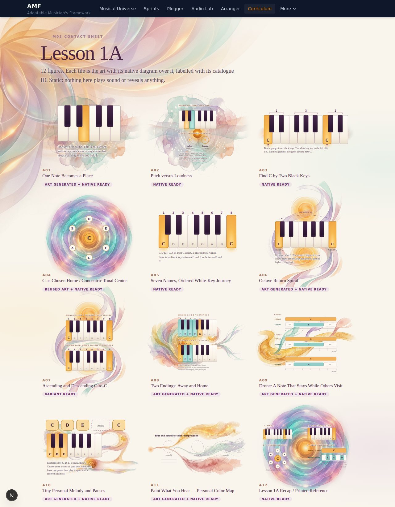

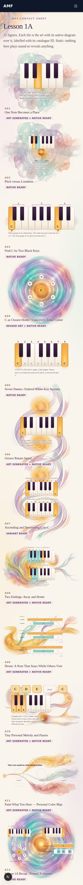

Integrated lesson-style pages: [lesson-1A-1280-p1](screenshots/lesson-1A-1280-p1.jpg), [lesson-1A-1280-p2](screenshots/lesson-1A-1280-p2.jpg), [lesson-1A-390-p1](screenshots/lesson-1A-390-p1.jpg), [lesson-1A-390-p2](screenshots/lesson-1A-390-p2.jpg)

### Lesson 1B
Half and whole steps, the major-scale pattern, open endings and arrivals.

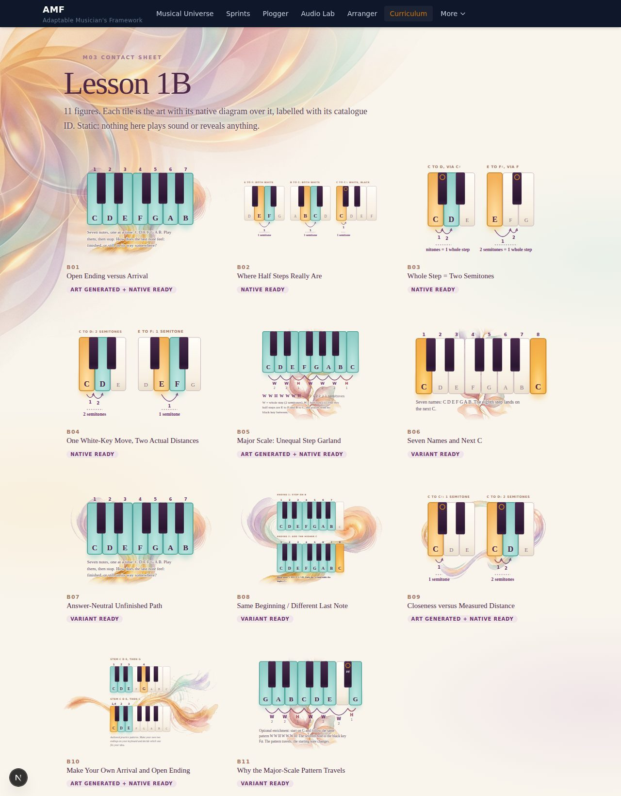

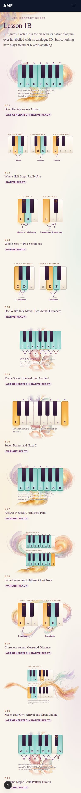

Integrated lesson-style pages: [lesson-1B-1280-p1](screenshots/lesson-1B-1280-p1.jpg), [lesson-1B-1280-p2](screenshots/lesson-1B-1280-p2.jpg), [lesson-1B-390-p1](screenshots/lesson-1B-390-p1.jpg), [lesson-1B-390-p2](screenshots/lesson-1B-390-p2.jpg)

### Lesson 1C
Two voices: a held foundation, timing and silence.

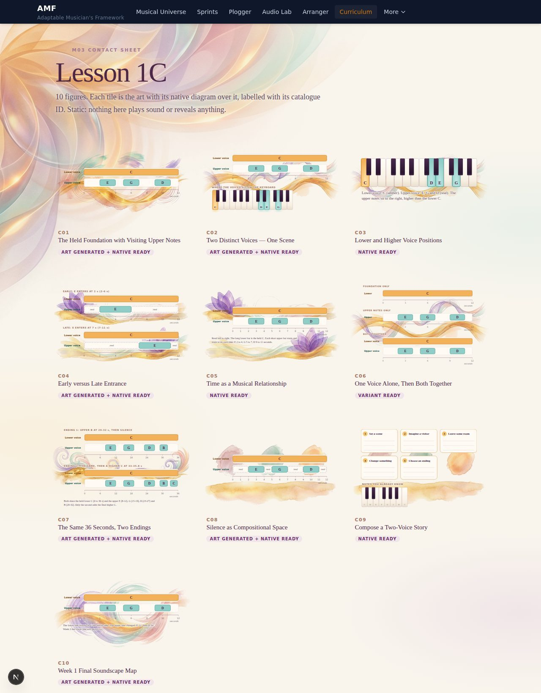

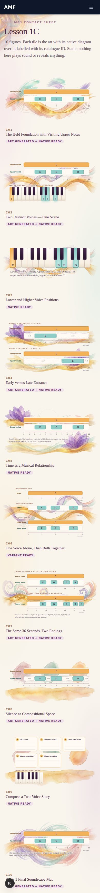

Integrated lesson-style pages: [lesson-1C-1280](screenshots/lesson-1C-1280.jpg), [lesson-1C-390-p1](screenshots/lesson-1C-390-p1.jpg), [lesson-1C-390-p2](screenshots/lesson-1C-390-p2.jpg)

### Week 1 hub
The Week 1 opening.

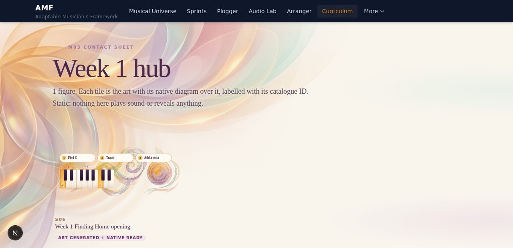

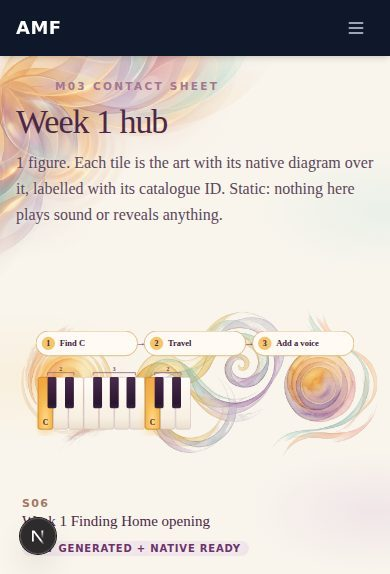

Integrated lesson-style pages: [lesson-W1HUB-1280](screenshots/lesson-W1HUB-1280.jpg), [lesson-W1HUB-390](screenshots/lesson-W1HUB-390.jpg)

### Lesson 2A
Pairs of notes and the intervals between them.

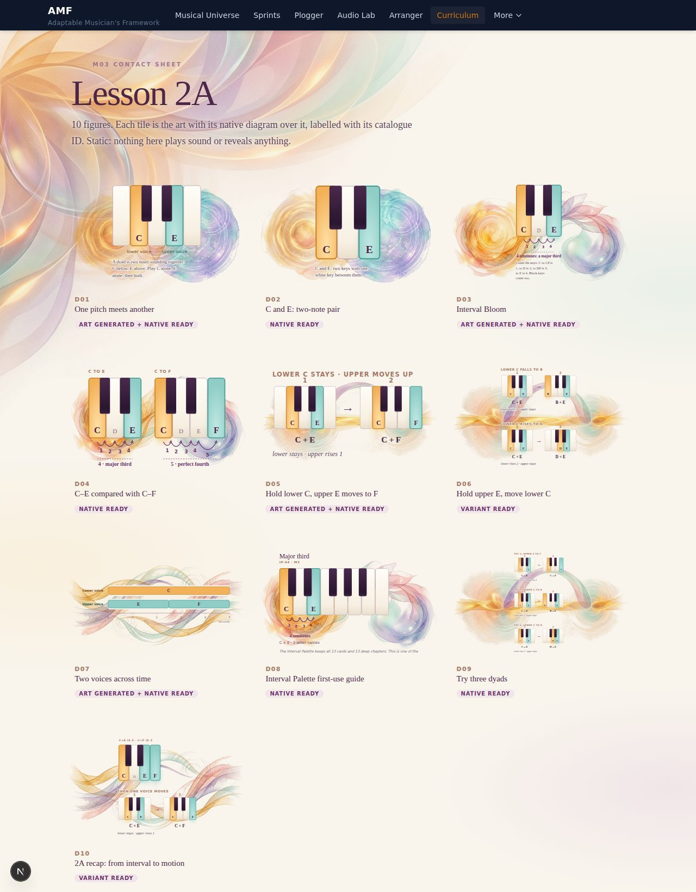

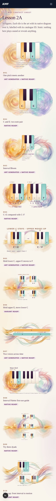

Integrated lesson-style pages: [lesson-2A-1280](screenshots/lesson-2A-1280.jpg), [lesson-2A-390-p1](screenshots/lesson-2A-390-p1.jpg), [lesson-2A-390-p2](screenshots/lesson-2A-390-p2.jpg)

### Lesson 2B
How two voices move: oblique, contrary, similar.

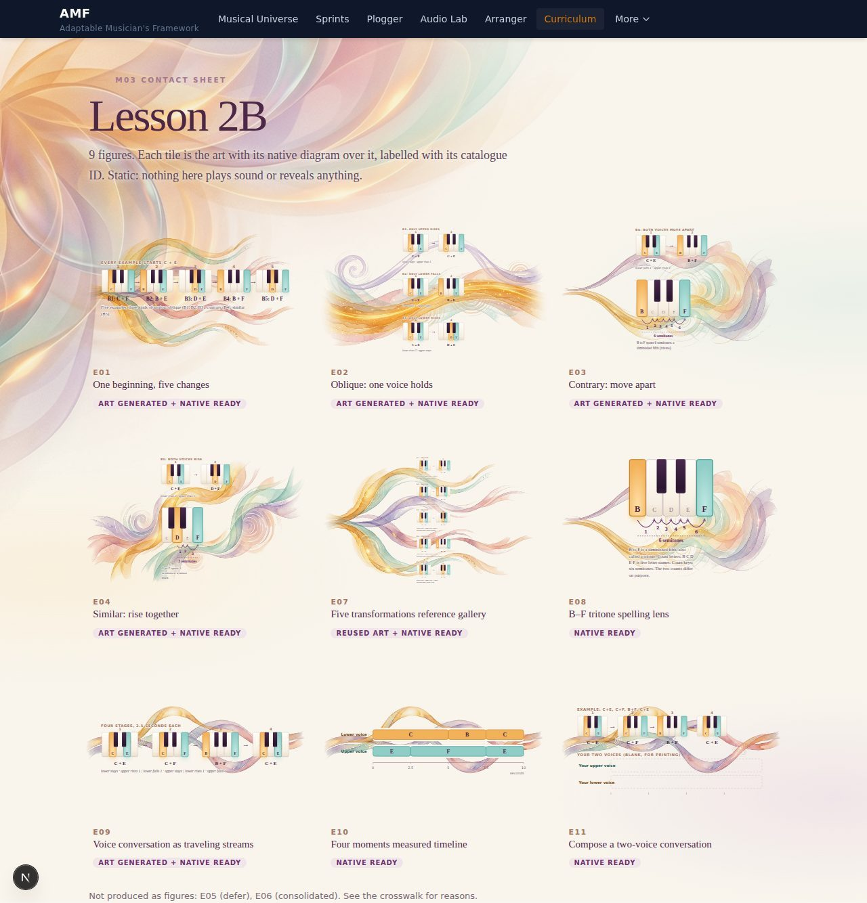

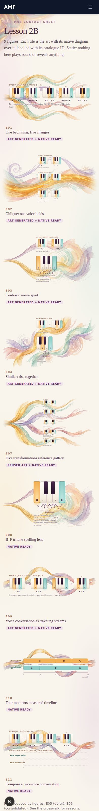

Integrated lesson-style pages: [lesson-2B-1280](screenshots/lesson-2B-1280.jpg), [lesson-2B-390-p1](screenshots/lesson-2B-390-p1.jpg), [lesson-2B-390-p2](screenshots/lesson-2B-390-p2.jpg)

### Lesson 2C
The same melody over a changed foundation.

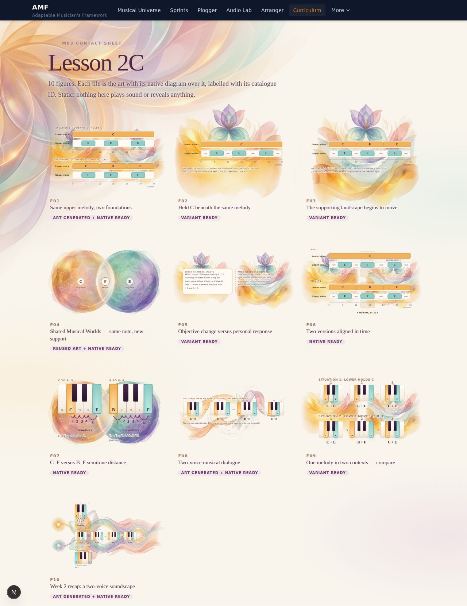

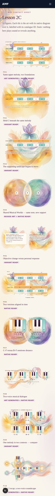

Integrated lesson-style pages: [lesson-2C-1280](screenshots/lesson-2C-1280.jpg), [lesson-2C-390-p1](screenshots/lesson-2C-390-p1.jpg), [lesson-2C-390-p2](screenshots/lesson-2C-390-p2.jpg)

### Week 2 hub
The Week 2 opening.

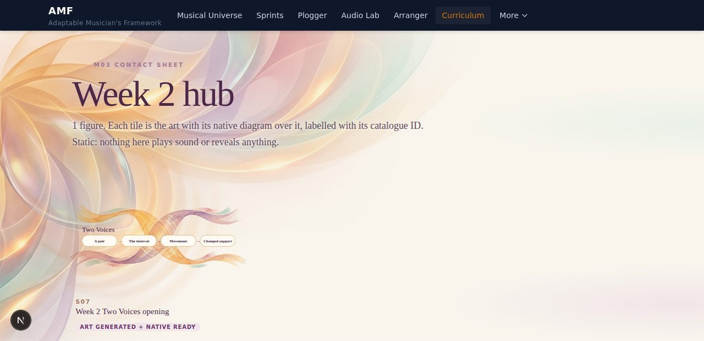

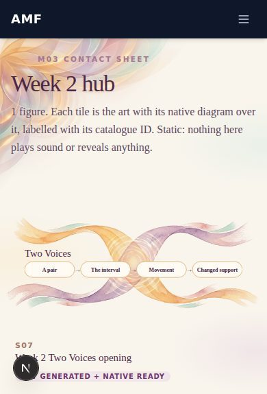

Integrated lesson-style pages: [lesson-W2HUB-1280](screenshots/lesson-W2HUB-1280.jpg), [lesson-W2HUB-390](screenshots/lesson-W2HUB-390.jpg)

### Supporting assets
Setup, legends, thumbnails, the Atlas and enrichment art.

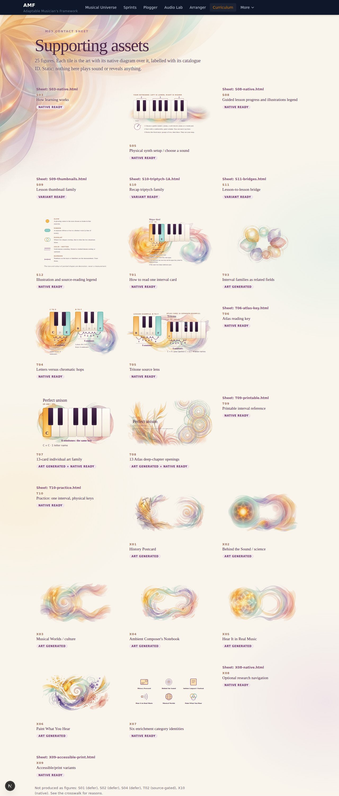

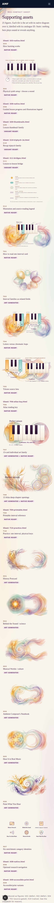

Integrated lesson-style pages: [lesson-SUP-1280-p1](screenshots/lesson-SUP-1280-p1.jpg), [lesson-SUP-1280-p2](screenshots/lesson-SUP-1280-p2.jpg), [lesson-SUP-1280-p3](screenshots/lesson-SUP-1280-p3.jpg), [lesson-SUP-390-p1](screenshots/lesson-SUP-390-p1.jpg), [lesson-SUP-390-p2](screenshots/lesson-SUP-390-p2.jpg), [lesson-SUP-390-p3](screenshots/lesson-SUP-390-p3.jpg), [lesson-SUP-390-p4](screenshots/lesson-SUP-390-p4.jpg)

## Look at it live

The review pages are static Next routes in this branch (`app/curriculum/soundscape-path/m03-preview/[group]` and `.../contact/[group]`). Run `npm ci && npx next dev -p 3412`, or tunnel to the server preview: `ssh -L 3412:127.0.0.1:3412 elderle@168.144.16.96`, then open `http://127.0.0.1:3412/curriculum/soundscape-path/m03-preview/1A` (also `/contact/1A`, groups `1A 1B 1C W1HUB 2A 2B 2C W2HUB SUP`).
