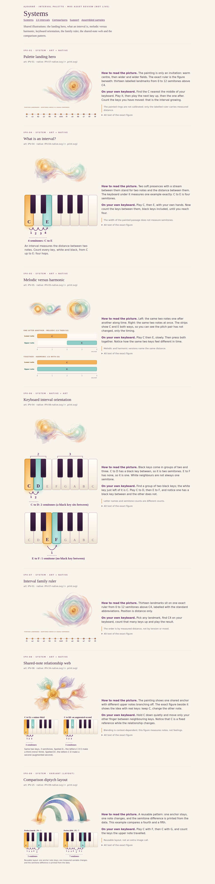
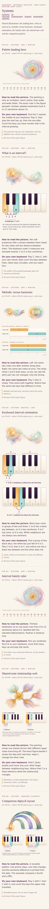
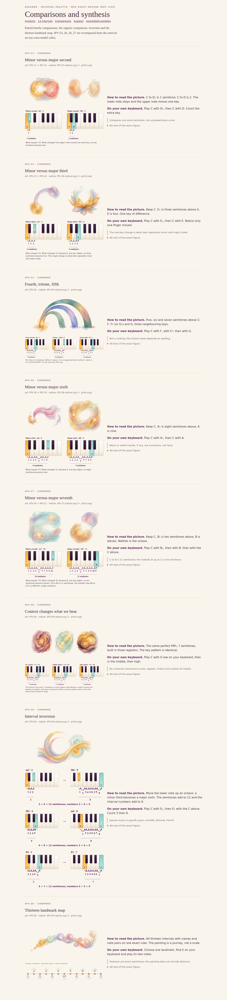
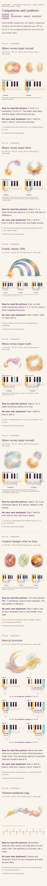
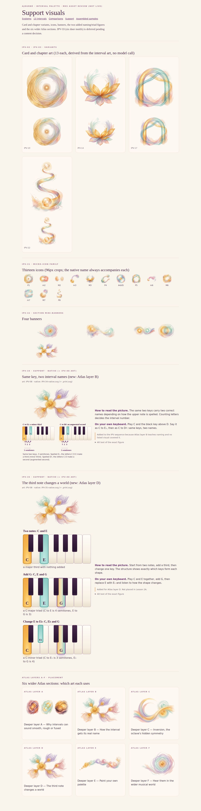
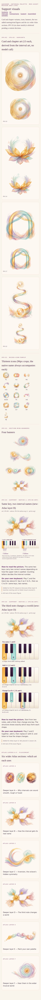
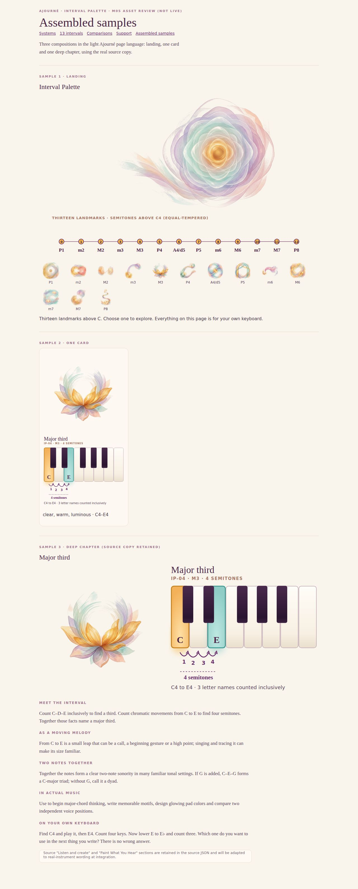
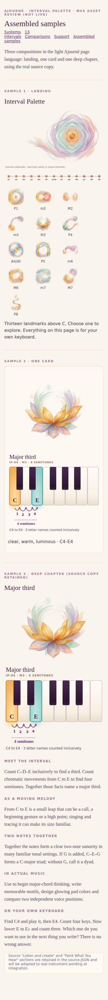
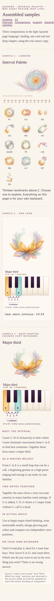

# Ajourné Interval Palette — M05 graphic asset production (review pack)

**Status: `M05_ASSETS_PRODUCED__FOUNDER_REVIEW_PENDING`.** Nothing is merged or deployed. The live Palette, Week 2 lessons and all other pages are untouched. Branch `feat/ajourne-m05-palette-assets-20261106`.

## Look first (grouped contact sheets, 1280 px and 390 px; 320 px for two pages)
| Group | 1280 | 390 | 320 |
|---|---|---|---|
| Systems (IPV-01…09) |  |  | |
| 13 intervals (IPV-10…22) |  |  |  |
| Comparisons (IPV-23…30) |  |  | |
| Support + added + six Atlas layers |  |  | |
| Assembled samples (landing, card, deep chapter) |  |  |  |

Live pages (static HTML, no script): `ssh -L 3413:127.0.0.1:3413 elderle@168.144.16.96`, then `http://127.0.0.1:3413/sheets/systems.html` (also `intervals`, `comparisons`, `support`, `assembled`).

## What was made
- **21 new art-only paintings** (Nano Banana, transparent, zero alpha border): IPV-01, 04, 05, 08, the 13 intervals IPV-10…22, and IPV-25, 28, 29, 30. No text, keys, notes or numerals in any.
- **29 exact native SVG figures** (screen + print each = 58 files), generated from `interval-data.json`: 13 interval plates, example/orientation/melodic-vs-harmonic, the 0–12 ruler and the full 13-landmark map (plus a narrow list), four diptychs, the P4/tritone/P5 trio, the register comparison, inversion, and two added figures.
- **43 derived variants (no model call):** 13 card crops (IPV-02), 13 chapter openers (IPV-03), 13 micro-icons (IPV-31), 4 banners (IPV-32).
- **Added IPV-34 (naming by letters, Atlas layer B) and IPV-35 (third note changes a world, Atlas layer D)** because no listed visual covered those two Atlas sections. **IPV-33 (six door motifs) deferred** pending a content decision.
- Source mapping check: IPV-10…22 ↔ IP-00…12 (IPV-10 is the unison, IPV-01 is the landing hero).

## Crosswalk (all 35 IDs)
| ID | Class | Art | Native | Sheet |
|---|---|---|---|---|
| IPV-01 | ART | IPV-01 | IPV-07-native | systems.html |
| IPV-04 | ART | IPV-04 | IPV-04-native | systems.html |
| IPV-05 | ART | IPV-05 | IPV-05-native | systems.html |
| IPV-08 | ART | IPV-08 | IPV-34-native | systems.html |
| IPV-02 | VARIANT | — | — | support.html |
| IPV-03 | VARIANT | — | — | support.html |
| IPV-06 | NATIVE | IPV-04 | IPV-06-native | systems.html |
| IPV-07 | NATIVE+REUSE | IPV-01 | IPV-07-native | systems.html |
| IPV-09 | VARIANT | — | IPV-09-native | systems.html |
| IPV-10 | ART | IPV-10 | IPV-10-native | intervals.html |
| IPV-11 | ART | IPV-11 | IPV-11-native | intervals.html |
| IPV-12 | ART | IPV-12 | IPV-12-native | intervals.html |
| IPV-13 | ART | IPV-13 | IPV-13-native | intervals.html |
| IPV-14 | ART | IPV-14 | IPV-14-native | intervals.html |
| IPV-15 | ART | IPV-15 | IPV-15-native | intervals.html |
| IPV-16 | ART | IPV-16 | IPV-16-native | intervals.html |
| IPV-17 | ART | IPV-17 | IPV-17-native | intervals.html |
| IPV-18 | ART | IPV-18 | IPV-18-native | intervals.html |
| IPV-19 | ART | IPV-19 | IPV-19-native | intervals.html |
| IPV-20 | ART | IPV-20 | IPV-20-native | intervals.html |
| IPV-21 | ART | IPV-21 | IPV-21-native | intervals.html |
| IPV-22 | ART | IPV-22 | IPV-22-native | intervals.html |
| IPV-23 | VARIANT | IPV-11+IPV-12 | IPV-23-native | comparisons.html |
| IPV-24 | VARIANT | IPV-13+IPV-14 | IPV-24-native | comparisons.html |
| IPV-26 | VARIANT | IPV-18+IPV-19 | IPV-26-native | comparisons.html |
| IPV-27 | VARIANT | IPV-20+IPV-21 | IPV-27-native | comparisons.html |
| IPV-25 | ART | IPV-25 | IPV-25-native | comparisons.html |
| IPV-28 | ART | IPV-28 | IPV-28-native | comparisons.html |
| IPV-29 | ART | IPV-29 | IPV-29-native | comparisons.html |
| IPV-30 | ART | IPV-30 | IPV-30-native | comparisons.html |
| IPV-31 | VARIANT | — | — | support.html |
| IPV-32 | VARIANT | — | — | support.html |
| IPV-33 | DEFER | — | — | — |
| IPV-34 | NATIVE | IPV-08 | IPV-34-native | support.html |
| IPV-35 | NATIVE | IPV-08 | IPV-35-native | support.html |

## Truth and policy
Notes, spellings and counts come from the data, never from the model. C4 = MIDI 60, 12-TET. Tritone shown as F♯ (augmented fourth) and G♭ (diminished fifth), one key. C4–B4 is 11 semitones, never confused with B4→C5. Inversions m3↔M6, M3↔m6, P4↔P5 add to 12. No ranking of consonance, no mood claims, no site audio, no playable keyboard, no toggles/quizzes; all playing is on the learner's own keyboard. Each figure has a how-to-read paragraph and an own-keyboard prompt on its review page, plus alt text.

## Tests (targeted)
`tests/m05.test.mts`: 8/8 pass (IPV↔IP mapping and exact semitones, static/no-script SVGs with title+desc, art alpha borders, ledger vs registry, 35-ID crosswalk, tritone, inversion sums, reference image absent). `tsc` clean.

## Cost
21 calls, 21 images, **$0.8192** by per-call `usage.cost` (about $0.039 each; cap $3.0). No duplicate or failed calls. Account remaining $24.1183 → $22.7967 (delta $1.3216). The $0.5 gap is not from M05 calls: the key is shared with QCR work (same pattern as M03). Provenance, prompts, hashes and generation ids: `PROVENANCE.md`, `art_registry.json`, `ledger.json`.

## Limits
No screen-reader run; contrast not measured numerically on these review pages; print rendering of the SVG print variants was generated but not rendered to paper; screenshots are one pass of headless Chromium. Art is decorative (empty alt); the native SVGs carry meaning. IPV-30's painting is slim and small inside its canvas (the exact ruler carries the content). Old Palette audio code and the live page are unchanged. Integration into the live Palette and the Week 2 rebuild are separate, not started.
