# Ajourné M07 — Week 2 graphics: founder review gallery

**Branch:** `feat/ajourne-m07-week2-graphics-20261107` (from live M06 `5bc10a139479900a9ffec5bc2be63496ac2336d8`). **Not integrated, not deployed, not merged.** Review only.

Every picture below is an **individual, usable SVG** (screen, phone and print). Previews are screenshots of those SVGs rendered in Chromium; the SVG files in `public/soundscape/m07/` are the assets. Facts (notes, octaves, keys, times) are drawn by code from `lib/soundscape/week2/fixtures.ts`; every colour is imported from `INTERVAL_IDENTITY_COLORS_V1` and every Plogger mark from `PLOGGER_LENS_V1`. **No model-generated image is used in any teaching figure, and no image-model calls were made.**

**Jump to:** [Shared grammar](#shared-grammar) · [Week 2 hub](#week-2-hub) · [Lesson 2A](#lesson-2a) · [Lesson 2B](#lesson-2b) · [Lesson 2C](#lesson-2c) · [Reused in place](#reused-in-place) · [Art](#art) · [Before / after](#before--after) · [Page previews](#page-integrated-previews) · [Step coverage](#step-by-step-coverage) · [Doors](#the-18-optional-doors) · [Downloads](#downloads-and-registry) · [QA and caveats](#qa-and-known-caveats)

## Totals

| | |
|---|---|
| New native masters | **50** (each in 3 variants = 150 SVG files) + 4 vector art washes = **154 new SVG files** |
| By disposition | REUSE 2 · REVISE 23 · REPLACE 2 · DERIVE 15 · CREATE 8 |
| Existing files reused in place (not copied) | 5 (+ 15 M03 art files, reviewed below) |
| Variants | **screen** 760 wide · **narrow** 360 wide (phones from 320 up) · **print** white page, shape-coded, same text |
| New image-model images / spend | **0 / $0** |

REUSE here means the builder or file is used unchanged (Plogger chip, panel and legend from M05, A-09). REVISE means an existing M03 figure's facts were kept and the figure rebuilt with octaves, hue and phone/print variants. DERIVE means built from a source idea with new code. CREATE means new.

## Contact sheets

Each group has contact sheets at **1280**, **390**, **320** and **print**. Click to open full size.

| Group | 1280 | 390 | 320 | print |
|---|---|---|---|---|
| Shared grammar 1/2 | [sheet](previews/sheets/shared-1.1280.jpg) | [sheet](previews/sheets/shared-1.390.jpg) | [sheet](previews/sheets/shared-1.320.jpg) | [sheet](previews/sheets/shared-1.print.jpg) |
| Shared grammar 2/2 | [sheet](previews/sheets/shared-2.1280.jpg) | [sheet](previews/sheets/shared-2.390.jpg) | [sheet](previews/sheets/shared-2.320.jpg) | [sheet](previews/sheets/shared-2.print.jpg) |
| Week 2 hub 1/1 | [sheet](previews/sheets/hub-1.1280.jpg) | [sheet](previews/sheets/hub-1.390.jpg) | [sheet](previews/sheets/hub-1.320.jpg) | [sheet](previews/sheets/hub-1.print.jpg) |
| Lesson 2A 1/2 | [sheet](previews/sheets/2A-1.1280.jpg) | [sheet](previews/sheets/2A-1.390.jpg) | [sheet](previews/sheets/2A-1.320.jpg) | [sheet](previews/sheets/2A-1.print.jpg) |
| Lesson 2A 2/2 | [sheet](previews/sheets/2A-2.1280.jpg) | [sheet](previews/sheets/2A-2.390.jpg) | [sheet](previews/sheets/2A-2.320.jpg) | [sheet](previews/sheets/2A-2.print.jpg) |
| Lesson 2B 1/3 | [sheet](previews/sheets/2B-1.1280.jpg) | [sheet](previews/sheets/2B-1.390.jpg) | [sheet](previews/sheets/2B-1.320.jpg) | [sheet](previews/sheets/2B-1.print.jpg) |
| Lesson 2B 2/3 | [sheet](previews/sheets/2B-2.1280.jpg) | [sheet](previews/sheets/2B-2.390.jpg) | [sheet](previews/sheets/2B-2.320.jpg) | [sheet](previews/sheets/2B-2.print.jpg) |
| Lesson 2B 3/3 | [sheet](previews/sheets/2B-3.1280.jpg) | [sheet](previews/sheets/2B-3.390.jpg) | [sheet](previews/sheets/2B-3.320.jpg) | [sheet](previews/sheets/2B-3.print.jpg) |
| Lesson 2C 1/2 | [sheet](previews/sheets/2C-1.1280.jpg) | [sheet](previews/sheets/2C-1.390.jpg) | [sheet](previews/sheets/2C-1.320.jpg) | [sheet](previews/sheets/2C-1.print.jpg) |
| Lesson 2C 2/2 | [sheet](previews/sheets/2C-2.1280.jpg) | [sheet](previews/sheets/2C-2.390.jpg) | [sheet](previews/sheets/2C-2.320.jpg) | [sheet](previews/sheets/2C-2.print.jpg) |

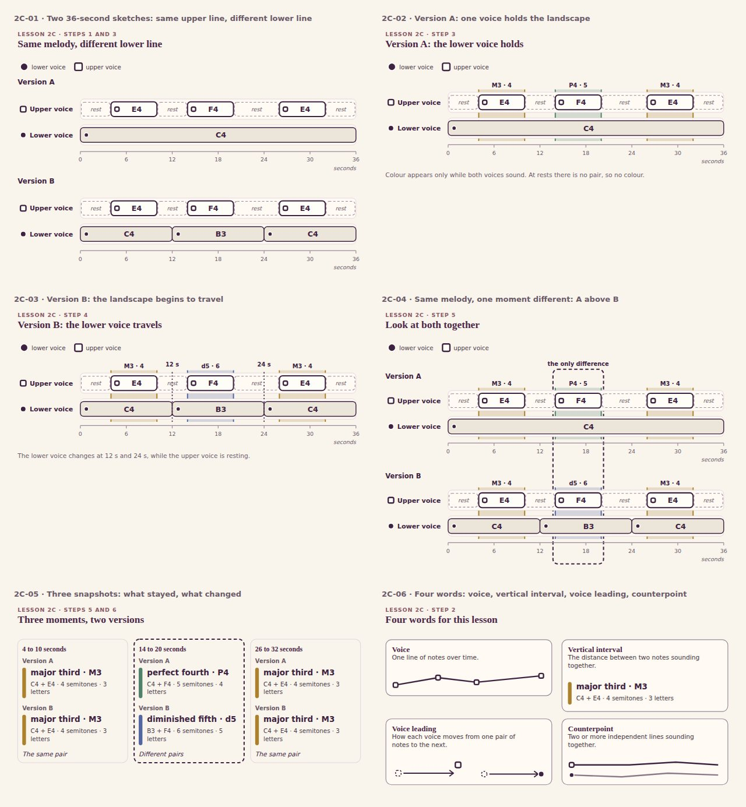

## Shared grammar

### A-02 · The thirteen interval identity colours

[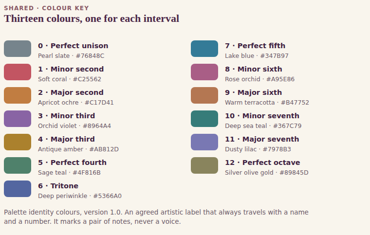](../../public/soundscape/m07/screen/A-02.svg)

The thirteen identity colours of the Interval Palette, each next to the name and semitone count it belongs to. The colour is an agreed artistic label for a pair of notes, never a property of sound.

| | |
|---|---|
| **Lesson step** | Hub |
| **State** | identity colour (pair named) |
| **Provenance** | **DERIVE** · audit row A-02 · from lib/soundscape/resources/interval-identity.ts (INTERVAL_IDENTITY_COLORS_V1, identityHex); lib/soundscape/resources/palette.ts (INTERVALS names) |
| **Tokens** | IP-00 `#76848C`, IP-01 `#C25562`, IP-02 `#C17D41`, IP-03 `#8964A4`, IP-04 `#AB812D`, IP-05 `#4F816B`, IP-06 `#5366A0`, IP-07 `#347B97`, IP-08 `#A95E86`, IP-09 `#B47752`, IP-10 `#367C79`, IP-11 `#7978B3`, IP-12 `#89845D` |
| **Files** | [screen](../../public/soundscape/m07/screen/A-02.svg) 760×483 · [narrow](../../public/soundscape/m07/narrow/A-02.svg) 360×829 ([preview](previews/narrow/A-02.png)) · [print](../../public/soundscape/m07/print/A-02.svg) |
| **Limits** | Reference sheet. Do not place before the learner has met the named intervals. |

How to read this picture (the paragraph the lesson page owes)

This is the key to every colour in Week 2. Read across a row: colour, number of semitones, then the interval name. A colour is always printed beside its name, so it never has to be guessed, and it is attached to the pair of notes, not to a voice. Compare with the live Palette page; the values are imported from the same file.

### A-03 · The Week 2 keyboard window, B3 to C5

[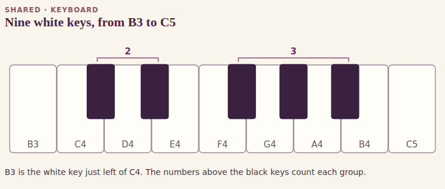](../../public/soundscape/m07/screen/A-03.svg)

The keyboard window Week 2 uses. It starts on B3, so the note just below C4 is on the picture, and every key is named with its octave number.

| | |
|---|---|
| **Lesson step** | 2A step 1, 2A step 7, 2A step 9, 2B step 3, 2C step 7 |
| **State** | neutral (no interval name or colour) |
| **Provenance** | **DERIVE** · audit row A-03 · from lib/soundscape/m02/keyboard-geometry.ts buildKeyboard(start B, cMidi 48); replaces public/soundscape/w2/W2-06_two-lines-on-one-keyboard_*.svg (no B3) |
| **Tokens** | none |
| **Files** | [screen](../../public/soundscape/m07/screen/A-03.svg) 760×323 · [narrow](../../public/soundscape/m07/narrow/A-03.svg) 360×325 ([preview](previews/narrow/A-03.png)) · [print](../../public/soundscape/m07/print/A-03.svg) |

How to read this picture (the paragraph the lesson page owes)

Find C4, the white key just left of the group of two black keys in the middle of this window. B3 is the white key immediately to its left. The small numbers above the black keys count each group (two, then three). Every white key carries its octave number, so C4 and C5 are different keys.

### A-04 · Reading a two-lane timeline

[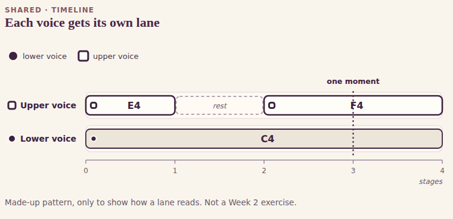](../../public/soundscape/m07/screen/A-04.svg)

How a lane works: each voice has its own row, bars are notes, dashed boxes are rests, and one vertical slice is a single moment of two notes together.

| | |
|---|---|
| **Lesson step** | 2A step 2, 2B step 2, 2C step 1, 2C step 7 |
| **State** | neutral (no interval name or colour) |
| **Provenance** | **DERIVE** · audit row A-04 · from lib/soundscape/m03/native-svg.ts lanes() idea, rebuilt in m07/kit.ts lanes(); old W2/SYS-04, SYS-09 (reveal and seconds removed) |
| **Tokens** | none |
| **Files** | [screen](../../public/soundscape/m07/screen/A-04.svg) 760×368 · [narrow](../../public/soundscape/m07/narrow/A-04.svg) 360×417 ([preview](previews/narrow/A-04.png)) · [print](../../public/soundscape/m07/print/A-04.svg) |

How to read this picture (the paragraph the lesson page owes)

The top lane is the upper voice and the bottom lane is the lower voice. A solid bar is a note sounding for as long as the bar is wide; a dashed box is a rest. The dashed vertical line cuts through both lanes at one moment, and the two notes it crosses are the pair sounding together. This pattern is made up to show how to read a lane; it is not a Week 2 exercise.

### A-05 · Counting letters is not counting semitones

[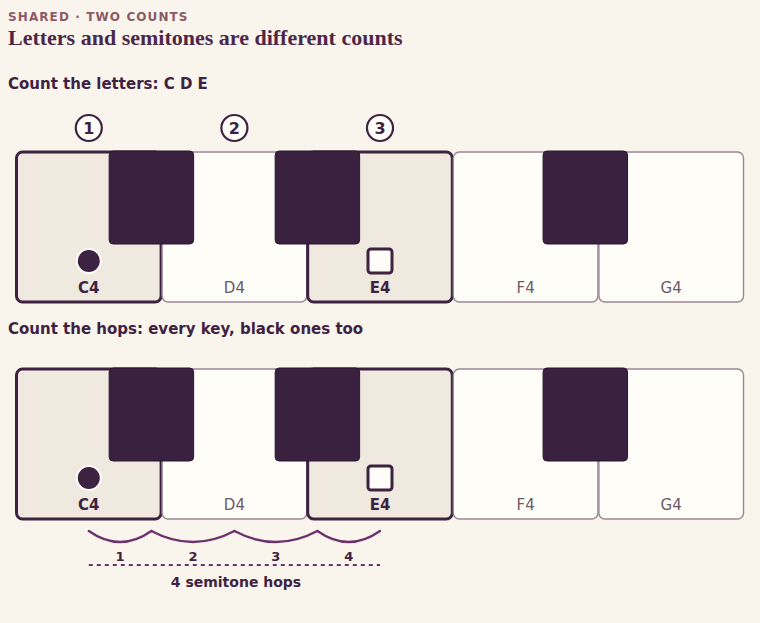](../../public/soundscape/m07/screen/A-05.svg)

Two different counts for the same two notes: three letters (C, D, E) and four semitone hops from C4 to E4. The black keys count as hops but not as letters.

| | |
|---|---|
| **Lesson step** | 2A step 3, 2A step 4 |
| **State** | neutral (no interval name or colour) |
| **Provenance** | **DERIVE** · audit row A-05 · from M03N/T04-native.svg left half (the B to F half belongs to 2B); lib/soundscape/m03/native-svg.ts hops() idea, rebuilt as kit hopRow() |
| **Tokens** | none |
| **Files** | [screen](../../public/soundscape/m07/screen/A-05.svg) 760×623 · [narrow](../../public/soundscape/m07/narrow/A-05.svg) 360×643 ([preview](previews/narrow/A-05.png)) · [print](../../public/soundscape/m07/print/A-05.svg) |

How to read this picture (the paragraph the lesson page owes)

In the first keyboard the numbers sit only on lettered white keys, C then D then E. In the second keyboard each arc is one hop to the very next key, black or white, from C4 up to E4. Same two notes, two separate rulers, two different numbers.

### A-06 · Four motion glyphs

[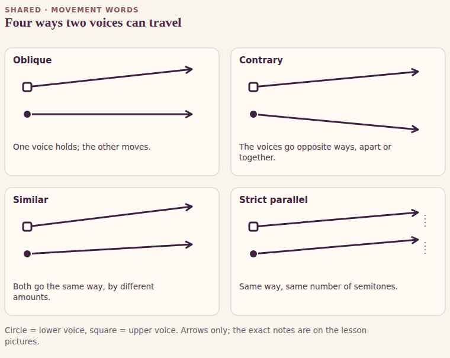](../../public/soundscape/m07/screen/A-06.svg)

The four movement words as pure arrows, with no pitch names: one voice holds, voices go opposite ways, voices go the same way by different amounts, and the strict parallel case of equal amounts.

| | |
|---|---|
| **Lesson step** | 2B step 7, 2B step 11 |
| **State** | neutral (no interval name or colour) |
| **Provenance** | **DERIVE** · audit row A-06 · from public/soundscape/w2/SYS-05_motion-glyph-library_source.svg (concept); M03N/E02, E03, E04 |
| **Tokens** | none |
| **Files** | [screen](../../public/soundscape/m07/screen/A-06.svg) 760×605 · [narrow](../../public/soundscape/m07/narrow/A-06.svg) 360×1074 ([preview](previews/narrow/A-06.png)) · [print](../../public/soundscape/m07/print/A-06.svg) |

How to read this picture (the paragraph the lesson page owes)

In each sketch the filled circle is the lower voice and the square is the upper voice, moving left to right. Watch the arrows: level or rising, opposite directions, same direction. The last sketch has two equal brackets to show that the distance travelled is the same.

### A-07 · What stayed, what changed

[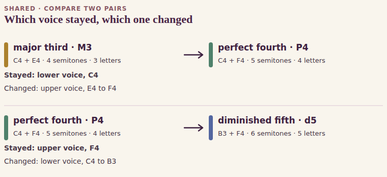](../../public/soundscape/m07/screen/A-07.svg)

A change in a pair can be described by saying which voice stayed and which moved. The interval changes only because one voice did.

| | |
|---|---|
| **Lesson step** | 2B step 10, 2B step 11, 2C step 5 |
| **State** | identity colour (pair named) |
| **Provenance** | **DERIVE** · audit row A-07 · from M03N/D10, F07 (concept); week2/fixtures.ts B.path |
| **Tokens** | IP-04 `#AB812D`, IP-05 `#4F816B`, IP-06 `#5366A0` |
| **Files** | [screen](../../public/soundscape/m07/screen/A-07.svg) 760×347 · [narrow](../../public/soundscape/m07/narrow/A-07.svg) 360×504 ([preview](previews/narrow/A-07.png)) · [print](../../public/soundscape/m07/print/A-07.svg) |

How to read this picture (the paragraph the lesson page owes)

Each row has three parts: the start pair, what stayed and what changed, and the end pair. The colour bar on each pair names that pair, not either voice. Read left to right, then check that the voice that stayed has the same note on both sides.

### A-09 · Plogger lens for the four named pairs

[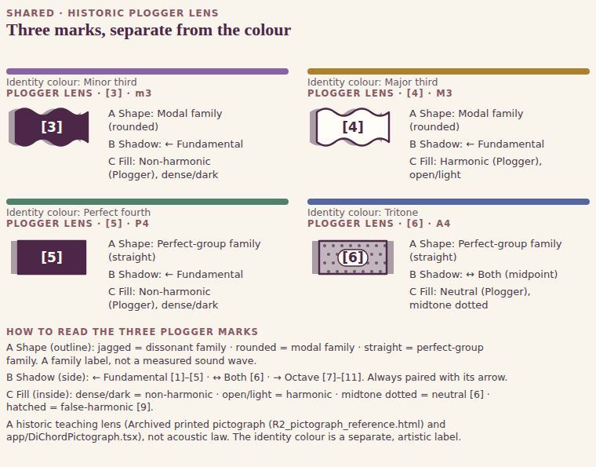](../../public/soundscape/m07/screen/A-09.svg)

The historic Plogger lens for minor third [3], major third [4], perfect fourth [5], tritone [6]: contour is the family, shadow direction is fundamental or octave, fill is harmonicity. It is a separate label from the identity colour.

| | |
|---|---|
| **Lesson step** | 2B step 5, 2B step 6, 2C step 5 |
| **State** | identity colour (pair named) |
| **Provenance** | **REUSE** · audit row A-09 · from lib/soundscape/resources/interval-identity.ts PLOGGER_LENS_V1; lib/soundscape/m05/info-svg.ts chip(), panel(), legend() (reused unchanged) |
| **Tokens** | IP-03 `#8964A4`, IP-04 `#AB812D`, IP-05 `#4F816B`, IP-06 `#5366A0` · Plogger [3] rounded/F/dark, [4] rounded/F/light, [5] straight/F/dark, [6] straight/both/neutral |
| **Files** | [screen](../../public/soundscape/m07/screen/A-09.svg) 760×595 · [narrow](../../public/soundscape/m07/narrow/A-09.svg) 360×1079 ([preview](previews/narrow/A-09.png)) · [print](../../public/soundscape/m07/print/A-09.svg) |
| **Limits** | A historic teaching lens, not acoustic law. [6] follows the printed original; older code disputes its shape family. Never use on motion figures. |

How to read this picture (the paragraph the lesson page owes)

Each chip has three separate marks: the outline shape, a shadow to the left, right or both sides, and the fill. The coloured bar beside it is the interval identity colour, which is a different label. The legend underneath states every mark in words and names the printed source this lens comes from.

### A-09a · Plogger lens for the 2A pairs

[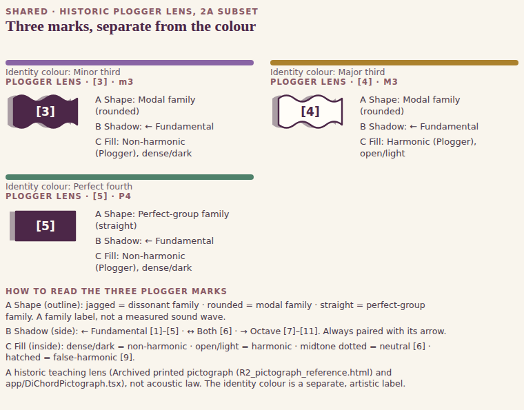](../../public/soundscape/m07/screen/A-09a.svg)

The historic Plogger lens for minor third [3], major third [4], perfect fourth [5]: contour is the family, shadow direction is fundamental or octave, fill is harmonicity. It is a separate label from the identity colour.

| | |
|---|---|
| **Lesson step** | 2A step 5, 2A step 6 |
| **State** | identity colour (pair named) |
| **Provenance** | **REUSE** · audit row A-09 · from lib/soundscape/resources/interval-identity.ts PLOGGER_LENS_V1; lib/soundscape/m05/info-svg.ts chip(), panel(), legend() (reused unchanged) |
| **Tokens** | IP-03 `#8964A4`, IP-04 `#AB812D`, IP-05 `#4F816B` · Plogger [3] rounded/F/dark, [4] rounded/F/light, [5] straight/F/dark |
| **Files** | [screen](../../public/soundscape/m07/screen/A-09a.svg) 760×595 · [narrow](../../public/soundscape/m07/narrow/A-09a.svg) 360×913 ([preview](previews/narrow/A-09a.png)) · [print](../../public/soundscape/m07/print/A-09a.svg) |
| **Limits** | A historic teaching lens, not acoustic law. [6] follows the printed original; older code disputes its shape family. Never use on motion figures. |

How to read this picture (the paragraph the lesson page owes)

Each chip has three separate marks: the outline shape, a shadow to the left, right or both sides, and the fill. The coloured bar beside it is the interval identity colour, which is a different label. The legend underneath states every mark in words and names the printed source this lens comes from.

### A-11 · Pair badges used in Week 2

[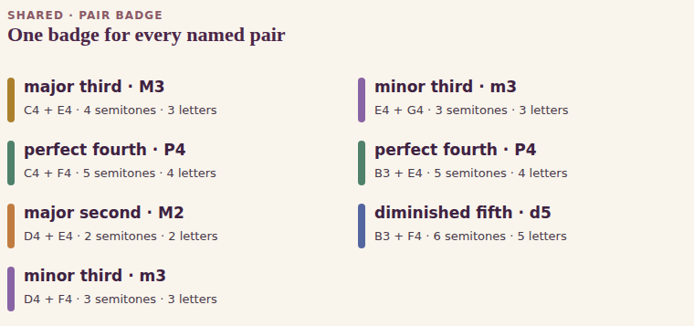](../../public/soundscape/m07/screen/A-11.svg)

The one badge every named pair in Week 2 uses: colour bar, interval name, the two actual notes, semitones and letters. The same badge appears in every lesson.

| | |
|---|---|
| **Lesson step** | 2B step 5, 2B step 6 |
| **State** | identity colour (pair named) |
| **Provenance** | **DERIVE** · audit row A-11 (added) · from lib/soundscape/m05/info-svg.ts header() idea; week2/fixtures.ts pairs |
| **Tokens** | IP-02 `#C17D41`, IP-03 `#8964A4`, IP-04 `#AB812D`, IP-05 `#4F816B`, IP-06 `#5366A0` |
| **Files** | [screen](../../public/soundscape/m07/screen/A-11.svg) 760×357 · [narrow](../../public/soundscape/m07/narrow/A-11.svg) 360×560 ([preview](previews/narrow/A-11.png)) · [print](../../public/soundscape/m07/print/A-11.svg) |

How to read this picture (the paragraph the lesson page owes)

Read each badge from the top: interval name and short symbol, then the two notes with their octave numbers, then the two counts. The colour bar belongs to the whole pair. Two badges can share a colour (C4 + F4 and B3 + E4 are both perfect fourths), because colour follows the interval, not the notes.

### A-12 · How to read our pictures

[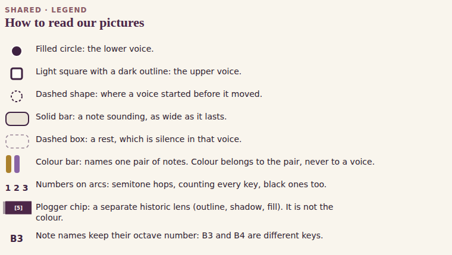](../../public/soundscape/m07/screen/A-12.svg)

The marks every Week 2 picture uses, including the rule that colour belongs to a pair of notes, not to a voice, and that shape tells the voices apart.

| | |
|---|---|
| **Lesson step** | Hub, 2A step 5 |
| **State** | neutral, then one named pair |
| **Provenance** | **REVISE** · audit row A-12 (added) · from M03N/S12-native.svg (revised: two lines added, colour rule); lib/soundscape/m05/info-svg.ts legend() wording |
| **Tokens** | IP-03 `#8964A4`, IP-04 `#AB812D` |
| **Files** | [screen](../../public/soundscape/m07/screen/A-12.svg) 760×429 · [narrow](../../public/soundscape/m07/narrow/A-12.svg) 360×567 ([preview](previews/narrow/A-12.png)) · [print](../../public/soundscape/m07/print/A-12.svg) |

How to read this picture (the paragraph the lesson page owes)

Read this once before the lessons. The two voices are told apart by shape (circle and square), so the picture still works in black and white. Colour appears only after a pair has been named, as a bar that belongs to the two notes together.

## Week 2 hub

### H-01 · The Week 2 path: three lessons

[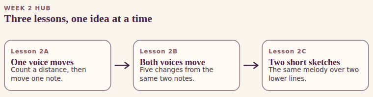](../../public/soundscape/m07/screen/H-01.svg)

The order of the week: first one voice moves, then both voices move, then two short sketches put the ideas to work.

| | |
|---|---|
| **Lesson step** | Hub |
| **State** | neutral (no interval name or colour) |
| **Provenance** | **CREATE** · audit row H-01 · from W2_FINAL_CONTENT_HUB_MANUSCRIPT_V2 (map of the week) |
| **Tokens** | none |
| **Files** | [screen](../../public/soundscape/m07/screen/H-01.svg) 760×198 · [narrow](../../public/soundscape/m07/narrow/H-01.svg) 360×440 ([preview](previews/narrow/H-01.png)) · [print](../../public/soundscape/m07/print/H-01.svg) |

How to read this picture (the paragraph the lesson page owes)

Follow the arrows from left to right (top to bottom on a phone). Each box names the lesson and what you do in it. The boxes do not give away the vocabulary; it is introduced in the lessons themselves.

### H-02 · Week 1 used C3; Week 2 starts at C4

[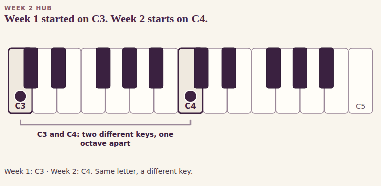](../../public/soundscape/m07/screen/H-02.svg)

Week 1 started on C3 and Week 2 starts on C4. They are different keys, one octave apart, and not the same pitch.

| | |
|---|---|
| **Lesson step** | Hub, 2A step 1 |
| **State** | neutral (no interval name or colour) |
| **Provenance** | **CREATE** · audit row H-02 · from lib/soundscape/m02/keyboard-geometry.ts buildKeyboard(C, 15, 48); Week 1 W1-06 (style only) |
| **Tokens** | none |
| **Files** | [screen](../../public/soundscape/m07/screen/H-02.svg) 760×372 · [narrow](../../public/soundscape/m07/narrow/H-02.svg) 360×352 ([preview](previews/narrow/H-02.png)) · [print](../../public/soundscape/m07/print/H-02.svg) |

How to read this picture (the paragraph the lesson page owes)

Find the two marked C keys: C3 on the left, C4 in the middle. Each C is the white key just left of a group of two black keys. The bracket joins them; it is a comparison between two registers, not an interval you will study this week.

### H-03 · From a note to harmony

[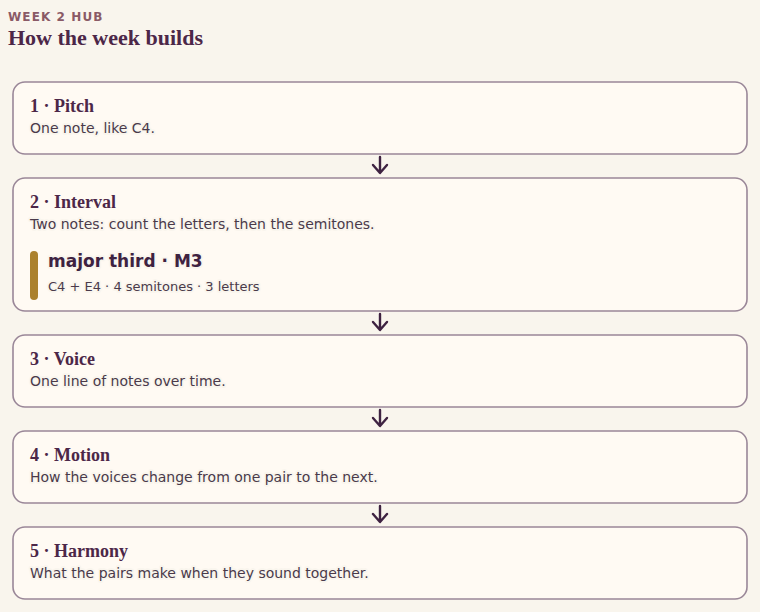](../../public/soundscape/m07/screen/H-03.svg)

How the week's ideas build on each other: a note, two notes (an interval), a line of notes (a voice), a change between pairs (motion), and what the pairs make together (harmony).

| | |
|---|---|
| **Lesson step** | Hub |
| **State** | neutral, then one named pair |
| **Provenance** | **CREATE** · audit row H-03 · from W2_FINAL_CONTENT_HUB_MANUSCRIPT_V2; lib/soundscape/resources/interval-identity.ts (M3 hue via kit badge) |
| **Tokens** | IP-04 `#AB812D` |
| **Files** | [screen](../../public/soundscape/m07/screen/H-03.svg) 760×612 · [narrow](../../public/soundscape/m07/narrow/H-03.svg) 360×662 ([preview](previews/narrow/H-03.png)) · [print](../../public/soundscape/m07/print/H-03.svg) |

How to read this picture (the paragraph the lesson page owes)

Read down the chain. Each box adds one idea to the one above it. The worked example beside "interval" uses C4 and E4 and carries the only colour on the page, because it is the only pair that is named here.

### H-04 · Three lessons in miniature

[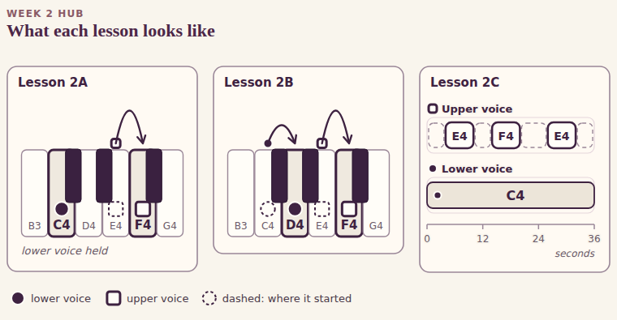](../../public/soundscape/m07/screen/H-04.svg)

A glimpse of what each lesson looks like on the page: one moving voice, two moving voices, and a timeline with rests.

| | |
|---|---|
| **Lesson step** | Hub |
| **State** | neutral (no interval name or colour) |
| **Provenance** | **DERIVE** · audit row H-04 · from miniatures of 2A-05, 2B-07 and 2C-01 built from the same kit functions; week2/fixtures.ts |
| **Tokens** | none |
| **Files** | [screen](../../public/soundscape/m07/screen/H-04.svg) 760×395 · [narrow](../../public/soundscape/m07/narrow/H-04.svg) 360×1023 ([preview](previews/narrow/H-04.png)) · [print](../../public/soundscape/m07/print/H-04.svg) |

How to read this picture (the paragraph the lesson page owes)

Each tile is a tiny version of a picture you will meet in that lesson. Only the shapes matter here: circles and squares are the lower and upper voice, dashed shapes show where a voice started, and the dashed boxes in the third tile are rests.

## Lesson 2A

### 2A-01 · Two notes, two voices: C4 and E4

[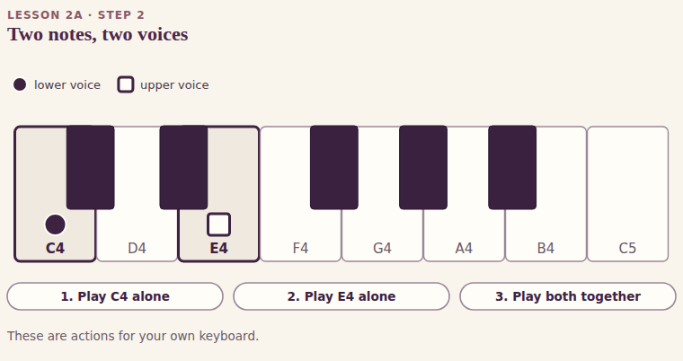](../../public/soundscape/m07/screen/2A-01.svg)

Two notes can be two voices: a lower one and an upper one. You play C4, then E4, then both together, on your own keyboard.

| | |
|---|---|
| **Lesson step** | 2A step 2 |
| **State** | neutral (no interval name or colour) |
| **Provenance** | **REVISE** · audit row 2A-01 · from M03N/D01-native.svg, D02-native.svg (geometry); week2/fixtures.ts A.together (C4 = 60, E4 = 64) |
| **Tokens** | none |
| **Files** | [screen](../../public/soundscape/m07/screen/2A-01.svg) 760×402 · [narrow](../../public/soundscape/m07/narrow/2A-01.svg) 360×455 ([preview](previews/narrow/2A-01.png)) · [print](../../public/soundscape/m07/print/2A-01.svg) |

How to read this picture (the paragraph the lesson page owes)

Find C4 (the circle) and E4 (the square) on the keyboard. The three prompts underneath are things to do on your own keyboard: play the lower note, play the upper note, then play both. The picture does not name the pair yet; that comes later in the lesson.

### 2A-02 · Count the letters: C D E and E F G

[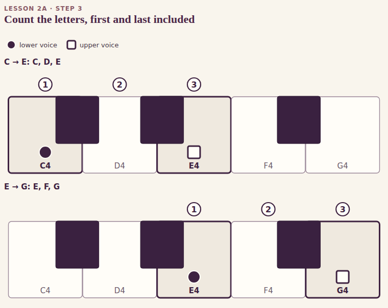](../../public/soundscape/m07/screen/2A-02.svg)

Counting letters, first and last included: C to E is three letters, and E to G is also three letters. At this point no semitones are counted.

| | |
|---|---|
| **Lesson step** | 2A step 3 |
| **State** | neutral (no interval name or colour) |
| **Provenance** | **CREATE** · audit row 2A-02 · from M03N/D02-native.svg (geometry); week2/fixtures.ts A.together, A.EG |
| **Tokens** | none |
| **Files** | [screen](../../public/soundscape/m07/screen/2A-02.svg) 760×605 · [narrow](../../public/soundscape/m07/narrow/2A-02.svg) 360×625 ([preview](previews/narrow/2A-02.png)) · [print](../../public/soundscape/m07/print/2A-02.svg) |

How to read this picture (the paragraph the lesson page owes)

The numbers sit on lettered keys only. Start at the lower note and count 1 on it, then each lettered key up to the upper note. Both pairs end on 3 even though the notes are different; the next step counts something else.

### 2A-03 · Count the semitones: every key counts

[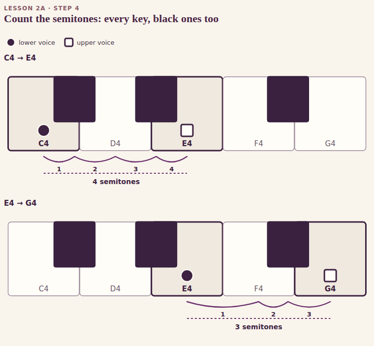](../../public/soundscape/m07/screen/2A-03.svg)

Semitones count every key, black or white. C4 to E4 is four hops and E4 to G4 is three hops, although both span three letters.

| | |
|---|---|
| **Lesson step** | 2A step 4 |
| **State** | neutral (no interval name or colour) |
| **Provenance** | **DERIVE** · audit row 2A-03 · from M03N/D03-native.svg (first half only); week2/fixtures.ts A.together, A.EG |
| **Tokens** | none |
| **Files** | [screen](../../public/soundscape/m07/screen/2A-03.svg) 760×703 · [narrow](../../public/soundscape/m07/narrow/2A-03.svg) 360×723 ([preview](previews/narrow/2A-03.png)) · [print](../../public/soundscape/m07/print/2A-03.svg) |

How to read this picture (the paragraph the lesson page owes)

Each arc is one hop to the very next key, whatever its colour. Count the arcs from the lower note to the upper note; the last number is the total. The two totals differ (4 and 3) even though both pairs span the letters C D E and E F G.

### 2A-04 · Same letters, different size: major and minor third

[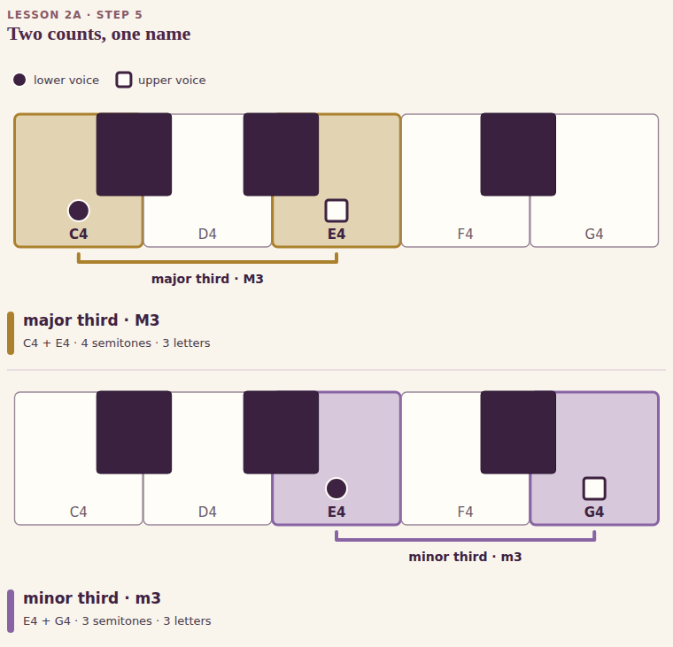](../../public/soundscape/m07/screen/2A-04.svg)

Two thirds, three letters each, but four semitones (major third) against three (minor third). E4 and G4 are an actual minor third with its own colour, not the Palette's C4 and E♭4.

| | |
|---|---|
| **Lesson step** | 2A step 5 |
| **State** | identity colour (pair named) |
| **Provenance** | **CREATE** · audit row 2A-04 · from M05 IPF-intro-04 (style); lib/soundscape/m05/info-svg.ts BY(3), BY(4) names |
| **Tokens** | IP-04 `#AB812D`, IP-03 `#8964A4` |
| **Files** | [screen](../../public/soundscape/m07/screen/2A-04.svg) 760×731 · [narrow](../../public/soundscape/m07/narrow/2A-04.svg) 360×727 ([preview](previews/narrow/2A-04.png)) · [print](../../public/soundscape/m07/print/2A-04.svg) |

How to read this picture (the paragraph the lesson page owes)

The coloured bracket under each keyboard names the pair. The bar on the badge uses the same colour as the keys, because the colour belongs to the pair of notes. The two colours differ because the semitone counts differ, even though both pairs span three letters.

### 2A-05 · One voice moves: a major third becomes a perfect fourth

[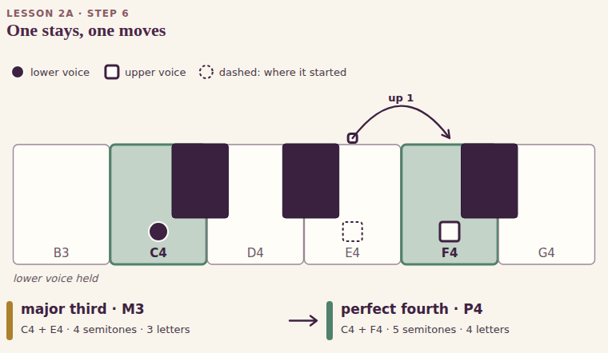](../../public/soundscape/m07/screen/2A-05.svg)

When only the upper voice moves up by one semitone, the interval grows from a major third (4 semitones) to a perfect fourth (5). The lower voice stays on C4.

| | |
|---|---|
| **Lesson step** | 2A step 6 |
| **State** | identity colour (pair named) |
| **Provenance** | **REVISE** · audit row 2A-05 · from M03N/D05-native.svg (facts, octaves added); week2/fixtures.ts A.upperEF |
| **Tokens** | IP-04 `#AB812D`, IP-05 `#4F816B` |
| **Files** | [screen](../../public/soundscape/m07/screen/2A-05.svg) 760×442 · [narrow](../../public/soundscape/m07/narrow/2A-05.svg) 360×580 ([preview](previews/narrow/2A-05.png)) · [print](../../public/soundscape/m07/print/2A-05.svg) |

How to read this picture (the paragraph the lesson page owes)

The dashed square is where the upper voice started (E4) and the arrow shows its single step to F4. The lower voice, the circle on C4, does not move. The keys are coloured for the pair where you finish, and the two badges name the start and the end.

### 2A-06 · The foundation can travel

[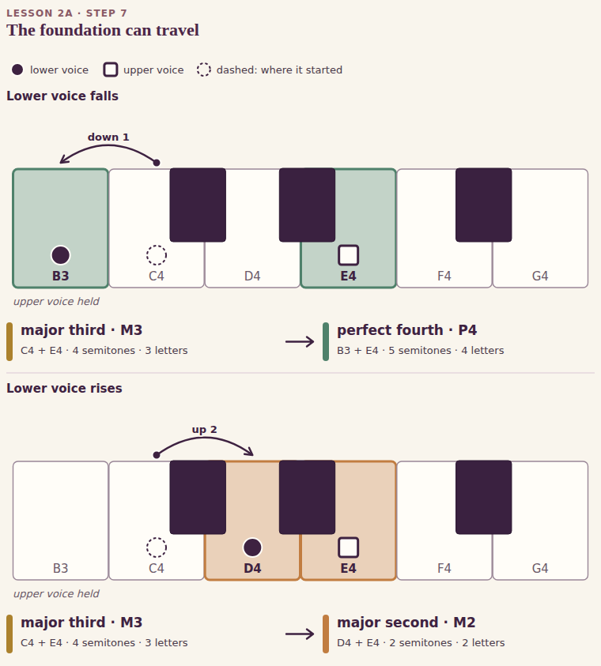](../../public/soundscape/m07/screen/2A-06.svg)

The lower voice can move too. C4 down to B3 under E4 makes a perfect fourth (5 semitones); C4 up to D4 makes a major second (2 semitones).

| | |
|---|---|
| **Lesson step** | 2A step 7 |
| **State** | identity colour (pair named) |
| **Provenance** | **REVISE** · audit row 2A-06 · from M03N/D06-native.svg (octaves, B3 window, hue); week2/fixtures.ts A.lowerCB, A.lowerCD |
| **Tokens** | IP-04 `#AB812D`, IP-05 `#4F816B`, IP-02 `#C17D41` |
| **Files** | [screen](../../public/soundscape/m07/screen/2A-06.svg) 760×843 · [narrow](../../public/soundscape/m07/narrow/2A-06.svg) 360×1097 ([preview](previews/narrow/2A-06.png)) · [print](../../public/soundscape/m07/print/2A-06.svg) |

How to read this picture (the paragraph the lesson page owes)

Each keyboard starts from the same pair, C4 and E4, shown by dashed marks. Read the arrow above the keys to see which way the lower voice went and by how much, then read the badges for the new pair. The keyboard starts at B3, so the key just below C4 is on the picture.

### 2A-07 · Three changes from one beginning

[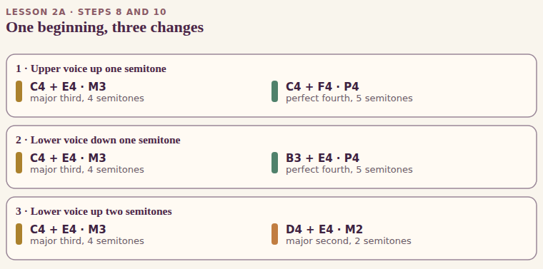](../../public/soundscape/m07/screen/2A-07.svg)

One beginning, three small changes, three different results: perfect fourth, perfect fourth, major second. The summary the lesson ends on.

| | |
|---|---|
| **Lesson step** | 2A step 8, 2A step 10 |
| **State** | identity colour (pair named) |
| **Provenance** | **DERIVE** · audit row 2A-07 · from M03N/D09-native.svg, D10-native.svg (recap form); week2/fixtures.ts A.upperEF, A.lowerCB, A.lowerCD |
| **Tokens** | IP-04 `#AB812D`, IP-05 `#4F816B`, IP-02 `#C17D41` |
| **Files** | [screen](../../public/soundscape/m07/screen/2A-07.svg) 760×377 · [narrow](../../public/soundscape/m07/narrow/2A-07.svg) 360×475 ([preview](previews/narrow/2A-07.png)) · [print](../../public/soundscape/m07/print/2A-07.svg) |

How to read this picture (the paragraph the lesson page owes)

Each card names the change in words, then lists the start pair and the end pair with their colour bars. Compare the end swatches: the first two changes land on the same colour, because both give 5 semitones, even though different notes moved.

### 2A-08 · Your keyboard sheet: build, then change

[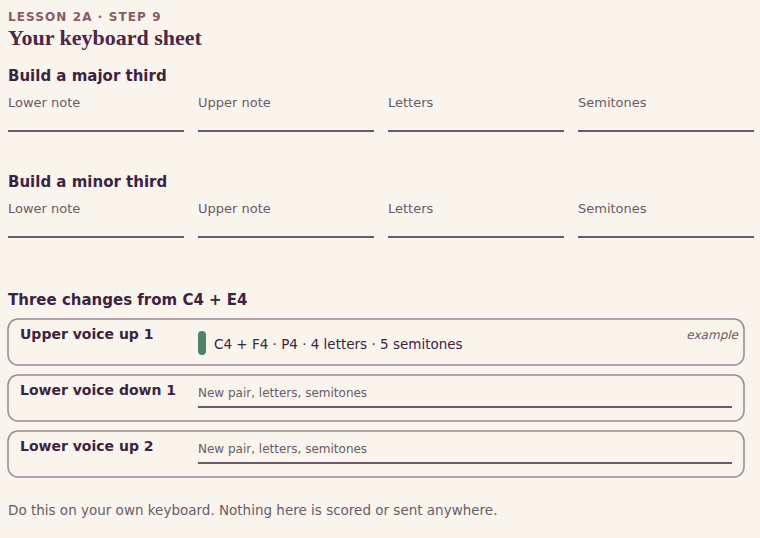](../../public/soundscape/m07/screen/2A-08.svg)

A paper companion for working at your own keyboard: write down the notes and counts for a major third, a minor third and three changes. Nothing is scored.

| | |
|---|---|
| **Lesson step** | 2A step 9 |
| **State** | identity colour (pair named) |
| **Provenance** | **REVISE** · audit row 2A-08 · from M03N/D09-native.svg; public/soundscape/w2/W2-04_blank-two-voice-path_blank.svg (blank-line form) |
| **Tokens** | IP-05 `#4F816B` |
| **Files** | [screen](../../public/soundscape/m07/screen/2A-08.svg) 760×538 · [narrow](../../public/soundscape/m07/narrow/2A-08.svg) 360×905 ([preview](previews/narrow/2A-08.png)) · [print](../../public/soundscape/m07/print/2A-08.svg) |

How to read this picture (the paragraph the lesson page owes)

Work on your own keyboard and write what you find on the lines. The first change row is already filled in as an example with its colour bar. The printed version carries the same words and lines in black and white; there is no check button and no score.

### 2A-09 · One after another, and together

[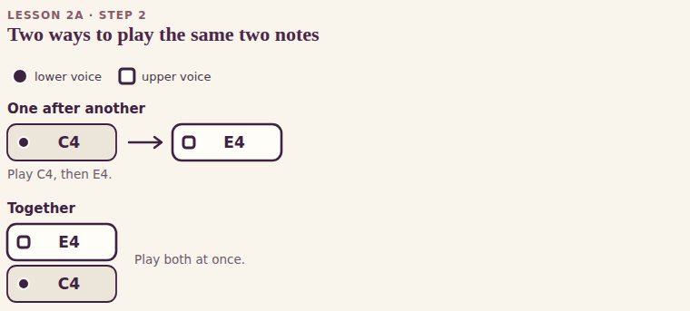](../../public/soundscape/m07/screen/2A-09.svg)

Two notes can be played one after another or at the same time. Together, the lower note sits under the upper note.

| | |
|---|---|
| **Lesson step** | 2A step 2 |
| **State** | neutral (no interval name or colour) |
| **Provenance** | **DERIVE** · audit row 2A-09 (N derivative of IPF-intro-05) · from public/soundscape/m05/info/IPF-intro-05.svg (reused later, at step 5, for the named version); lib/soundscape/m05/info-svg.ts strip2() idea (neutral derivative: no hue, no name) |
| **Tokens** | none |
| **Files** | [screen](../../public/soundscape/m07/screen/2A-09.svg) 760×343 · [narrow](../../public/soundscape/m07/narrow/2A-09.svg) 360×363 ([preview](previews/narrow/2A-09.png)) · [print](../../public/soundscape/m07/print/2A-09.svg) |

How to read this picture (the paragraph the lesson page owes)

In the first row, read left to right: the lower note first, then the upper note. In the second row the two notes share one slot: the square (upper) sits above the circle (lower) because they sound at the same moment. Try both on your own keyboard.

### 2A-10 · The foundation moves: E4 and G4, a minor third

[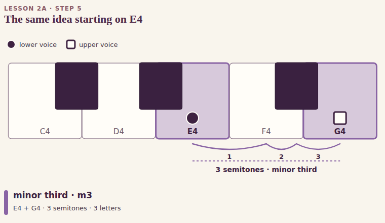](../../public/soundscape/m07/screen/2A-10.svg)

A third does not have to start on C. E4 to G4 spans three letters and three semitones: a minor third, in the minor third colour.

| | |
|---|---|
| **Lesson step** | 2A step 5 |
| **State** | identity colour (pair named) |
| **Provenance** | **DERIVE** · audit row 2A-10 · from M03N/D03-native.svg (second half); week2/fixtures.ts A.EG (E4 = 64, G4 = 67) |
| **Tokens** | IP-03 `#8964A4` |
| **Files** | [screen](../../public/soundscape/m07/screen/2A-10.svg) 760×442 · [narrow](../../public/soundscape/m07/narrow/2A-10.svg) 360×438 ([preview](previews/narrow/2A-10.png)) · [print](../../public/soundscape/m07/print/2A-10.svg) |

How to read this picture (the paragraph the lesson page owes)

Count the three arcs from E4 up to G4 (E to F, F to F♯, F♯ to G). The keys and the bracket share the minor third colour because that colour belongs to the pair, wherever it sits on the keyboard. The pair is E4 and G4, not C4 and E♭4.

## Lesson 2B

### 2B-01a · Two paths through time

[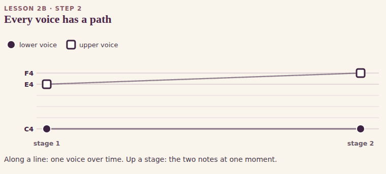](../../public/soundscape/m07/screen/2B-01a.svg)

Each voice has its own path across time (horizontal), and at any one stage the two notes make a gap (vertical). Two directions to look in: along a path, and between the voices.

| | |
|---|---|
| **Lesson step** | 2B step 1, 2B step 2 |
| **State** | neutral (no interval name or colour) |
| **Provenance** | **REPLACE** · audit row 2B-01 (step 2 master) · from public/soundscape/w2/SYS-04_voice-path-chart_learner.svg (grammar only; its learner version hid beat 2); week2/fixtures.ts B.upperRises |
| **Tokens** | none |
| **Files** | [screen](../../public/soundscape/m07/screen/2B-01a.svg) 760×343 · [narrow](../../public/soundscape/m07/narrow/2B-01a.svg) 360×359 ([preview](previews/narrow/2B-01a.png)) · [print](../../public/soundscape/m07/print/2B-01a.svg) |

How to read this picture (the paragraph the lesson page owes)

Read each line from left to right: that is a voice's path. Then look straight up at one stage: the vertical gap there is the two notes at that moment. The picture gives only note names and stages. It does not name the pair or the movement; the lesson does that next.

### 2B-01b · Before we name it: two journeys

[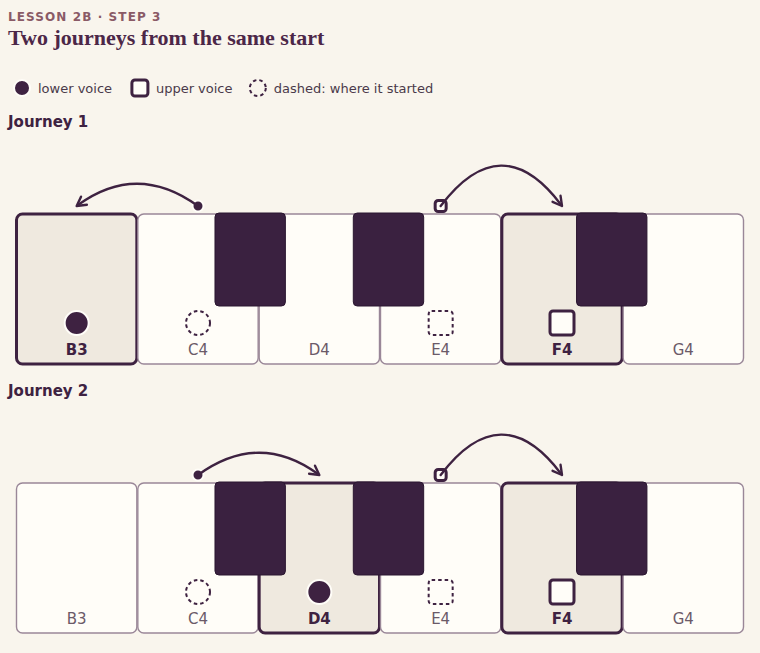](../../public/soundscape/m07/screen/2B-01b.svg)

Two journeys from the same two notes. Compare them: in each, one voice does something different. The picture shows only the notes and the arrows, so you can decide what you notice before it is named.

| | |
|---|---|
| **Lesson step** | 2B step 3 |
| **State** | neutral (no interval name or colour) |
| **Provenance** | **REPLACE** · audit row 2B-01 (step 3 master) · from M03N/E01 idea (art E01 dropped: wrong ribbon count); week2/fixtures.ts B.lowerFalls... see FIVE B2/B4, B3/B5 endings |
| **Tokens** | none |
| **Files** | [screen](../../public/soundscape/m07/screen/2B-01b.svg) 760×653 · [narrow](../../public/soundscape/m07/narrow/2B-01b.svg) 360×675 ([preview](previews/narrow/2B-01b.png)) · [print](../../public/soundscape/m07/print/2B-01b.svg) |
| **Limits** | Inquiry figure: must not carry result labels, sizes, hue or movement words in the picture, title, description or alt. |

How to read this picture (the paragraph the lesson page owes)

Each keyboard starts from the dashed shapes on C4 and E4 and ends on the solid shapes. Follow the arrows and compare the two journeys with your eyes and, if you like, with your own keyboard. There are no labels on the endings: that is deliberate, and the next step supplies the names.

### 2B-02 · Three families of motion, with exact examples

[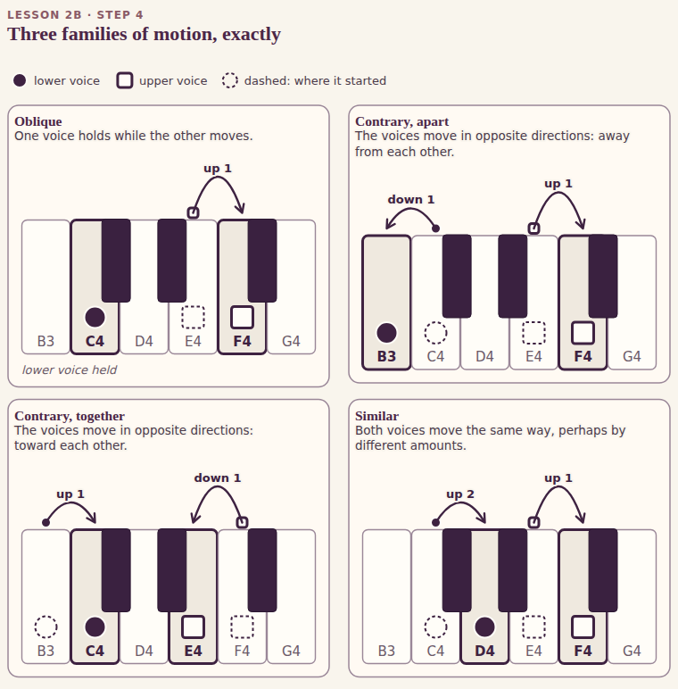](../../public/soundscape/m07/screen/2B-02.svg)

The three families of motion as exact keyboard examples: oblique, contrary (both apart and together) and similar. The narrower word "parallel" comes later, in step 6.

| | |
|---|---|
| **Lesson step** | 2B step 4 |
| **State** | neutral (no interval name or colour) |
| **Provenance** | **DERIVE** · audit row 2B-02 · from M03N/E02, E03, E04; public/soundscape/w2/SYS-05_motion-glyph-library_source.svg (the strict parallel glyph moves to A-06 and 2B-09) |
| **Tokens** | none |
| **Files** | [screen](../../public/soundscape/m07/screen/2B-02.svg) 760×772 · [narrow](../../public/soundscape/m07/narrow/2B-02.svg) 360×1468 ([preview](previews/narrow/2B-02.png)) · [print](../../public/soundscape/m07/print/2B-02.svg) |

How to read this picture (the paragraph the lesson page owes)

Each tile is one example with its definition above it. The dashed shapes are where each voice started and the arrows show where it goes. Contrary covers two examples, moving apart and moving together. Match what the arrows do to the words, not the other way round.

### 2B-03 · Change 1: only the upper voice rises

[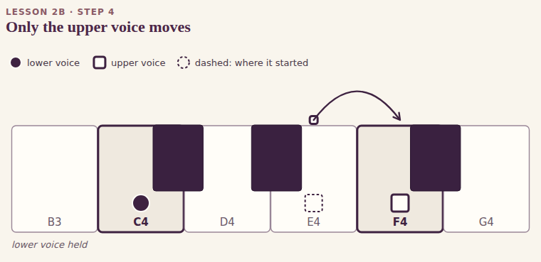](../../public/soundscape/m07/screen/2B-03.svg)

The first of the five changes: C4 holds while E4 rises to F4. One voice holds and one moves, which is oblique motion.

| | |
|---|---|
| **Lesson step** | 2B step 4, 2B step 8 |
| **State** | neutral (no interval name or colour) |
| **Provenance** | **REVISE** · audit row 2B-03 · from M03N/E02-native.svg panel B1; week2/fixtures.ts FIVE[0] (B1) |
| **Tokens** | none |
| **Files** | [screen](../../public/soundscape/m07/screen/2B-03.svg) 760×369 · [narrow](../../public/soundscape/m07/narrow/2B-03.svg) 360×391 ([preview](previews/narrow/2B-03.png)) · [print](../../public/soundscape/m07/print/2B-03.svg) |

How to read this picture (the paragraph the lesson page owes)

The dashed square is where the upper voice began, on E4, and the arrow takes it to F4. The circle on C4 does not move. The page does not yet say what pair this makes; you will name it later, from the same picture.

### 2B-04 · Change 2: only the lower voice falls

[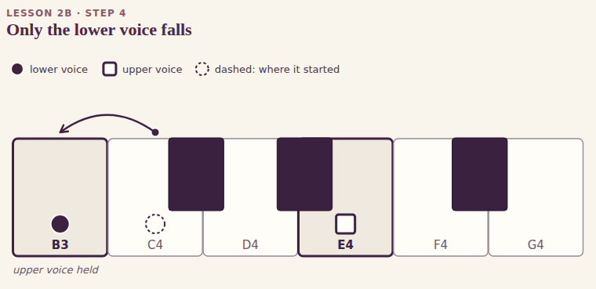](../../public/soundscape/m07/screen/2B-04.svg)

The second of the five changes: E4 holds while C4 falls to B3. One voice holds, one moves, so this is also oblique.

| | |
|---|---|
| **Lesson step** | 2B step 4, 2B step 8 |
| **State** | neutral (no interval name or colour) |
| **Provenance** | **REVISE** · audit row 2B-04 · from M03N/E02-native.svg panel B2; week2/fixtures.ts FIVE[1] (B2) |
| **Tokens** | none |
| **Files** | [screen](../../public/soundscape/m07/screen/2B-04.svg) 760×369 · [narrow](../../public/soundscape/m07/narrow/2B-04.svg) 360×391 ([preview](previews/narrow/2B-04.png)) · [print](../../public/soundscape/m07/print/2B-04.svg) |

How to read this picture (the paragraph the lesson page owes)

The dashed circle on C4 is where the lower voice began; the arrow takes it left to B3. The square on E4 stays. The keyboard starts at B3, so the new low note is on the picture.

### 2B-05 · Change 3: only the lower voice rises

[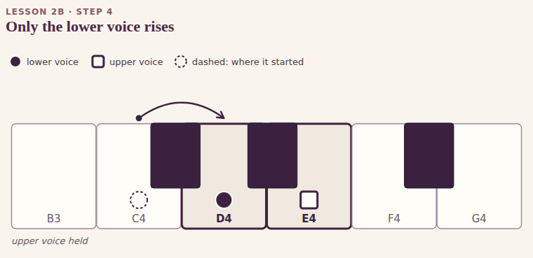](../../public/soundscape/m07/screen/2B-05.svg)

The third of the five changes: E4 holds while C4 rises to D4. Again one voice holds and one moves, oblique motion, but the lower voice now moves up.

| | |
|---|---|
| **Lesson step** | 2B step 4, 2B step 8 |
| **State** | neutral (no interval name or colour) |
| **Provenance** | **REVISE** · audit row 2B-05 · from M03N/E02-native.svg panel B3; week2/fixtures.ts FIVE[2] (B3) |
| **Tokens** | none |
| **Files** | [screen](../../public/soundscape/m07/screen/2B-05.svg) 760×369 · [narrow](../../public/soundscape/m07/narrow/2B-05.svg) 360×391 ([preview](previews/narrow/2B-05.png)) · [print](../../public/soundscape/m07/print/2B-05.svg) |

How to read this picture (the paragraph the lesson page owes)

The dashed circle on C4 is the start; the arrow takes the lower voice right to D4, one key below the held E4. Compare with change 2: same voice moving, the other direction.

### 2B-06 · Change 4: moving apart, B3 and F4, a diminished fifth

[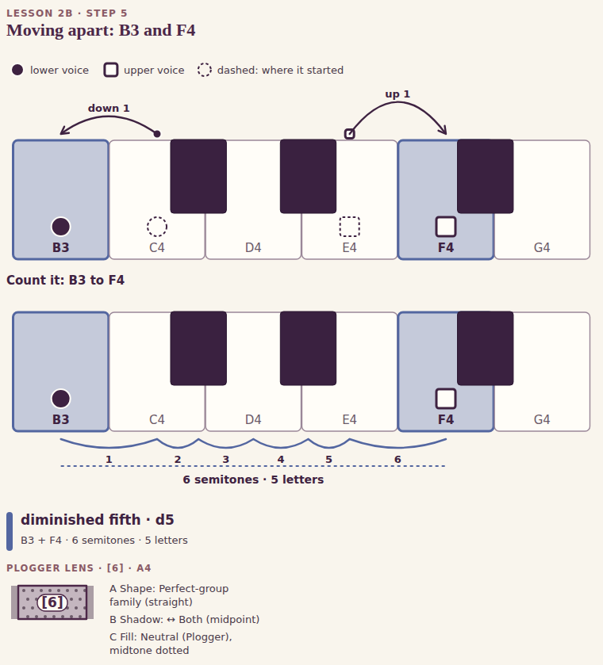](../../public/soundscape/m07/screen/2B-06.svg)

Moving apart: both voices go in opposite directions, C4 down to B3 and E4 up to F4. The new pair B3 + F4 spans five letters and six semitones: a diminished fifth, shown in the tritone colour with its Plogger chip.

| | |
|---|---|
| **Lesson step** | 2B step 5, 2B step 8 |
| **State** | identity colour (pair named) |
| **Provenance** | **REVISE** · audit row 2B-06 · from M03N/E03-native.svg, E08-native.svg (facts); week2/fixtures.ts B.apart (B3 = 59, F4 = 65) |
| **Tokens** | IP-06 `#5366A0` · Plogger [6] straight/both/neutral |
| **Files** | [screen](../../public/soundscape/m07/screen/2B-06.svg) 760×839 · [narrow](../../public/soundscape/m07/narrow/2B-06.svg) 360×861 ([preview](previews/narrow/2B-06.png)) · [print](../../public/soundscape/m07/print/2B-06.svg) |
| **Limits** | Plogger [6] follows the printed original; shape family is disputed in older code. See A-09 legend. |

How to read this picture (the paragraph the lesson page owes)

The arrows above the keys show the two voices leaving C4 and E4 in opposite directions. The keys B3 and F4 are tinted with the tritone colour, and the six numbered arcs count every key from B3 to F4. The chip is a separate historic lens, not the colour. These are B3 and F4, not the C4 and F♯4 on the Palette card.

### 2B-07 · Change 5: both rise, a major third becomes a minor third

[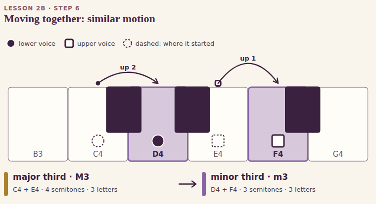](../../public/soundscape/m07/screen/2B-07.svg)

Similar motion: both voices rise, the lower by 2 semitones and the upper by 1. Because the distances differ, the interval shrinks from a major third to a minor third, so this is similar and not strict parallel in this course.

| | |
|---|---|
| **Lesson step** | 2B step 6, 2B step 8 |
| **State** | identity colour (pair named) |
| **Provenance** | **REVISE** · audit row 2B-07 · from M03N/E04-native.svg; week2/fixtures.ts B.climb |
| **Tokens** | IP-04 `#AB812D`, IP-03 `#8964A4` |
| **Files** | [screen](../../public/soundscape/m07/screen/2B-07.svg) 760×414 · [narrow](../../public/soundscape/m07/narrow/2B-07.svg) 360×552 ([preview](previews/narrow/2B-07.png)) · [print](../../public/soundscape/m07/print/2B-07.svg) |

How to read this picture (the paragraph the lesson page owes)

Two arrows go the same way but are not the same size: the lower voice steps over a black key (up 2) and the upper takes one step (up 1). That difference is why the pair changes size. The end keys carry the minor third colour.

### 2B-08 · The five changes, all from C4 + E4

All five changes side by side, each restarting from the same C4 + E4: which voice moves, the new pair, its interval and its semitone count.

| | |
|---|---|
| **Lesson step** | 2B step 8, 2B step 9, 2B step 11 |
| **State** | identity colour (pair named) |
| **Provenance** | **REVISE** · audit row 2B-08 · from M03N/E07-native.svg (single 316 × 1182 column; replaced by this landscape table, stacked narrow variant and print table); week2/fixtures.ts FIVE |
| **Tokens** | IP-05 `#4F816B`, IP-02 `#C17D41`, IP-06 `#5366A0`, IP-03 `#8964A4` |
| **Files** | [screen](../../public/soundscape/m07/screen/2B-08.svg) 760×407 · [narrow](../../public/soundscape/m07/narrow/2B-08.svg) 360×633 ([preview](previews/narrow/2B-08.png)) · [print](../../public/soundscape/m07/print/2B-08.svg) |

How to read this picture (the paragraph the lesson page owes)

Every row begins from C4 and E4 again; the changes do not chain. Read across: the change in words, the motion word, the end pair, then the interval with its colour. Rows 1 and 2 share a colour because they give the same interval size.

### 2B-09 · Similar, and strict parallel

[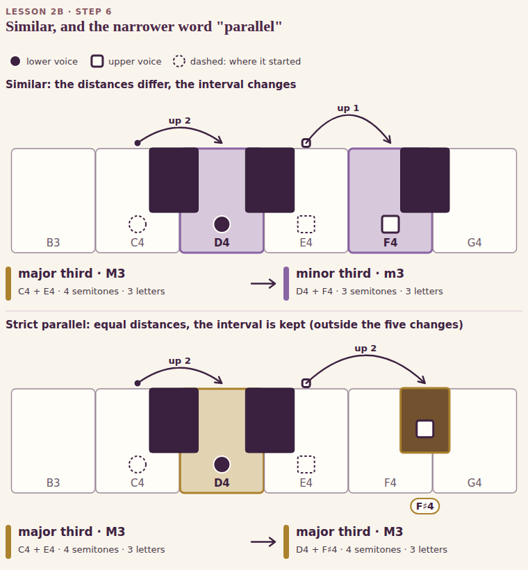](../../public/soundscape/m07/screen/2B-09.svg)

Same direction is not always strict parallel. In the course vocabulary strict parallel needs equal distances and an unchanged interval size. Some books use the word "parallel" more widely; both uses are respectable.

| | |
|---|---|
| **Lesson step** | 2B step 6 |
| **State** | identity colour (pair named) |
| **Provenance** | **CREATE** · audit row 2B-09 · from M03N/E04-native.svg, E10-native.svg (idea); week2/fixtures.ts B.climb, M.Fs4 |
| **Tokens** | IP-04 `#AB812D`, IP-03 `#8964A4` |
| **Files** | [screen](../../public/soundscape/m07/screen/2B-09.svg) 760×821 · [narrow](../../public/soundscape/m07/narrow/2B-09.svg) 360×1162 ([preview](previews/narrow/2B-09.png)) · [print](../../public/soundscape/m07/print/2B-09.svg) |

How to read this picture (the paragraph the lesson page owes)

The top keyboard is change 5 of the lesson: the two arrows are different sizes and the interval shrinks. The lower keyboard is the strict case, outside the five changes: both arrows are the same size and the end pair is a major third again. Compare the two arrow pairs and the two end colours.

### 2B-10 · A two-voice path in four stages

[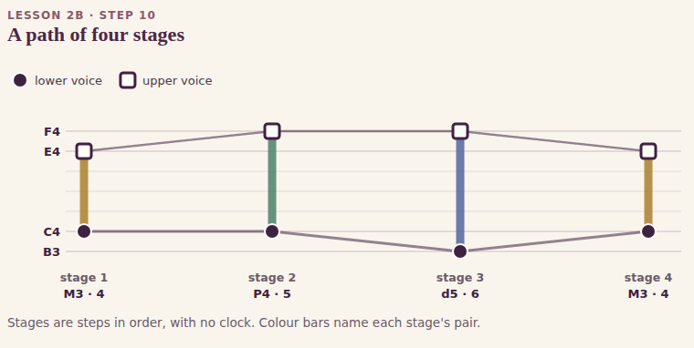](../../public/soundscape/m07/screen/2B-10.svg)

A short path through four stages that uses the lesson's changes in a row. Each stage has its own pair and colour, and the path ends where it began.

| | |
|---|---|
| **Lesson step** | 2B step 10 |
| **State** | identity colour (pair named) |
| **Provenance** | **REVISE** · audit row 2B-10 · from M03N/E11-native.svg (re-timed to stages); week2/fixtures.ts B.path |
| **Tokens** | IP-04 `#AB812D`, IP-05 `#4F816B`, IP-06 `#5366A0` |
| **Files** | [screen](../../public/soundscape/m07/screen/2B-10.svg) 760×382 · [narrow](../../public/soundscape/m07/narrow/2B-10.svg) 360×397 ([preview](previews/narrow/2B-10.png)) · [print](../../public/soundscape/m07/print/2B-10.svg) |

How to read this picture (the paragraph the lesson page owes)

Read left to right, stage by stage. Each vertical coloured bar joins the two notes of that stage and names its interval underneath; the lines show how each voice travels between stages. Stages are steps in order, with no clock, so take as long as you like at each.

### 2B-10b · Your two-voice path sheet

[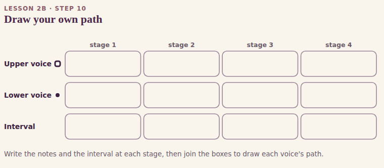](../../public/soundscape/m07/screen/2B-10b.svg)

A paper sheet for drawing your own four-stage path: write the upper and lower note at each stage, then the interval you find.

| | |
|---|---|
| **Lesson step** | 2B step 10 |
| **State** | neutral (no interval name or colour) |
| **Provenance** | **REVISE** · audit row 2B-10 (blank sheet) · from public/soundscape/w2/W2-04_blank-two-voice-path_blank.svg; public/soundscape/w2/SYS-09_two-voice-timeline_blank.svg |
| **Tokens** | none |
| **Files** | [screen](../../public/soundscape/m07/screen/2B-10b.svg) 760×332 · [narrow](../../public/soundscape/m07/narrow/2B-10b.svg) 360×366 ([preview](previews/narrow/2B-10b.png)) · [print](../../public/soundscape/m07/print/2B-10b.svg) |

How to read this picture (the paragraph the lesson page owes)

Each column is one stage. Write the upper note in the top box and the lower note in the lower box, then work out the letters and semitones in the bottom box using your own keyboard. Join the boxes with lines to draw each voice's path. Nothing is scored.

### 2B-11n · Contrary motion, together: the voices move toward each other

[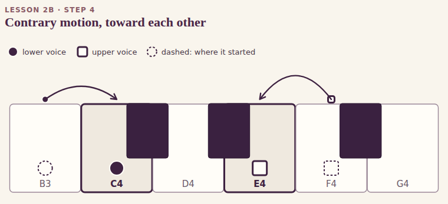](../../public/soundscape/m07/screen/2B-11n.svg)

Contrary motion also covers voices that move toward each other: the lower voice rises and the upper voice falls, and the gap between them closes.

| | |
|---|---|
| **Lesson step** | 2B step 4 |
| **State** | neutral (no interval name or colour) |
| **Provenance** | **REVISE** · audit row 2B-11 · from M03N/E09-native.svg (the "2.5 seconds" label removed); week2/fixtures.ts B.path stage 3 to 4 |
| **Tokens** | none |
| **Files** | [screen](../../public/soundscape/m07/screen/2B-11n.svg) 760×347 · [narrow](../../public/soundscape/m07/narrow/2B-11n.svg) 360×393 ([preview](previews/narrow/2B-11n.png)) · [print](../../public/soundscape/m07/print/2B-11n.svg) |

How to read this picture (the paragraph the lesson page owes)

The dashed shapes are where the voices started, on B3 and F4. The arrows go toward each other and end on C4 and E4. The picture shows the movement only; nothing is named or counted, and no colour is used.

### 2B-11 · Contrary motion, together: B3 + F4 to C4 + E4

[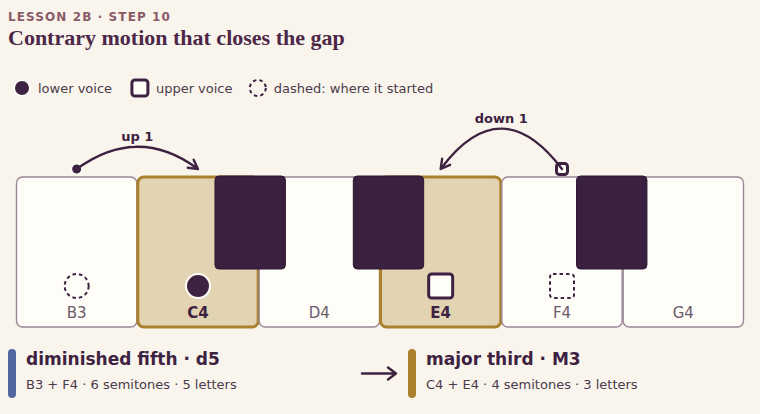](../../public/soundscape/m07/screen/2B-11.svg)

Contrary motion can also go together: the lower voice rises one semitone and the upper falls one, closing the gap from a diminished fifth to a major third.

| | |
|---|---|
| **Lesson step** | 2B step 10 |
| **State** | identity colour (pair named) |
| **Provenance** | **REVISE** · audit row 2B-11 · from M03N/E09-native.svg (the "2.5 seconds" label removed); week2/fixtures.ts B.path stage 3 to 4 |
| **Tokens** | IP-06 `#5366A0`, IP-04 `#AB812D` |
| **Files** | [screen](../../public/soundscape/m07/screen/2B-11.svg) 760×414 · [narrow](../../public/soundscape/m07/narrow/2B-11.svg) 360×576 ([preview](previews/narrow/2B-11.png)) · [print](../../public/soundscape/m07/print/2B-11.svg) |

How to read this picture (the paragraph the lesson page owes)

This is the closing move of the four-stage path, drawn on the keyboard. The dashed shapes are B3 and F4; the arrows go toward each other and meet around C4 and E4, where the major third colour appears on the keys.

### 2B-12 · Two kinds of words: along a path, up a stage

[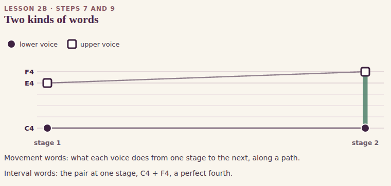](../../public/soundscape/m07/screen/2B-12.svg)

Movement words (oblique, contrary, similar, parallel) describe what voices do between stages, along the path. Interval words (the names of intervals) describe a pair of notes at a single stage, up the page.

| | |
|---|---|
| **Lesson step** | 2B step 7, 2B step 9 |
| **State** | neutral, then one named pair |
| **Provenance** | **CREATE** · audit row 2B-12 · from concept new; kit stagePath(); week2/fixtures.ts B.upperRises |
| **Tokens** | IP-05 `#4F816B` |
| **Files** | [screen](../../public/soundscape/m07/screen/2B-12.svg) 760×363 · [narrow](../../public/soundscape/m07/narrow/2B-12.svg) 360×395 ([preview](previews/narrow/2B-12.png)) · [print](../../public/soundscape/m07/print/2B-12.svg) |

How to read this picture (the paragraph the lesson page owes)

Follow the upper line left to right: that horizontal direction is movement. Then look straight up the page at stage 2: that vertical gap, the only coloured part, is the interval. One kind of word is about travelling, the other about distance at one moment.

### 2B-13 · The tritone family: B3–F4 beside the Palette card C4–F♯4

[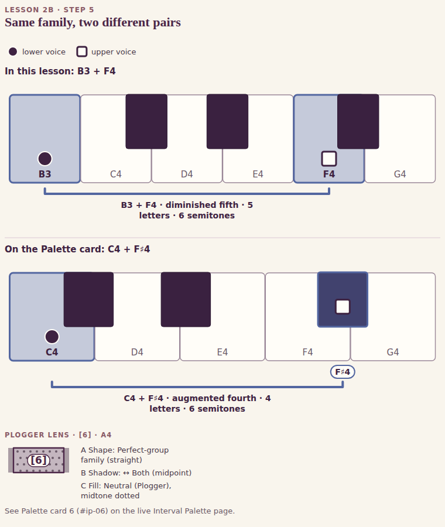](../../public/soundscape/m07/screen/2B-13.svg)

Two different pairs, one tritone colour and one chip. B3–F4 (five letters) and C4–F♯4 (four letters) are both six semitones. The lesson uses B3–F4; the Palette card draws C4–F♯4. They are separate examples of the same family.

| | |
|---|---|
| **Lesson step** | 2B step 5 |
| **State** | identity colour (pair named) |
| **Provenance** | **REVISE** · audit row 2B-13 (added) · from M03N/T05-native.svg (octaves, hue and chip added); lib/soundscape/resources/interval-data.json IP-06 (C4 + F♯4; alternate spelling C4 + G♭4) |
| **Tokens** | IP-06 `#5366A0` · Plogger [6] straight/both/neutral |
| **Files** | [screen](../../public/soundscape/m07/screen/2B-13.svg) 760×900 · [narrow](../../public/soundscape/m07/narrow/2B-13.svg) 360×914 ([preview](previews/narrow/2B-13.png)) · [print](../../public/soundscape/m07/print/2B-13.svg) |

How to read this picture (the paragraph the lesson page owes)

Compare the two keyboards. The key colour and the chip are identical because both pairs are six semitones. The note names differ because the pairs sit in different places and are spelled with different letters. The Palette page (card 6) shows the second; this lesson works with the first.

## Lesson 2C

### 2C-01 · Two 36-second sketches: same upper line, different lower line

Two sketches of the same melody over different lower lines. The upper line is identical in both; only the lower voice differs.

| | |
|---|---|
| **Lesson step** | 2C step 1, 2C step 3 |
| **State** | neutral (no interval name or colour) |
| **Provenance** | **REVISE** · audit row 2C-01 · from M03N/F01-native.svg; week2/fixtures.ts C.held, C.moving (upper at 4–10, 14–20, 26–32) |
| **Tokens** | none |
| **Files** | [screen](../../public/soundscape/m07/screen/2C-01.svg) 760×545 · [narrow](../../public/soundscape/m07/narrow/2C-01.svg) 360×633 ([preview](previews/narrow/2C-01.png)) · [print](../../public/soundscape/m07/print/2C-01.svg) |

How to read this picture (the paragraph the lesson page owes)

Each timeline is 36 seconds wide. Upper lane first, lower lane below. Solid bars are notes, dashed boxes are rests. Compare the two upper lanes: they match exactly. Then compare the two lower lanes: Version A holds one note, Version B changes it twice.

### 2C-02 · Version A: one voice holds the landscape

[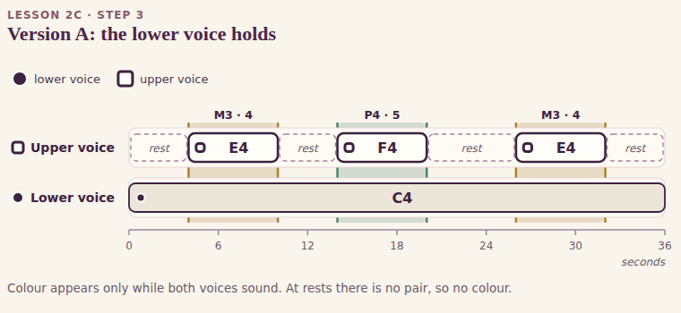](../../public/soundscape/m07/screen/2C-02.svg)

With a held lower note, the pair changes only when the upper voice moves: C4 + E4 (major third), C4 + F4 (perfect fourth), then C4 + E4 again.

| | |
|---|---|
| **Lesson step** | 2C step 3 |
| **State** | identity colour (pair named) |
| **Provenance** | **REVISE** · audit row 2C-02 · from M03N/F02-native.svg (bar positions verified exact); week2/fixtures.ts C.held |
| **Tokens** | IP-04 `#AB812D`, IP-05 `#4F816B` |
| **Files** | [screen](../../public/soundscape/m07/screen/2C-02.svg) 760×350 · [narrow](../../public/soundscape/m07/narrow/2C-02.svg) 360×399 ([preview](previews/narrow/2C-02.png)) · [print](../../public/soundscape/m07/print/2C-02.svg) |

How to read this picture (the paragraph the lesson page owes)

Colour bands appear only while both voices sound; where the upper voice rests there is no pair, so there is no colour. Read the band labels left to right: M3 for 4 semitones, P4 for 5, M3 again. The lower voice is the same note under all three.

### 2C-03 · Version B: the landscape begins to travel

When the lower voice moves under the same melody, one moment changes: from 14 to 20 seconds the pair is B3 + F4, a diminished fifth, instead of C4 + F4.

| | |
|---|---|
| **Lesson step** | 2C step 4 |
| **State** | identity colour (pair named) |
| **Provenance** | **REVISE** · audit row 2C-03 · from M03N/F03-native.svg (positions verified exact); week2/fixtures.ts C.moving (B3 = 59) |
| **Tokens** | IP-04 `#AB812D`, IP-06 `#5366A0` |
| **Files** | [screen](../../public/soundscape/m07/screen/2C-03.svg) 760×350 · [narrow](../../public/soundscape/m07/narrow/2C-03.svg) 360×423 ([preview](previews/narrow/2C-03.png)) · [print](../../public/soundscape/m07/print/2C-03.svg) |

How to read this picture (the paragraph the lesson page owes)

The dashed lines at 12 and 24 seconds mark where the lower voice changes. At both moments the upper lane is a dashed rest, so no pair changes at that instant. The F4 only sounds from 14 to 20 seconds, over B3, and that band carries the tritone colour.

### 2C-04 · Same melody, one moment different: A above B

[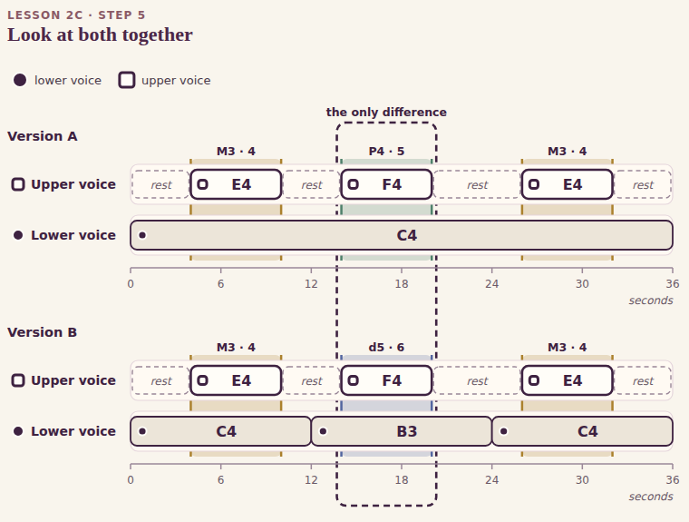](../../public/soundscape/m07/screen/2C-04.svg)

Stack the two versions and look: the upper line and the first and last pairs are identical. Only from 14 to 20 seconds does the lower voice change what the pair is.

| | |
|---|---|
| **Lesson step** | 2C step 5 |
| **State** | identity colour (pair named) |
| **Provenance** | **REVISE** · audit row 2C-04 · from M03N/F06-native.svg; week2/fixtures.ts C.held, C.moving |
| **Tokens** | IP-04 `#AB812D`, IP-05 `#4F816B`, IP-06 `#5366A0` |
| **Files** | [screen](../../public/soundscape/m07/screen/2C-04.svg) 760×575 · [narrow](../../public/soundscape/m07/narrow/2C-04.svg) 360×639 ([preview](previews/narrow/2C-04.png)) · [print](../../public/soundscape/m07/print/2C-04.svg) |

How to read this picture (the paragraph the lesson page owes)

Both timelines share one time scale so a vertical line crosses both at the same moment. The dashed outline covers 14 to 20 seconds. Inside it the two bands have different colours; outside it they match.

### 2C-05 · Three snapshots: what stayed, what changed

[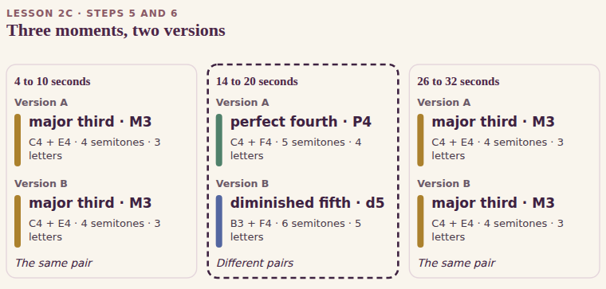](../../public/soundscape/m07/screen/2C-05.svg)

Three moments side by side. In two of them the two versions have the same pair; in exactly one, the middle, they differ.

| | |
|---|---|
| **Lesson step** | 2C step 5, 2C step 6 |
| **State** | identity colour (pair named) |
| **Provenance** | **DERIVE** · audit row 2C-05 · from M03N/F07-native.svg (extended with the two major third snapshots); week2/fixtures.ts C.held, C.moving |
| **Tokens** | IP-04 `#AB812D`, IP-05 `#4F816B`, IP-06 `#5366A0` |
| **Files** | [screen](../../public/soundscape/m07/screen/2C-05.svg) 760×363 · [narrow](../../public/soundscape/m07/narrow/2C-05.svg) 360×817 ([preview](previews/narrow/2C-05.png)) · [print](../../public/soundscape/m07/print/2C-05.svg) |

How to read this picture (the paragraph the lesson page owes)

Read each column as one moment. The two badges in a column are the pair in Version A and the pair in Version B at that moment. Compare across the row: same, different, same. The middle column also gives the semitone count: 5 against 6.

### 2C-06 · Four words: voice, vertical interval, voice leading, counterpoint

Four words for the week's ideas, each with a small picture: one line, the gap between two notes at one moment, how lines travel between moments, and independent lines together.

| | |
|---|---|
| **Lesson step** | 2C step 2, 2C step 6 |
| **State** | neutral, then one named pair |
| **Provenance** | **CREATE** · audit row 2C-06 · from concept new; kit glyph(), badge() |
| **Tokens** | IP-04 `#AB812D` |
| **Files** | [screen](../../public/soundscape/m07/screen/2C-06.svg) 760×410 · [narrow](../../public/soundscape/m07/narrow/2C-06.svg) 360×697 ([preview](previews/narrow/2C-06.png)) · [print](../../public/soundscape/m07/print/2C-06.svg) |

How to read this picture (the paragraph the lesson page owes)

Each card gives the word, its meaning in one sentence, and a tiny picture built from the same marks as the rest of Week 2. The vertical interval card carries the only colour: C4 + E4, the major third from lesson 2A.

### 2C-07 · Plan your miniature: two blank timelines

[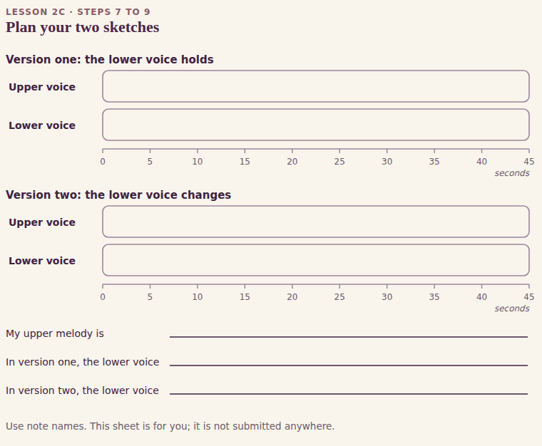](../../public/soundscape/m07/screen/2C-07.svg)

A paper planning sheet for your own two sketches: draw where each voice sounds and rests, write note names, and finish three plan sentences.

| | |
|---|---|
| **Lesson step** | 2C step 8, 2C step 9 |
| **State** | neutral (no interval name or colour) |
| **Provenance** | **REVISE** · audit row 2C-07 · from public/soundscape/w2/SYS-09_two-voice-timeline_blank.svg; public/soundscape/w2/W2-04_blank-two-voice-path_blank.svg (concept) |
| **Tokens** | none |
| **Files** | [screen](../../public/soundscape/m07/screen/2C-07.svg) 760×626 · [narrow](../../public/soundscape/m07/narrow/2C-07.svg) 360×725 ([preview](previews/narrow/2C-07.png)) · [print](../../public/soundscape/m07/print/2C-07.svg) |

How to read this picture (the paragraph the lesson page owes)

Each blank timeline runs from 0 to 45 seconds with a tick every 5. The upper lane is for your melody and the lower lane is for the line beneath. Draw bars for notes and leave gaps for rests, writing note names inside. Then complete the three sentences at the bottom. Nothing is scored or sent anywhere.

### 2C-08 · What changes, and your response

Separate what the notes did (a fact) from what you make of it (your response). The facts are shown; the response is yours and has no correct answer.

| | |
|---|---|
| **Lesson step** | 2C step 9 |
| **State** | identity colour (pair named) |
| **Provenance** | **REVISE** · audit row 2C-08 · from M03N/F05-native.svg; week2/fixtures.ts C.held, C.moving |
| **Tokens** | IP-05 `#4F816B`, IP-06 `#5366A0` |
| **Files** | [screen](../../public/soundscape/m07/screen/2C-08.svg) 760×369 · [narrow](../../public/soundscape/m07/narrow/2C-08.svg) 360×630 ([preview](previews/narrow/2C-08.png)) · [print](../../public/soundscape/m07/print/2C-08.svg) |

How to read this picture (the paragraph the lesson page owes)

The left panel states what changed, with the pairs and their colour bars. The right panel is empty on purpose: complete the sentence in your own words. There is no right feeling to write.

### 2C-09 · Week 2 in three anchors

[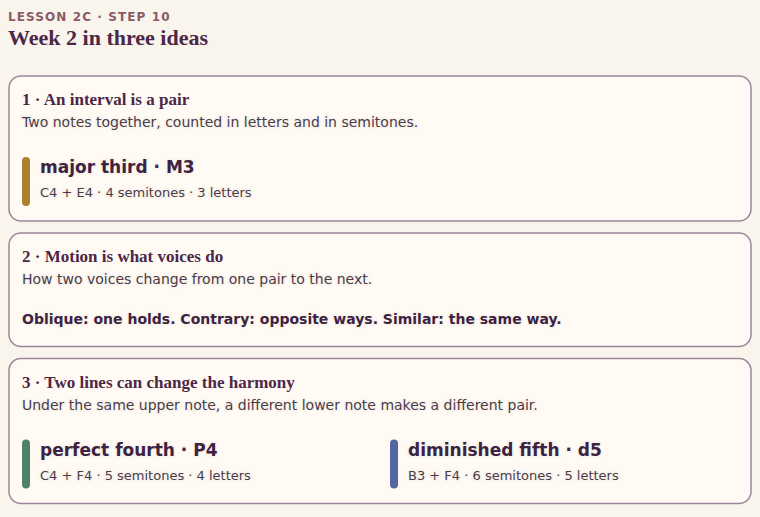](../../public/soundscape/m07/screen/2C-09.svg)

The whole week in three sentences: an interval is a pair counted two ways; motion is what two voices do between pairs; two lines are enough to make changing harmony.

| | |
|---|---|
| **Lesson step** | 2C step 10 |
| **State** | identity colour (pair named) |
| **Provenance** | **REVISE** · audit row 2C-09 · from M03N/F10-native.svg (676 × 758, 8 px text: rebuilt for 12 px minimum); week2/fixtures.ts |
| **Tokens** | IP-04 `#AB812D`, IP-05 `#4F816B`, IP-06 `#5366A0` |
| **Files** | [screen](../../public/soundscape/m07/screen/2C-09.svg) 760×517 · [narrow](../../public/soundscape/m07/narrow/2C-09.svg) 360×652 ([preview](previews/narrow/2C-09.png)) · [print](../../public/soundscape/m07/print/2C-09.svg) |

How to read this picture (the paragraph the lesson page owes)

Each card is one idea with one example from the week. Read them as a chain: first the pair, then the movement between pairs, then how a different lower line changes the harmony under the same melody. The picture ends here; Week 3 is introduced in text only.

### 2C-10 · The truth check: the lower voice moves while the upper rests

[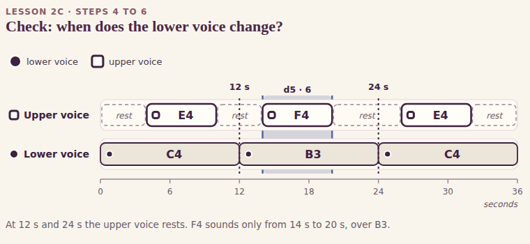](../../public/soundscape/m07/screen/2C-10.svg)

A check on the sketch: the lower voice changes at 12 and 24 seconds, but the upper voice is resting then, so F4 is never sounding when the lower note changes. F4 appears only from 14 to 20 seconds, over B3.

| | |
|---|---|
| **Lesson step** | 2C step 4, 2C step 5, 2C step 6 |
| **State** | identity colour (pair named) |
| **Provenance** | **DERIVE** · audit row 2C-10 · from M03N/F06-native.svg + overlay; week2/fixtures.ts C.moving |
| **Tokens** | IP-06 `#5366A0` |
| **Files** | [screen](../../public/soundscape/m07/screen/2C-10.svg) 760×350 · [narrow](../../public/soundscape/m07/narrow/2C-10.svg) 360×423 ([preview](previews/narrow/2C-10.png)) · [print](../../public/soundscape/m07/print/2C-10.svg) |

How to read this picture (the paragraph the lesson page owes)

Look at the two dashed markers. At each, the upper lane is a dashed rest box: no upper note is sounding. Then find the one band, 14 to 20 seconds, where F4 sits over B3. Nothing sounds as F4 over C4 in this version.

## Reused in place

These existing files are used as they are; they were not copied or redrawn.

### A-01 · Two ribbons meeting and parting (art S07)

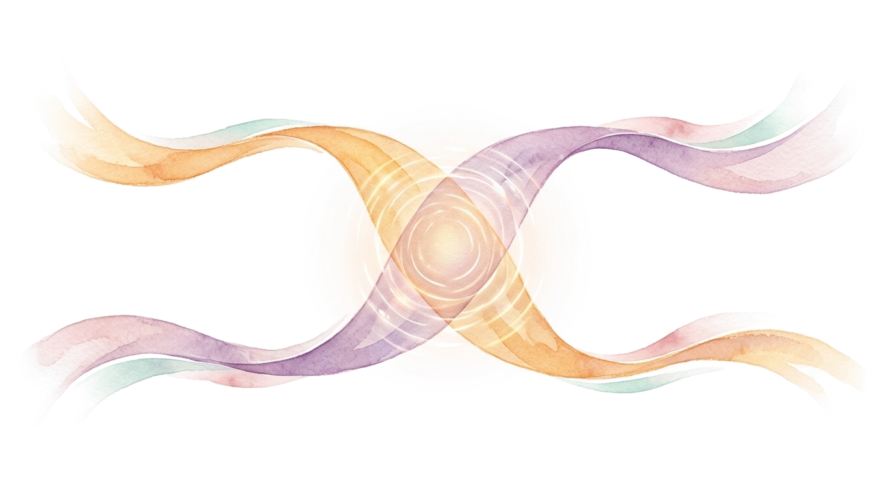

Optional atmosphere for the hub: two painted ribbons that meet and part. It carries no note, interval or measurement.

Steps: H · **REUSE** · [file](../../public/soundscape/m03/art/S07.webp) · REUSE as is. Atmosphere only; never captioned as showing a count or a colour meaning.

### A-08 · Six discovery door names (X07)

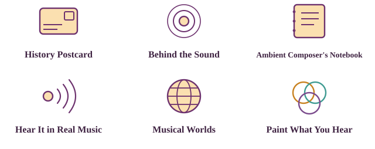

The six door names with icons on the hub. Neutral plum; no interval meaning.

Steps: H · **REUSE** · [file](../../public/soundscape/m03/native/X07-native.svg) · REUSE as is.

### A-10 · C4 then E4, and C4 with E4, major third (IPF-intro-05)

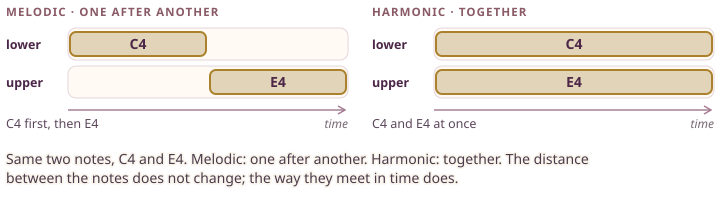

The named version of "one after another, and together": C4 and E4 in the major third colour. Used at step 5, after the pair has been named.

Steps: 2A:5 · **REUSE** · [file](../../public/soundscape/m05/info/IPF-intro-05.svg) · REUSE as is at step 5. At step 2 use the neutral derivative 2A-09.

### H-05a · Palette card 4, major third (IPF-card-04)

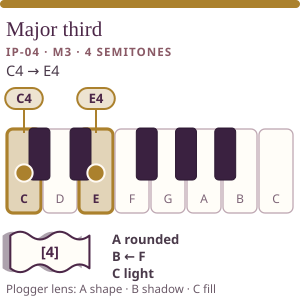

Optional pointer from the hub to the live Palette chapter for the major third (#ip-04).

Steps: H, 2A:5 · **REUSE** · [file](../../public/soundscape/m05/info/IPF-card-04.svg) · REUSE as is. Link target: Palette #ip-04.

### H-05b · Palette card 6, tritone (IPF-card-06)

Optional pointer from the hub to the live Palette chapter for the tritone (#ip-06). It shows C4 and F♯4; the lesson figure 2B-13 sets B3–F4 beside it.

Steps: H, 2B:5 · **REUSE** · [file](../../public/soundscape/m05/info/IPF-card-06.svg) · REUSE as is. Link target: Palette #ip-06.

## Art

Rule: art is atmosphere only. It sits behind or beside a factual figure, is never captioned as showing a count or a colour meaning, and does not replace any native figure. **No Nano Banana (image-model) call was justified**: the 15 existing Week 2 art files were opened and rendered below, and no teaching concept was missing a painterly image. The four new washes are deterministic vector art in the approved palette direction (warm ivory and plum with translucent amber, orchid, rose and teal).

### New vector washes (optional page atmosphere)

| | |
|---|---|
| **wash-hub** · Hub atmosphere wash [SVG](../../public/soundscape/m07/art/wash-hub.svg) · transparent, no frame |  |
| **wash-2a** · Lesson 2A atmosphere wash [SVG](../../public/soundscape/m07/art/wash-2a.svg) · transparent, no frame |  |
| **wash-2b** · Lesson 2B atmosphere wash [SVG](../../public/soundscape/m07/art/wash-2b.svg) · transparent, no frame |  |
| **wash-2c** · Lesson 2C atmosphere wash [SVG](../../public/soundscape/m07/art/wash-2c.svg) · transparent, no frame |  |

### Existing M03 Week 2 art (15 files, reused in place)

| File | Preview | Verdict |
|---|---|---|
| [S07.webp](../../public/soundscape/m03/art/S07.webp) |  | KEEP: hub atmosphere (A-01) |
| [D01.webp](../../public/soundscape/m03/art/D01.webp) |  | Optional faint accent behind a lesson opener; decorative only; spectrum palette, so never explain its colours as intervals |
| [D03.webp](../../public/soundscape/m03/art/D03.webp) |  | Optional faint accent behind a lesson opener; decorative only; spectrum palette, so never explain its colours as intervals |
| [D05.webp](../../public/soundscape/m03/art/D05.webp) |  | Optional faint accent behind a lesson opener; decorative only; spectrum palette, so never explain its colours as intervals |
| [D07.webp](../../public/soundscape/m03/art/D07.webp) |  | Optional faint accent behind a lesson opener; decorative only; spectrum palette, so never explain its colours as intervals |
| [E01.webp](../../public/soundscape/m03/art/E01.webp) |  | **DROP:** briefed as five paths but shows about four ribbons |
| [E02.webp](../../public/soundscape/m03/art/E02.webp) |  | Optional faint accent behind a lesson opener; decorative only; spectrum palette, so never explain its colours as intervals |
| [E03.webp](../../public/soundscape/m03/art/E03.webp) |  | **DROP:** briefed as moving apart but shows one converging swirl |
| [E04.webp](../../public/soundscape/m03/art/E04.webp) |  | Optional faint accent behind a lesson opener; decorative only; spectrum palette, so never explain its colours as intervals |
| [E09.webp](../../public/soundscape/m03/art/E09.webp) |  | Optional faint accent behind a lesson opener; decorative only; spectrum palette, so never explain its colours as intervals |
| [F01.webp](../../public/soundscape/m03/art/F01.webp) |  | Optional faint accent behind a lesson opener; decorative only; spectrum palette, so never explain its colours as intervals |
| [F02.webp](../../public/soundscape/m03/art/F02.webp) |  | Optional faint accent behind a lesson opener; decorative only; spectrum palette, so never explain its colours as intervals |
| [F03.webp](../../public/soundscape/m03/art/F03.webp) |  | Optional faint accent behind a lesson opener; decorative only; spectrum palette, so never explain its colours as intervals |
| [F08.webp](../../public/soundscape/m03/art/F08.webp) |  | Optional faint accent behind a lesson opener; decorative only; spectrum palette, so never explain its colours as intervals |
| [F10.webp](../../public/soundscape/m03/art/F10.webp) |  | Optional faint accent behind a lesson opener; decorative only; spectrum palette, so never explain its colours as intervals |

## Before / after

Old M03 figures (left, unchanged in the live tree) against the M07 replacements (right).

**B3–F4: octaves, tritone colour and [6] chip added; amber/teal voice colours removed**

**The five changes: one 316×1182 phone column becomes a landscape table, a stacked phone variant and a print table**

**Version B: same exact times, neutral voices, hue only on sounding pairs, 12 s / 24 s rests marked**

**Foundation can travel: window now starts at B3, octave numerals added**

**B3–F4 beside the Palette card C4–F♯4: shared tritone colour and chip**

**Recap: 8 px text rebuilt at 12 px minimum**

## Page-integrated previews

Isolated mock pages (not the live site) showing intro, the figure, the real how-to-read paragraph, the learner's own-keyboard action and step navigation. Copy is excerpted from the V2 manuscripts. HTML: [2B step 5](preview/page-2B-step5.html), [2C step 4](preview/page-2C-step4.html), [2A step 6](preview/page-2A-step6.html).

| 1280 | 390 |
|---|---|
|  |  |
|  |  |
|  |  |

## Step-by-step coverage

N = neutral, I = identity colour after the lesson names the pair. Every step of the hub and all 31 lessons steps has at least one figure; steps are never given a figure that names an answer earlier than the manuscript does.

| Step | State | Figures |
|---|---|---|
| Week 2 hub | N | H-01, H-02, H-03, H-04, H-05a, H-05b, A-01, A-02, A-08, A-12 |
| 2A step 1 · Where we are | N | H-02, A-03 |
| 2A step 2 · Two notes, two voices | N | 2A-01, 2A-09, A-04 |
| 2A step 3 · Count the letters | N | 2A-02, A-05 |
| 2A step 4 · Count the semitones | N | 2A-03, A-05 |
| 2A step 5 · Major and minor | I | 2A-04, 2A-10, A-10, A-09a, H-05a, A-12 |
| 2A step 6 · One stays, one moves | I | 2A-05, A-09a |
| 2A step 7 · The foundation can travel | I | 2A-06, A-03 |
| 2A step 8 · Three changes | I | 2A-07 |
| 2A step 9 · Make three changes | I | 2A-08, A-03 |
| 2A step 10 · Recap | I | 2A-07 |
| 2B step 1 · Where we are | N | 2B-01a |
| 2B step 2 · Two lines, each with a path | N | 2B-01a, A-04 |
| 2B step 3 · Before we name it: two journeys (inquiry only) | N | 2B-01b, A-03 |
| 2B step 4 · Three families of motion | N | 2B-02, 2B-03, 2B-04, 2B-05, 2B-11n |
| 2B step 5 · Moving apart: the tritone | I | 2B-06, 2B-13, A-09, A-11, H-05b |
| 2B step 6 · Similar motion and the word "parallel" | I | 2B-07, 2B-09, A-09, A-11 |
| 2B step 7 · Two kinds of words | N+I | 2B-12, A-06 |
| 2B step 8 · Five ways | I | 2B-08, 2B-03, 2B-04, 2B-05, 2B-06, 2B-07 |
| 2B step 9 · Which voice changed | I | 2B-12, 2B-08 |
| 2B step 10 · Draw a conversation | I | 2B-10, 2B-10b, 2B-11, A-07 |
| 2B step 11 · Recap | I | 2B-08, A-06, A-07 |
| 2C step 1 · Where we are | N | 2C-01, A-04 |
| 2C step 2 · Four words | N | 2C-06 |
| 2C step 3 · Version A | I | 2C-02, 2C-01 |
| 2C step 4 · Version B | I | 2C-03, 2C-10 |
| 2C step 5 · What stayed, what changed | I | 2C-04, 2C-05, 2C-10, A-09, A-07 |
| 2C step 6 · Words for movement, words for intervals | I | 2C-05, 2C-06, 2C-10 |
| 2C step 7 · Carry the keyboard in your imagination | N | A-03, A-04 |
| 2C step 8 · Plan your miniature | N | 2C-07 |
| 2C step 9 · Make your two sketches | N | 2C-07, 2C-08 |
| 2C step 10 · What you learned, and Week 3 | I | 2C-09 |

## The 18 optional doors

All 18 were reviewed against the audit: **0 new graphics**. Text-only doors stay text. Three optional candidates remain source-gated (2A Behind the Sound, 2B Musical Worlds, 2C Behind the Sound). The small door-icon strip is the existing X07 file (A-08).

## Downloads and registry

- Screen: `public/soundscape/m07/screen/<ID>.svg` · Narrow: `.../narrow/<ID>.svg` · Print: `.../print/<ID>.svg` · Art: `.../art/`
- [`registry.json`](registry.json): ID, audit row, disposition, steps, state, Palette tokens, Plogger mapping, title, alt text, teaching text, how-to-read text, sources, variants with sizes and hashes, generation provenance.
- [`PROVENANCE.md`](PROVENANCE.md) · generators: `lib/soundscape/m07/`, `scripts/m07/` · tests: `tests/m07.test.mts`.

Implementation handoff (suggested, for a later authorized step): place each ID at the step listed in its section; use the narrow file below 600 px and the print file for print stylesheets; put the how-to-read text beside the figure as the lesson paragraph (G-05); never place a figure before its step.

## QA and known caveats

- `tests/m07.test.mts`: 15 targeted tests pass (inventory, well-formed and accessible SVG, hues exactly equal `identityHex()` for the pairs each figure names and never legacy hexes or voice colours, 11 Plogger glyphs, B3–F4 and E4–G4 locks, five 2B cases restart at C4+E4, 2C bar geometry and rests at 12/24 s, no early spoilers, font size, print parity, step coverage, no literal token hexes in code).
- Previews were rendered in Chromium; no screen reader was run. Accessible `<title>`/`<desc>` and registry alt text are present on every SVG.
- Smallest text is 11.5 px (reused M05 Plogger legend) and 12 px elsewhere on the 360-wide phone variant. On a 320 px screen the narrow files scale to about 0.9, so about 10.5–11 px.
- The wide timelines (2C) rely on the narrow variant below 600 px.
- The Palette's own print download `INTERVAL_PALETTE_QUICK_PRINT_V1.svg` still uses pre-v1 hues. It is outside this work, was not copied and was not changed.
- The existing test `visual copy … verbatim` fails on the M06 baseline too, independent of this branch.
- Art and Plogger [6] follow the printed original; Plogger is a historic teaching lens, not acoustic law.
