# M08 — Week 2 transparent foreground infographics

**Status: for founder visual review. Not integrated, not deployed, not merged.** Branch `feat/ajourne-m08-week2-transparent-infographics-20261107` (from the approved round-4 pilot). M07's 50 graphics are untouched.

Every figure is a true-alpha foreground: a concept-specific glass-and-watercolor frame painted by Nano Banana Pro (B4 JSON reference-lock method, approved reference bytes), with the exact native M07 facts (keys, note names, arcs, timelines, counts, labels) and a "how to read" paragraph composed inside it. No page background is baked in; the site's own page colour is a separate layer. Each asset has editable SVG (art embedded as WebP alpha plus native text and vector) and a transparent PNG, for desktop, phone and print.

## At a glance
- **Figures:** 50 (all 50 reconciled M07 rows) × 3 variants (desktop, phone, print) × SVG + PNG = 300 files
- **New model art:** 57 kept generations, **$7.87**; discarded design iterations $0.69; **total $8.56** of the $20 guard. No top-ups.
- **Alpha QA:** all PNGs pass; the pass rule is alpha min 0, max 255, and 3-px perimeter all alpha 0.
- **Model/route:** `google/gemini-3-pro-image` via OpenRouter `POST /api/v1/images`; per-figure prompt JSON at `art/<ID>.prompt.json`, ledger at `ledger.json`, manifest at `manifest.json`.

## Known limits (honest)
- The frame art is a concept-specific glass-and-watercolor frame around one clearing; the model often ignores the 'nothing enters the clearing' rule, so some frames have small motifs intruding and a few clearings are narrower than their figure, where the frame wall is mirror-tiled; tiling seams are visible on the tallest figures (2B-02, 2B-09, 2B-13, 2A-06).
- Interior plates are soft translucent ivory behind the native text so it stays legible; text is plum ink and needs a light page colour.
- Fonts are system fonts; no brand type.
- The native layer is exactly the M07 builder output plus a native how-to-read paragraph; all M07 tests apply (15, passing at M07).
- The 14K production contract linked in the request was not found on the pushed docs branch, so scope was taken from the request text, the M07 registry/manuscripts and the 50-row audit.
- No page background is baked into any PNG/SVG. Each PNG has a 3-px fully transparent perimeter; none of these are verified on a real page layout.

## Contact sheets
- [Shared references](contact/shared.jpg)
- [Week 2 hub](contact/hub.jpg)
- [Lesson 2A — Same letters, different size](contact/2A.jpg)
- [Lesson 2B — How two voices move](contact/2B.jpg)
- [Lesson 2C — Two voices through time](contact/2C.jpg)

## Shared references

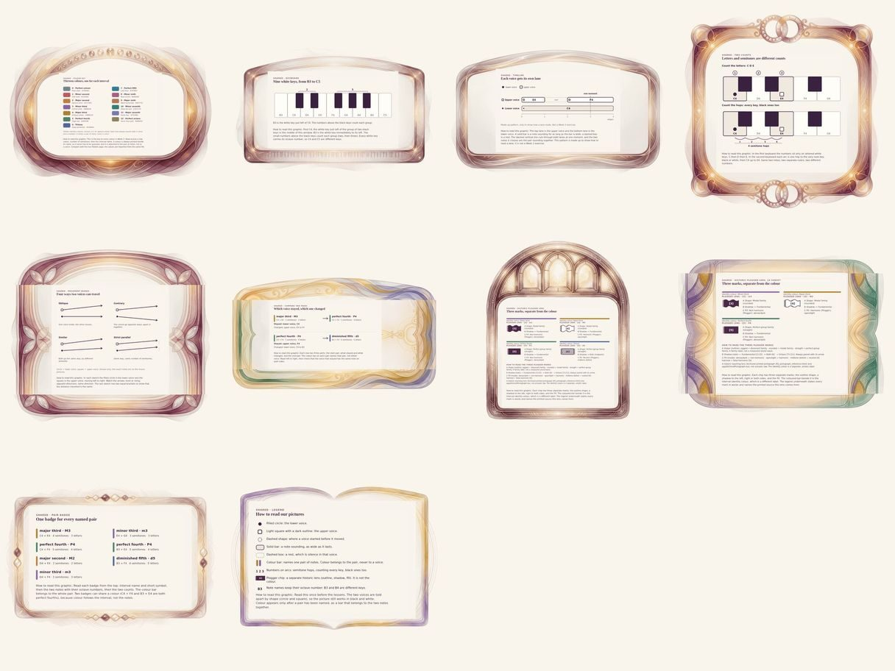

### A-02 — The thirteen interval identity colours
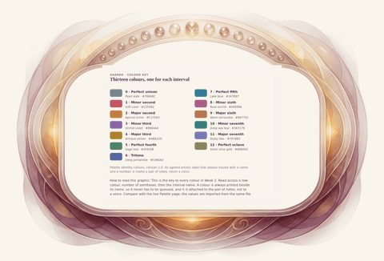

**Step(s):** H · **Status:** Derived (new context from fixtures)

**What it teaches:** The thirteen identity colours of the Interval Palette, each next to the name and semitone count it belongs to. The colour is an agreed artistic label for a pair of notes, never a property of sound.

**How to read it:** This is the key to every colour in Week 2. Read across a row: colour, number of semitones, then the interval name. A colour is always printed beside its name, so it never has to be guessed, and it is attached to the pair of notes, not to a voice. Compare with the live Palette page; the values are imported from the same file.

Files: desktop [PNG](assets/A-02/A-02.desktop.png) / [SVG](assets/A-02/A-02.desktop.svg) · phone [PNG](assets/A-02/A-02.phone.png) / [SVG](assets/A-02/A-02.phone.svg) · print [PNG](assets/A-02/A-02.print.png) / [SVG](assets/A-02/A-02.print.svg) · [proof on cream and slate](proof/A-02.proof.jpg) · art [prompt](art/A-02.prompt.json), [raw art (JPEG q93 of the original PNG; sha256 in ledger is of the PNG)](art/A-02.raw.jpg), [alpha art](art/A-02.alpha.png)

Art: sha256 `6580add7279a057a…`, $0.1381 · hues in art: none (neutral) · alpha QA: pass

### A-03 — The Week 2 keyboard window, B3 to C5
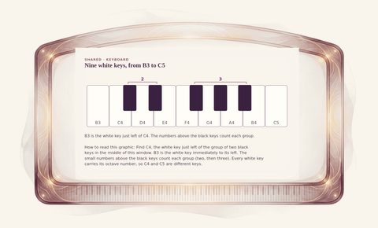

**Step(s):** 2A:1, 2A:7, 2A:9, 2B:3, 2C:7 · **Status:** Derived (new context from fixtures)

**What it teaches:** The keyboard window Week 2 uses. It starts on B3, so the note just below C4 is on the picture, and every key is named with its octave number.

**How to read it:** Find C4, the white key just left of the group of two black keys in the middle of this window. B3 is the white key immediately to its left. The small numbers above the black keys count each group (two, then three). Every white key carries its octave number, so C4 and C5 are different keys.

Files: desktop [PNG](assets/A-03/A-03.desktop.png) / [SVG](assets/A-03/A-03.desktop.svg) · phone [PNG](assets/A-03/A-03.phone.png) / [SVG](assets/A-03/A-03.phone.svg) · print [PNG](assets/A-03/A-03.print.png) / [SVG](assets/A-03/A-03.print.svg) · [proof on cream and slate](proof/A-03.proof.jpg) · art [prompt](art/A-03.prompt.json), [raw art (JPEG q93 of the original PNG; sha256 in ledger is of the PNG)](art/A-03.raw.jpg), [alpha art](art/A-03.alpha.png)

Art: sha256 `ab2e95625bf926cf…`, $0.1381 · hues in art: none (neutral) · alpha QA: pass

### A-04 — Reading a two-lane timeline
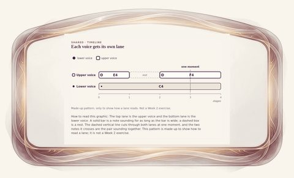

**Step(s):** 2A:2, 2B:2, 2C:1, 2C:7 · **Status:** Derived (new context from fixtures)

**What it teaches:** How a lane works: each voice has its own row, bars are notes, dashed boxes are rests, and one vertical slice is a single moment of two notes together.

**How to read it:** The top lane is the upper voice and the bottom lane is the lower voice. A solid bar is a note sounding for as long as the bar is wide; a dashed box is a rest. The dashed vertical line cuts through both lanes at one moment, and the two notes it crosses are the pair sounding together. This pattern is made up to show how to read a lane; it is not a Week 2 exercise.

Files: desktop [PNG](assets/A-04/A-04.desktop.png) / [SVG](assets/A-04/A-04.desktop.svg) · phone [PNG](assets/A-04/A-04.phone.png) / [SVG](assets/A-04/A-04.phone.svg) · print [PNG](assets/A-04/A-04.print.png) / [SVG](assets/A-04/A-04.print.svg) · [proof on cream and slate](proof/A-04.proof.jpg) · art [prompt](art/A-04.prompt.json), [raw art (JPEG q93 of the original PNG; sha256 in ledger is of the PNG)](art/A-04.raw.jpg), [alpha art](art/A-04.alpha.png)

Art: sha256 `eba9bfcff60cb208…`, $0.1381 · hues in art: none (neutral) · alpha QA: pass

### A-05 — Counting letters is not counting semitones
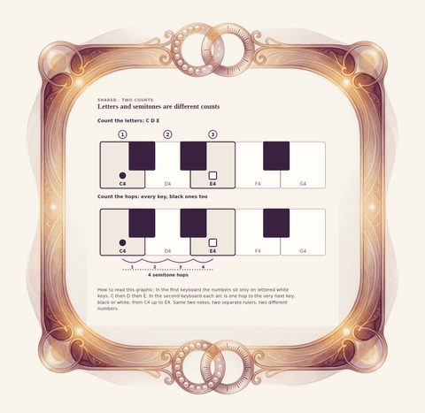

**Step(s):** 2A:3, 2A:4 · **Status:** Derived (new context from fixtures)

**What it teaches:** Two different counts for the same two notes: three letters (C, D, E) and four semitone hops from C4 to E4. The black keys count as hops but not as letters.

**How to read it:** In the first keyboard the numbers sit only on lettered white keys, C then D then E. In the second keyboard each arc is one hop to the very next key, black or white, from C4 up to E4. Same two notes, two separate rulers, two different numbers.

Files: desktop [PNG](assets/A-05/A-05.desktop.png) / [SVG](assets/A-05/A-05.desktop.svg) · phone [PNG](assets/A-05/A-05.phone.png) / [SVG](assets/A-05/A-05.phone.svg) · print [PNG](assets/A-05/A-05.print.png) / [SVG](assets/A-05/A-05.print.svg) · [proof on cream and slate](proof/A-05.proof.jpg) · art [prompt](art/A-05.prompt.json), [raw art (JPEG q93 of the original PNG; sha256 in ledger is of the PNG)](art/A-05.raw.jpg), [alpha art](art/A-05.alpha.png)

Art: sha256 `2d550594f76134f7…`, $0.1381 · hues in art: none (neutral) · alpha QA: pass

### A-06 — Four motion glyphs
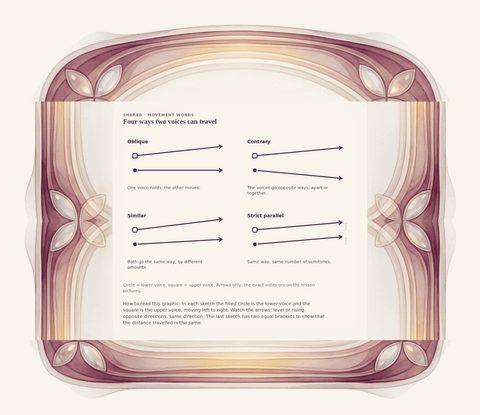

**Step(s):** 2B:7, 2B:11 · **Status:** Derived (new context from fixtures)

**What it teaches:** The four movement words as pure arrows, with no pitch names: one voice holds, voices go opposite ways, voices go the same way by different amounts, and the strict parallel case of equal amounts.

**How to read it:** In each sketch the filled circle is the lower voice and the square is the upper voice, moving left to right. Watch the arrows: level or rising, opposite directions, same direction. The last sketch has two equal brackets to show that the distance travelled is the same.

Files: desktop [PNG](assets/A-06/A-06.desktop.png) / [SVG](assets/A-06/A-06.desktop.svg) · phone [PNG](assets/A-06/A-06.phone.png) / [SVG](assets/A-06/A-06.phone.svg) · print [PNG](assets/A-06/A-06.print.png) / [SVG](assets/A-06/A-06.print.svg) · [proof on cream and slate](proof/A-06.proof.jpg) · art [prompt](art/A-06.prompt.json), [raw art (JPEG q93 of the original PNG; sha256 in ledger is of the PNG)](art/A-06.raw.jpg), [alpha art](art/A-06.alpha.png)

Art: sha256 `9ae9a7860d6c4120…`, $0.1381 · hues in art: none (neutral) · alpha QA: pass

### A-07 — What stayed, what changed
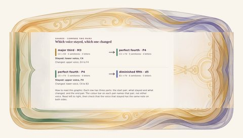

**Step(s):** 2B:10, 2B:11, 2C:5 · **Status:** Derived (new context from fixtures)

**What it teaches:** A change in a pair can be described by saying which voice stayed and which moved. The interval changes only because one voice did.

**How to read it:** Each row has three parts: the start pair, what stayed and what changed, and the end pair. The colour bar on each pair names that pair, not either voice. Read left to right, then check that the voice that stayed has the same note on both sides.

Files: desktop [PNG](assets/A-07/A-07.desktop.png) / [SVG](assets/A-07/A-07.desktop.svg) · phone [PNG](assets/A-07/A-07.phone.png) / [SVG](assets/A-07/A-07.phone.svg) · print [PNG](assets/A-07/A-07.print.png) / [SVG](assets/A-07/A-07.print.svg) · [proof on cream and slate](proof/A-07.proof.jpg) · art [prompt](art/A-07.prompt.json), [raw art (JPEG q93 of the original PNG; sha256 in ledger is of the PNG)](art/A-07.raw.jpg), [alpha art](art/A-07.alpha.png)

Art: sha256 `a757b50b1054b576…`, $0.1381 · hues in art: #AB812D, #4F816B, #5366A0 · alpha QA: pass

### A-09 — Plogger lens for the four named pairs
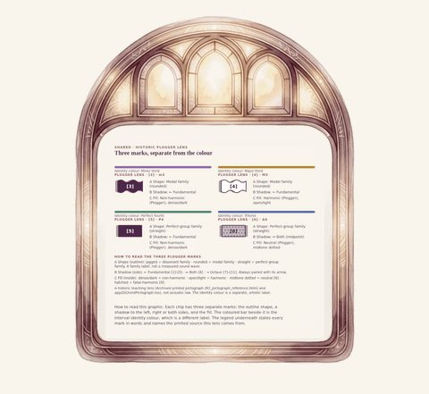

**Step(s):** 2B:5, 2B:6, 2C:5 · **Status:** Reused (native facts reused from M07/M05)

**What it teaches:** The historic Plogger lens for minor third [3], major third [4], perfect fourth [5], tritone [6]: contour is the family, shadow direction is fundamental or octave, fill is harmonicity. It is a separate label from the identity colour.

**How to read it:** Each chip has three separate marks: the outline shape, a shadow to the left, right or both sides, and the fill. The coloured bar beside it is the interval identity colour, which is a different label. The legend underneath states every mark in words and names the printed source this lens comes from.

Files: desktop [PNG](assets/A-09/A-09.desktop.png) / [SVG](assets/A-09/A-09.desktop.svg) · phone [PNG](assets/A-09/A-09.phone.png) / [SVG](assets/A-09/A-09.phone.svg) · print [PNG](assets/A-09/A-09.print.png) / [SVG](assets/A-09/A-09.print.svg) · [proof on cream and slate](proof/A-09.proof.jpg) · art [prompt](art/A-09.prompt.json), [raw art (JPEG q93 of the original PNG; sha256 in ledger is of the PNG)](art/A-09.raw.jpg), [alpha art](art/A-09.alpha.png)

Art: sha256 `5f612ccabd96728e…`, $0.1381 · hues in art: none (neutral) · alpha QA: pass

### A-09a — Plogger lens for the 2A pairs
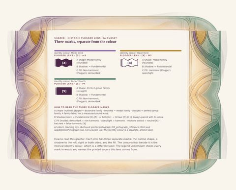

**Step(s):** 2A:5, 2A:6 · **Status:** Reused (native facts reused from M07/M05)

**What it teaches:** The historic Plogger lens for minor third [3], major third [4], perfect fourth [5]: contour is the family, shadow direction is fundamental or octave, fill is harmonicity. It is a separate label from the identity colour.

**How to read it:** Each chip has three separate marks: the outline shape, a shadow to the left, right or both sides, and the fill. The coloured bar beside it is the interval identity colour, which is a different label. The legend underneath states every mark in words and names the printed source this lens comes from.

Files: desktop [PNG](assets/A-09a/A-09a.desktop.png) / [SVG](assets/A-09a/A-09a.desktop.svg) · phone [PNG](assets/A-09a/A-09a.phone.png) / [SVG](assets/A-09a/A-09a.phone.svg) · print [PNG](assets/A-09a/A-09a.print.png) / [SVG](assets/A-09a/A-09a.print.svg) · [proof on cream and slate](proof/A-09a.proof.jpg) · art [prompt](art/A-09a.prompt.json), [raw art (JPEG q93 of the original PNG; sha256 in ledger is of the PNG)](art/A-09a.raw.jpg), [alpha art](art/A-09a.alpha.png)

Art: sha256 `1bcdbd99d2a1ec69…`, $0.1381 · hues in art: #8964A4, #AB812D, #4F816B · alpha QA: pass

### A-11 — Pair badges used in Week 2
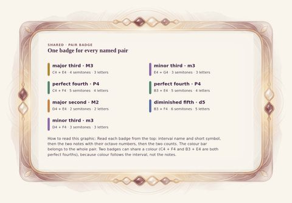

**Step(s):** 2B:5, 2B:6 · **Status:** Derived (new context from fixtures)

**What it teaches:** The one badge every named pair in Week 2 uses: colour bar, interval name, the two actual notes, semitones and letters. The same badge appears in every lesson.

**How to read it:** Read each badge from the top: interval name and short symbol, then the two notes with their octave numbers, then the two counts. The colour bar belongs to the whole pair. Two badges can share a colour (C4 + F4 and B3 + E4 are both perfect fourths), because colour follows the interval, not the notes.

Files: desktop [PNG](assets/A-11/A-11.desktop.png) / [SVG](assets/A-11/A-11.desktop.svg) · phone [PNG](assets/A-11/A-11.phone.png) / [SVG](assets/A-11/A-11.phone.svg) · print [PNG](assets/A-11/A-11.print.png) / [SVG](assets/A-11/A-11.print.svg) · [proof on cream and slate](proof/A-11.proof.jpg) · art [prompt](art/A-11.prompt.json), [raw art (JPEG q93 of the original PNG; sha256 in ledger is of the PNG)](art/A-11.raw.jpg), [alpha art](art/A-11.alpha.png)

Art: sha256 `70ced4d9c955c4d2…`, $0.1381 · hues in art: none (neutral) · alpha QA: pass

### A-12 — How to read our pictures
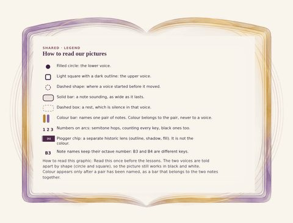

**Step(s):** H, 2A:5 · **Status:** Revised (rebuilt as transparent foreground)

**What it teaches:** The marks every Week 2 picture uses, including the rule that colour belongs to a pair of notes, not to a voice, and that shape tells the voices apart.

**How to read it:** Read this once before the lessons. The two voices are told apart by shape (circle and square), so the picture still works in black and white. Colour appears only after a pair has been named, as a bar that belongs to the two notes together.

Files: desktop [PNG](assets/A-12/A-12.desktop.png) / [SVG](assets/A-12/A-12.desktop.svg) · phone [PNG](assets/A-12/A-12.phone.png) / [SVG](assets/A-12/A-12.phone.svg) · print [PNG](assets/A-12/A-12.print.png) / [SVG](assets/A-12/A-12.print.svg) · [proof on cream and slate](proof/A-12.proof.jpg) · art [prompt](art/A-12.prompt.json), [raw art (JPEG q93 of the original PNG; sha256 in ledger is of the PNG)](art/A-12.raw.jpg), [alpha art](art/A-12.alpha.png)

Art: sha256 `9899d44c8e290d89…`, $0.1381 · hues in art: #8964A4, #AB812D · alpha QA: pass

## Week 2 hub

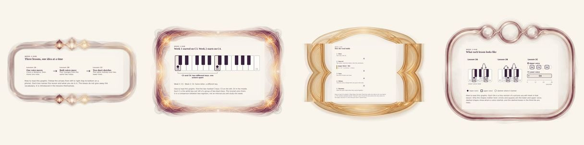

### H-01 — The Week 2 path: three lessons
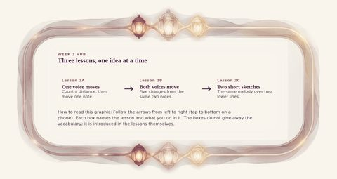

**Step(s):** H · **Status:** New

**What it teaches:** The order of the week: first one voice moves, then both voices move, then two short sketches put the ideas to work.

**How to read it:** Follow the arrows from left to right (top to bottom on a phone). Each box names the lesson and what you do in it. The boxes do not give away the vocabulary; it is introduced in the lessons themselves.

Files: desktop [PNG](assets/H-01/H-01.desktop.png) / [SVG](assets/H-01/H-01.desktop.svg) · phone [PNG](assets/H-01/H-01.phone.png) / [SVG](assets/H-01/H-01.phone.svg) · print [PNG](assets/H-01/H-01.print.png) / [SVG](assets/H-01/H-01.print.svg) · [proof on cream and slate](proof/H-01.proof.jpg) · art [prompt](art/H-01.prompt.json), [raw art (JPEG q93 of the original PNG; sha256 in ledger is of the PNG)](art/H-01.raw.jpg), [alpha art](art/H-01.alpha.png)

Art: sha256 `630b19ad4b1b281e…`, $0.1382 · hues in art: none (neutral) · alpha QA: pass

### H-02 — Week 1 used C3; Week 2 starts at C4
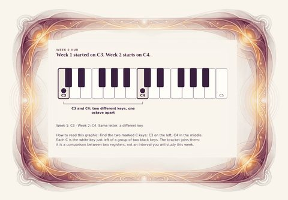

**Step(s):** H, 2A:1 · **Status:** New

**What it teaches:** Week 1 started on C3 and Week 2 starts on C4. They are different keys, one octave apart, and not the same pitch.

**How to read it:** Find the two marked C keys: C3 on the left, C4 in the middle. Each C is the white key just left of a group of two black keys. The bracket joins them; it is a comparison between two registers, not an interval you will study this week.

Files: desktop [PNG](assets/H-02/H-02.desktop.png) / [SVG](assets/H-02/H-02.desktop.svg) · phone [PNG](assets/H-02/H-02.phone.png) / [SVG](assets/H-02/H-02.phone.svg) · print [PNG](assets/H-02/H-02.print.png) / [SVG](assets/H-02/H-02.print.svg) · [proof on cream and slate](proof/H-02.proof.jpg) · art [prompt](art/H-02.prompt.json), [raw art (JPEG q93 of the original PNG; sha256 in ledger is of the PNG)](art/H-02.raw.jpg), [alpha art](art/H-02.alpha.png)

Art: sha256 `f46a0fc81ca0d764…`, $0.1381 · hues in art: none (neutral) · alpha QA: pass

### H-03 — From a note to harmony
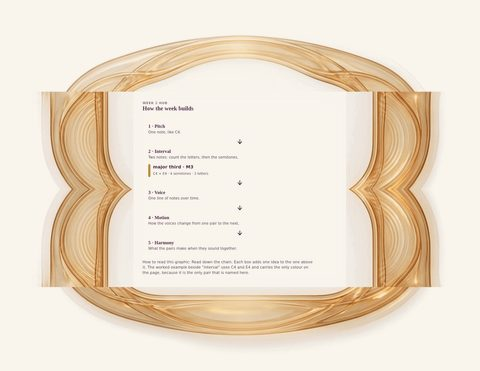

**Step(s):** H · **Status:** New

**What it teaches:** How the week's ideas build on each other: a note, two notes (an interval), a line of notes (a voice), a change between pairs (motion), and what the pairs make together (harmony).

**How to read it:** Read down the chain. Each box adds one idea to the one above it. The worked example beside "interval" uses C4 and E4 and carries the only colour on the page, because it is the only pair that is named here.

Files: desktop [PNG](assets/H-03/H-03.desktop.png) / [SVG](assets/H-03/H-03.desktop.svg) · phone [PNG](assets/H-03/H-03.phone.png) / [SVG](assets/H-03/H-03.phone.svg) · print [PNG](assets/H-03/H-03.print.png) / [SVG](assets/H-03/H-03.print.svg) · [proof on cream and slate](proof/H-03.proof.jpg) · art [prompt](art/H-03.prompt.json), [raw art (JPEG q93 of the original PNG; sha256 in ledger is of the PNG)](art/H-03.raw.jpg), [alpha art](art/H-03.alpha.png)

Art: sha256 `cac4273100d83f1d…`, $0.1381 · hues in art: #AB812D · alpha QA: pass

### H-04 — Three lessons in miniature
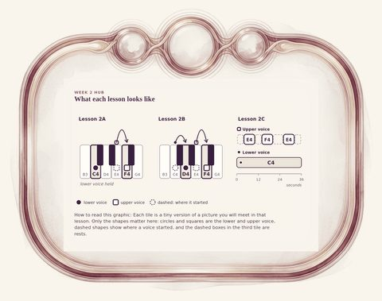

**Step(s):** H · **Status:** Derived (new context from fixtures)

**What it teaches:** A glimpse of what each lesson looks like on the page: one moving voice, two moving voices, and a timeline with rests.

**How to read it:** Each tile is a tiny version of a picture you will meet in that lesson. Only the shapes matter here: circles and squares are the lower and upper voice, dashed shapes show where a voice started, and the dashed boxes in the third tile are rests.

Files: desktop [PNG](assets/H-04/H-04.desktop.png) / [SVG](assets/H-04/H-04.desktop.svg) · phone [PNG](assets/H-04/H-04.phone.png) / [SVG](assets/H-04/H-04.phone.svg) · print [PNG](assets/H-04/H-04.print.png) / [SVG](assets/H-04/H-04.print.svg) · [proof on cream and slate](proof/H-04.proof.jpg) · art [prompt](art/H-04.prompt.json), [raw art (JPEG q93 of the original PNG; sha256 in ledger is of the PNG)](art/H-04.raw.jpg), [alpha art](art/H-04.alpha.png)

Art: sha256 `d74e6d46823abab9…`, $0.1381 · hues in art: none (neutral) · alpha QA: pass

## Lesson 2A — Same letters, different size

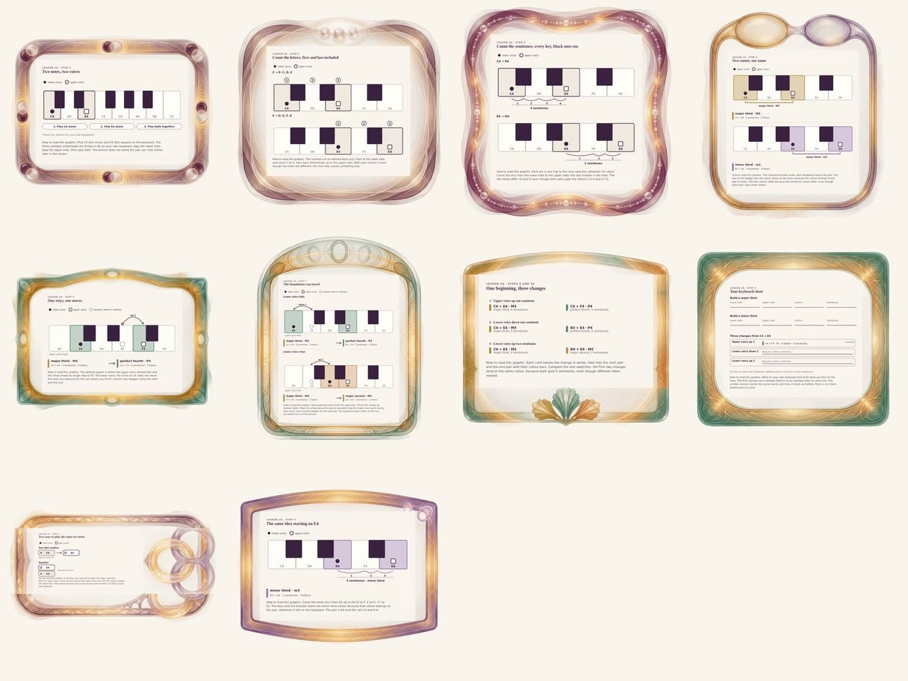

### 2A-01 — Two notes, two voices: C4 and E4
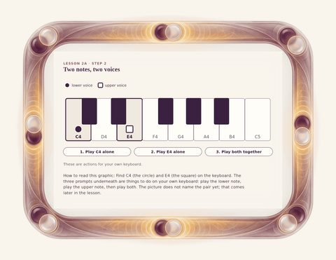

**Step(s):** 2A:2 · **Status:** Revised (rebuilt as transparent foreground)

**What it teaches:** Two notes can be two voices: a lower one and an upper one. You play C4, then E4, then both together, on your own keyboard.

**How to read it:** Find C4 (the circle) and E4 (the square) on the keyboard. The three prompts underneath are things to do on your own keyboard: play the lower note, play the upper note, then play both. The picture does not name the pair yet; that comes later in the lesson.

Files: desktop [PNG](assets/2A-01/2A-01.desktop.png) / [SVG](assets/2A-01/2A-01.desktop.svg) · phone [PNG](assets/2A-01/2A-01.phone.png) / [SVG](assets/2A-01/2A-01.phone.svg) · print [PNG](assets/2A-01/2A-01.print.png) / [SVG](assets/2A-01/2A-01.print.svg) · [proof on cream and slate](proof/2A-01.proof.jpg) · art [prompt](art/2A-01.prompt.json), [raw art (JPEG q93 of the original PNG; sha256 in ledger is of the PNG)](art/2A-01.raw.jpg), [alpha art](art/2A-01.alpha.png)

Art: sha256 `238b168c948540b2…`, $0.1381 · hues in art: none (neutral) · alpha QA: pass

### 2A-02 — Count the letters: C D E and E F G
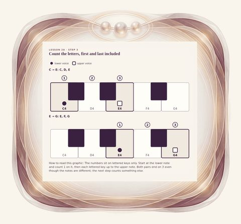

**Step(s):** 2A:3 · **Status:** New

**What it teaches:** Counting letters, first and last included: C to E is three letters, and E to G is also three letters. At this point no semitones are counted.

**How to read it:** The numbers sit on lettered keys only. Start at the lower note and count 1 on it, then each lettered key up to the upper note. Both pairs end on 3 even though the notes are different; the next step counts something else.

Files: desktop [PNG](assets/2A-02/2A-02.desktop.png) / [SVG](assets/2A-02/2A-02.desktop.svg) · phone [PNG](assets/2A-02/2A-02.phone.png) / [SVG](assets/2A-02/2A-02.phone.svg) · print [PNG](assets/2A-02/2A-02.print.png) / [SVG](assets/2A-02/2A-02.print.svg) · [proof on cream and slate](proof/2A-02.proof.jpg) · art [prompt](art/2A-02.prompt.json), [raw art (JPEG q93 of the original PNG; sha256 in ledger is of the PNG)](art/2A-02.raw.jpg), [alpha art](art/2A-02.alpha.png)

Art: sha256 `5f61310f3182ffaf…`, $0.1381 · hues in art: none (neutral) · alpha QA: pass

### 2A-03 — Count the semitones: every key counts
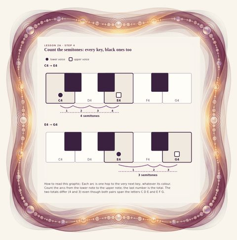

**Step(s):** 2A:4 · **Status:** Derived (new context from fixtures)

**What it teaches:** Semitones count every key, black or white. C4 to E4 is four hops and E4 to G4 is three hops, although both span three letters.

**How to read it:** Each arc is one hop to the very next key, whatever its colour. Count the arcs from the lower note to the upper note; the last number is the total. The two totals differ (4 and 3) even though both pairs span the letters C D E and E F G.

Files: desktop [PNG](assets/2A-03/2A-03.desktop.png) / [SVG](assets/2A-03/2A-03.desktop.svg) · phone [PNG](assets/2A-03/2A-03.phone.png) / [SVG](assets/2A-03/2A-03.phone.svg) · print [PNG](assets/2A-03/2A-03.print.png) / [SVG](assets/2A-03/2A-03.print.svg) · [proof on cream and slate](proof/2A-03.proof.jpg) · art [prompt](art/2A-03.prompt.json), [raw art (JPEG q93 of the original PNG; sha256 in ledger is of the PNG)](art/2A-03.raw.jpg), [alpha art](art/2A-03.alpha.png)

Art: sha256 `3cc3475bdb16578c…`, $0.1381 · hues in art: none (neutral) · alpha QA: pass

### 2A-04 — Same letters, different size: major and minor third
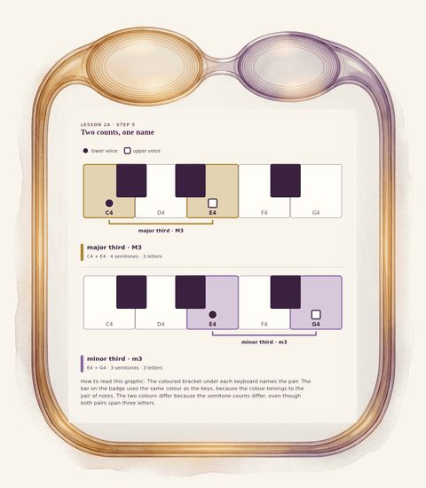

**Step(s):** 2A:5 · **Status:** New

**What it teaches:** Two thirds, three letters each, but four semitones (major third) against three (minor third). E4 and G4 are an actual minor third with its own colour, not the Palette's C4 and E♭4.

**How to read it:** The coloured bracket under each keyboard names the pair. The bar on the badge uses the same colour as the keys, because the colour belongs to the pair of notes. The two colours differ because the semitone counts differ, even though both pairs span three letters.

Files: desktop [PNG](assets/2A-04/2A-04.desktop.png) / [SVG](assets/2A-04/2A-04.desktop.svg) · phone [PNG](assets/2A-04/2A-04.phone.png) / [SVG](assets/2A-04/2A-04.phone.svg) · print [PNG](assets/2A-04/2A-04.print.png) / [SVG](assets/2A-04/2A-04.print.svg) · [proof on cream and slate](proof/2A-04.proof.jpg) · art [prompt](art/2A-04.prompt.json), [raw art (JPEG q93 of the original PNG; sha256 in ledger is of the PNG)](art/2A-04.raw.jpg), [alpha art](art/2A-04.alpha.png)

Art: sha256 `570080dfd78e17e9…`, $0.1381 · hues in art: #AB812D, #8964A4 · alpha QA: pass

### 2A-05 — One voice moves: a major third becomes a perfect fourth
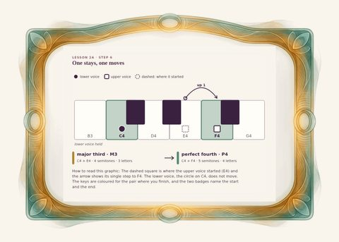

**Step(s):** 2A:6 · **Status:** Revised (rebuilt as transparent foreground)

**What it teaches:** When only the upper voice moves up by one semitone, the interval grows from a major third (4 semitones) to a perfect fourth (5). The lower voice stays on C4.

**How to read it:** The dashed square is where the upper voice started (E4) and the arrow shows its single step to F4. The lower voice, the circle on C4, does not move. The keys are coloured for the pair where you finish, and the two badges name the start and the end.

Files: desktop [PNG](assets/2A-05/2A-05.desktop.png) / [SVG](assets/2A-05/2A-05.desktop.svg) · phone [PNG](assets/2A-05/2A-05.phone.png) / [SVG](assets/2A-05/2A-05.phone.svg) · print [PNG](assets/2A-05/2A-05.print.png) / [SVG](assets/2A-05/2A-05.print.svg) · [proof on cream and slate](proof/2A-05.proof.jpg) · art [prompt](art/2A-05.prompt.json), [raw art (JPEG q93 of the original PNG; sha256 in ledger is of the PNG)](art/2A-05.raw.jpg), [alpha art](art/2A-05.alpha.png)

Art: sha256 `434b175d723a78ac…`, $0.1381 · hues in art: #AB812D, #4F816B · alpha QA: pass

### 2A-06 — The foundation can travel
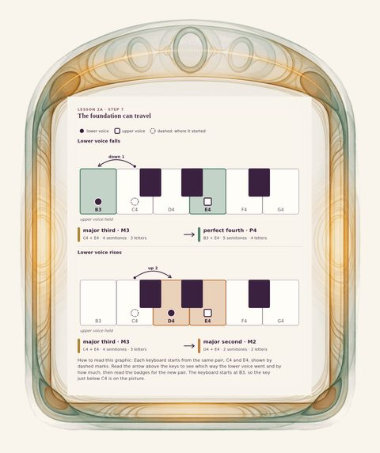

**Step(s):** 2A:7 · **Status:** Revised (rebuilt as transparent foreground)

**What it teaches:** The lower voice can move too. C4 down to B3 under E4 makes a perfect fourth (5 semitones); C4 up to D4 makes a major second (2 semitones).

**How to read it:** Each keyboard starts from the same pair, C4 and E4, shown by dashed marks. Read the arrow above the keys to see which way the lower voice went and by how much, then read the badges for the new pair. The keyboard starts at B3, so the key just below C4 is on the picture.

Files: desktop [PNG](assets/2A-06/2A-06.desktop.png) / [SVG](assets/2A-06/2A-06.desktop.svg) · phone [PNG](assets/2A-06/2A-06.phone.png) / [SVG](assets/2A-06/2A-06.phone.svg) · print [PNG](assets/2A-06/2A-06.print.png) / [SVG](assets/2A-06/2A-06.print.svg) · [proof on cream and slate](proof/2A-06.proof.jpg) · art [prompt](art/2A-06.prompt.json), [raw art (JPEG q93 of the original PNG; sha256 in ledger is of the PNG)](art/2A-06.raw.jpg), [alpha art](art/2A-06.alpha.png)

Art: sha256 `9517f1e690397cc7…`, $0.1381 · hues in art: #AB812D, #4F816B, #C17D41 · alpha QA: pass

### 2A-07 — Three changes from one beginning
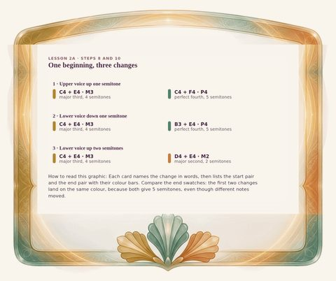

**Step(s):** 2A:8, 2A:10 · **Status:** Derived (new context from fixtures)

**What it teaches:** One beginning, three small changes, three different results: perfect fourth, perfect fourth, major second. The summary the lesson ends on.

**How to read it:** Each card names the change in words, then lists the start pair and the end pair with their colour bars. Compare the end swatches: the first two changes land on the same colour, because both give 5 semitones, even though different notes moved.

Files: desktop [PNG](assets/2A-07/2A-07.desktop.png) / [SVG](assets/2A-07/2A-07.desktop.svg) · phone [PNG](assets/2A-07/2A-07.phone.png) / [SVG](assets/2A-07/2A-07.phone.svg) · print [PNG](assets/2A-07/2A-07.print.png) / [SVG](assets/2A-07/2A-07.print.svg) · [proof on cream and slate](proof/2A-07.proof.jpg) · art [prompt](art/2A-07.prompt.json), [raw art (JPEG q93 of the original PNG; sha256 in ledger is of the PNG)](art/2A-07.raw.jpg), [alpha art](art/2A-07.alpha.png)

Art: sha256 `983ca18100334696…`, $0.1382 · hues in art: #AB812D, #4F816B, #C17D41 · alpha QA: pass

### 2A-08 — Your keyboard sheet: build, then change
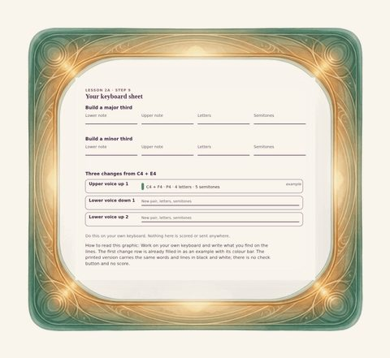

**Step(s):** 2A:9 · **Status:** Revised (rebuilt as transparent foreground)

**What it teaches:** A paper companion for working at your own keyboard: write down the notes and counts for a major third, a minor third and three changes. Nothing is scored.

**How to read it:** Work on your own keyboard and write what you find on the lines. The first change row is already filled in as an example with its colour bar. The printed version carries the same words and lines in black and white; there is no check button and no score.

Files: desktop [PNG](assets/2A-08/2A-08.desktop.png) / [SVG](assets/2A-08/2A-08.desktop.svg) · phone [PNG](assets/2A-08/2A-08.phone.png) / [SVG](assets/2A-08/2A-08.phone.svg) · print [PNG](assets/2A-08/2A-08.print.png) / [SVG](assets/2A-08/2A-08.print.svg) · [proof on cream and slate](proof/2A-08.proof.jpg) · art [prompt](art/2A-08.prompt.json), [raw art (JPEG q93 of the original PNG; sha256 in ledger is of the PNG)](art/2A-08.raw.jpg), [alpha art](art/2A-08.alpha.png)

Art: sha256 `7c3571c200bf6c33…`, $0.1381 · hues in art: #4F816B · alpha QA: pass

### 2A-09 — One after another, and together
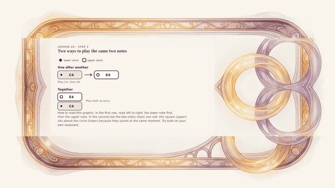

**Step(s):** 2A:2 · **Status:** Derived (new context from fixtures)

**What it teaches:** Two notes can be played one after another or at the same time. Together, the lower note sits under the upper note.

**How to read it:** In the first row, read left to right: the lower note first, then the upper note. In the second row the two notes share one slot: the square (upper) sits above the circle (lower) because they sound at the same moment. Try both on your own keyboard.

Files: desktop [PNG](assets/2A-09/2A-09.desktop.png) / [SVG](assets/2A-09/2A-09.desktop.svg) · phone [PNG](assets/2A-09/2A-09.phone.png) / [SVG](assets/2A-09/2A-09.phone.svg) · print [PNG](assets/2A-09/2A-09.print.png) / [SVG](assets/2A-09/2A-09.print.svg) · [proof on cream and slate](proof/2A-09.proof.jpg) · art [prompt](art/2A-09.prompt.json), [raw art (JPEG q93 of the original PNG; sha256 in ledger is of the PNG)](art/2A-09.raw.jpg), [alpha art](art/2A-09.alpha.png)

Art: sha256 `6d2b99a9bb7871af…`, $0.1381 · hues in art: none (neutral) · alpha QA: pass

### 2A-10 — The foundation moves: E4 and G4, a minor third
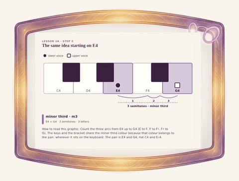

**Step(s):** 2A:5 · **Status:** Derived (new context from fixtures)

**What it teaches:** A third does not have to start on C. E4 to G4 spans three letters and three semitones: a minor third, in the minor third colour.

**How to read it:** Count the three arcs from E4 up to G4 (E to F, F to F♯, F♯ to G). The keys and the bracket share the minor third colour because that colour belongs to the pair, wherever it sits on the keyboard. The pair is E4 and G4, not C4 and E♭4.

Files: desktop [PNG](assets/2A-10/2A-10.desktop.png) / [SVG](assets/2A-10/2A-10.desktop.svg) · phone [PNG](assets/2A-10/2A-10.phone.png) / [SVG](assets/2A-10/2A-10.phone.svg) · print [PNG](assets/2A-10/2A-10.print.png) / [SVG](assets/2A-10/2A-10.print.svg) · [proof on cream and slate](proof/2A-10.proof.jpg) · art [prompt](art/2A-10.prompt.json), [raw art (JPEG q93 of the original PNG; sha256 in ledger is of the PNG)](art/2A-10.raw.jpg), [alpha art](art/2A-10.alpha.png)

Art: sha256 `b49e4e759d1055f8…`, $0.1381 · hues in art: #8964A4 · alpha QA: pass

## Lesson 2B — How two voices move

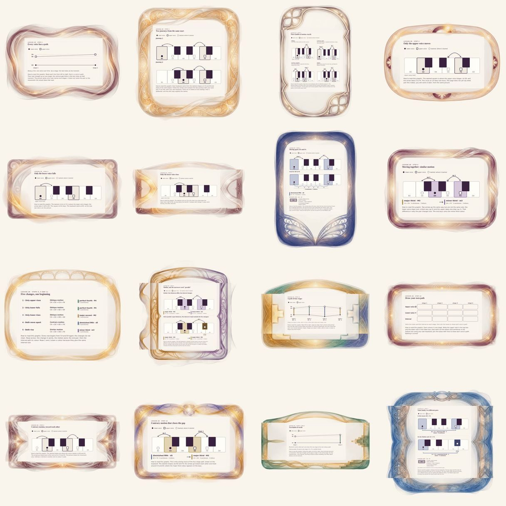

### 2B-01a — Two paths through time
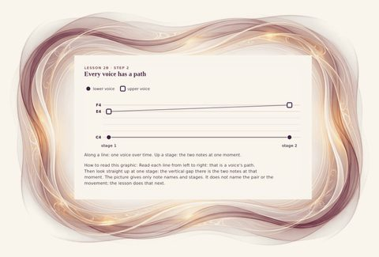

**Step(s):** 2B:1, 2B:2 · **Status:** Replaced (new design)

**What it teaches:** Each voice has its own path across time (horizontal), and at any one stage the two notes make a gap (vertical). Two directions to look in: along a path, and between the voices.

**How to read it:** Read each line from left to right: that is a voice's path. Then look straight up at one stage: the vertical gap there is the two notes at that moment. The picture gives only note names and stages. It does not name the pair or the movement; the lesson does that next.

Files: desktop [PNG](assets/2B-01a/2B-01a.desktop.png) / [SVG](assets/2B-01a/2B-01a.desktop.svg) · phone [PNG](assets/2B-01a/2B-01a.phone.png) / [SVG](assets/2B-01a/2B-01a.phone.svg) · print [PNG](assets/2B-01a/2B-01a.print.png) / [SVG](assets/2B-01a/2B-01a.print.svg) · [proof on cream and slate](proof/2B-01a.proof.jpg) · art [prompt](art/2B-01a.prompt.json), [raw art (JPEG q93 of the original PNG; sha256 in ledger is of the PNG)](art/2B-01a.raw.jpg), [alpha art](art/2B-01a.alpha.png)

Art: sha256 `6799487def93641b…`, $0.1381 · hues in art: none (neutral) · alpha QA: pass

### 2B-01b — Before we name it: two journeys
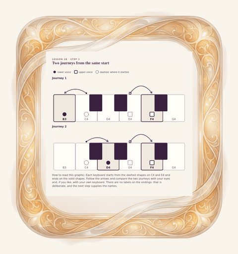

**Step(s):** 2B:3 · **Status:** Replaced (new design)

**What it teaches:** Two journeys from the same two notes. Compare them: in each, one voice does something different. The picture shows only the notes and the arrows, so you can decide what you notice before it is named.

**How to read it:** Each keyboard starts from the dashed shapes on C4 and E4 and ends on the solid shapes. Follow the arrows and compare the two journeys with your eyes and, if you like, with your own keyboard. There are no labels on the endings: that is deliberate, and the next step supplies the names.

Files: desktop [PNG](assets/2B-01b/2B-01b.desktop.png) / [SVG](assets/2B-01b/2B-01b.desktop.svg) · phone [PNG](assets/2B-01b/2B-01b.phone.png) / [SVG](assets/2B-01b/2B-01b.phone.svg) · print [PNG](assets/2B-01b/2B-01b.print.png) / [SVG](assets/2B-01b/2B-01b.print.svg) · [proof on cream and slate](proof/2B-01b.proof.jpg) · art [prompt](art/2B-01b.prompt.json), [raw art (JPEG q93 of the original PNG; sha256 in ledger is of the PNG)](art/2B-01b.raw.jpg), [alpha art](art/2B-01b.alpha.png)

Art: sha256 `a30d5bf5dffed76e…`, $0.1381 · hues in art: none (neutral) · alpha QA: pass

### 2B-02 — Three families of motion, with exact examples
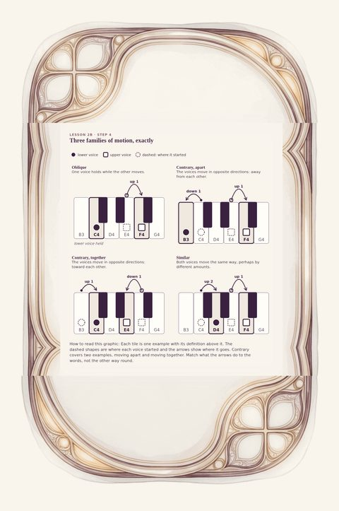

**Step(s):** 2B:4 · **Status:** Derived (new context from fixtures)

**What it teaches:** The three families of motion as exact keyboard examples: oblique, contrary (both apart and together) and similar. The narrower word "parallel" comes later, in step 6.

**How to read it:** Each tile is one example with its definition above it. The dashed shapes are where each voice started and the arrows show where it goes. Contrary covers two examples, moving apart and moving together. Match what the arrows do to the words, not the other way round.

Files: desktop [PNG](assets/2B-02/2B-02.desktop.png) / [SVG](assets/2B-02/2B-02.desktop.svg) · phone [PNG](assets/2B-02/2B-02.phone.png) / [SVG](assets/2B-02/2B-02.phone.svg) · print [PNG](assets/2B-02/2B-02.print.png) / [SVG](assets/2B-02/2B-02.print.svg) · [proof on cream and slate](proof/2B-02.proof.jpg) · art [prompt](art/2B-02.prompt.json), [raw art (JPEG q93 of the original PNG; sha256 in ledger is of the PNG)](art/2B-02.raw.jpg), [alpha art](art/2B-02.alpha.png)

Art: sha256 `19cd7d6d8b5dd5d8…`, $0.1381 · hues in art: none (neutral) · alpha QA: pass

### 2B-03 — Change 1: only the upper voice rises
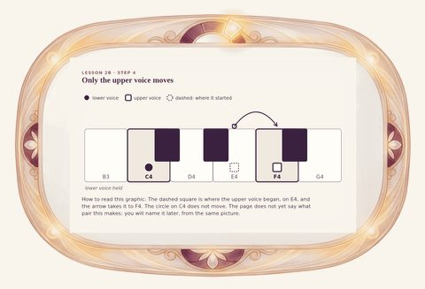

**Step(s):** 2B:4, 2B:8 · **Status:** Revised (rebuilt as transparent foreground)

**What it teaches:** The first of the five changes: C4 holds while E4 rises to F4. One voice holds and one moves, which is oblique motion.

**How to read it:** The dashed square is where the upper voice began, on E4, and the arrow takes it to F4. The circle on C4 does not move. The page does not yet say what pair this makes; you will name it later, from the same picture.

Files: desktop [PNG](assets/2B-03/2B-03.desktop.png) / [SVG](assets/2B-03/2B-03.desktop.svg) · phone [PNG](assets/2B-03/2B-03.phone.png) / [SVG](assets/2B-03/2B-03.phone.svg) · print [PNG](assets/2B-03/2B-03.print.png) / [SVG](assets/2B-03/2B-03.print.svg) · [proof on cream and slate](proof/2B-03.proof.jpg) · art [prompt](art/2B-03.prompt.json), [raw art (JPEG q93 of the original PNG; sha256 in ledger is of the PNG)](art/2B-03.raw.jpg), [alpha art](art/2B-03.alpha.png)

Art: sha256 `dbea5c9c85a16f71…`, $0.1381 · hues in art: none (neutral) · alpha QA: pass

### 2B-04 — Change 2: only the lower voice falls
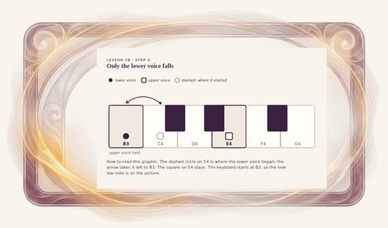

**Step(s):** 2B:4, 2B:8 · **Status:** Revised (rebuilt as transparent foreground)

**What it teaches:** The second of the five changes: E4 holds while C4 falls to B3. One voice holds, one moves, so this is also oblique.

**How to read it:** The dashed circle on C4 is where the lower voice began; the arrow takes it left to B3. The square on E4 stays. The keyboard starts at B3, so the new low note is on the picture.

Files: desktop [PNG](assets/2B-04/2B-04.desktop.png) / [SVG](assets/2B-04/2B-04.desktop.svg) · phone [PNG](assets/2B-04/2B-04.phone.png) / [SVG](assets/2B-04/2B-04.phone.svg) · print [PNG](assets/2B-04/2B-04.print.png) / [SVG](assets/2B-04/2B-04.print.svg) · [proof on cream and slate](proof/2B-04.proof.jpg) · art [prompt](art/2B-04.prompt.json), [raw art (JPEG q93 of the original PNG; sha256 in ledger is of the PNG)](art/2B-04.raw.jpg), [alpha art](art/2B-04.alpha.png)

Art: sha256 `ff6171c4bfcc61f6…`, $0.1381 · hues in art: none (neutral) · alpha QA: pass

### 2B-05 — Change 3: only the lower voice rises
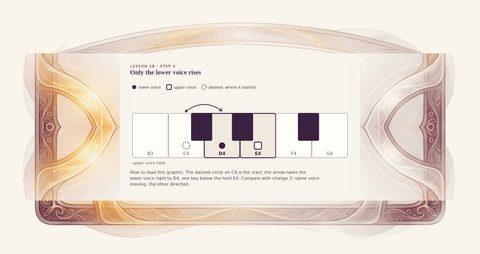

**Step(s):** 2B:4, 2B:8 · **Status:** Revised (rebuilt as transparent foreground)

**What it teaches:** The third of the five changes: E4 holds while C4 rises to D4. Again one voice holds and one moves, oblique motion, but the lower voice now moves up.

**How to read it:** The dashed circle on C4 is the start; the arrow takes the lower voice right to D4, one key below the held E4. Compare with change 2: same voice moving, the other direction.

Files: desktop [PNG](assets/2B-05/2B-05.desktop.png) / [SVG](assets/2B-05/2B-05.desktop.svg) · phone [PNG](assets/2B-05/2B-05.phone.png) / [SVG](assets/2B-05/2B-05.phone.svg) · print [PNG](assets/2B-05/2B-05.print.png) / [SVG](assets/2B-05/2B-05.print.svg) · [proof on cream and slate](proof/2B-05.proof.jpg) · art [prompt](art/2B-05.prompt.json), [raw art (JPEG q93 of the original PNG; sha256 in ledger is of the PNG)](art/2B-05.raw.jpg), [alpha art](art/2B-05.alpha.png)

Art: sha256 `b338d6e3e51fe269…`, $0.1381 · hues in art: none (neutral) · alpha QA: pass

### 2B-06 — Change 4: moving apart, B3 and F4, a diminished fifth
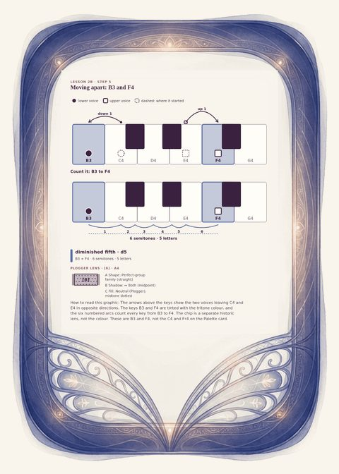

**Step(s):** 2B:5, 2B:8 · **Status:** Revised (rebuilt as transparent foreground)

**What it teaches:** Moving apart: both voices go in opposite directions, C4 down to B3 and E4 up to F4. The new pair B3 + F4 spans five letters and six semitones: a diminished fifth, shown in the tritone colour with its Plogger chip.

**How to read it:** The arrows above the keys show the two voices leaving C4 and E4 in opposite directions. The keys B3 and F4 are tinted with the tritone colour, and the six numbered arcs count every key from B3 to F4. The chip is a separate historic lens, not the colour. These are B3 and F4, not the C4 and F♯4 on the Palette card.

Files: desktop [PNG](assets/2B-06/2B-06.desktop.png) / [SVG](assets/2B-06/2B-06.desktop.svg) · phone [PNG](assets/2B-06/2B-06.phone.png) / [SVG](assets/2B-06/2B-06.phone.svg) · print [PNG](assets/2B-06/2B-06.print.png) / [SVG](assets/2B-06/2B-06.print.svg) · [proof on cream and slate](proof/2B-06.proof.jpg) · art [prompt](art/2B-06.prompt.json), [raw art (JPEG q93 of the original PNG; sha256 in ledger is of the PNG)](art/2B-06.raw.jpg), [alpha art](art/2B-06.alpha.png)

Art: sha256 `dc261f2cd5e78228…`, $0.1381 · hues in art: #5366A0 · alpha QA: pass

### 2B-07 — Change 5: both rise, a major third becomes a minor third
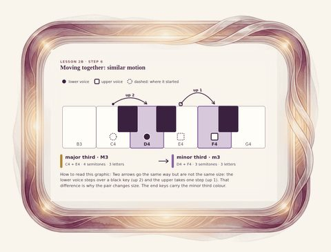

**Step(s):** 2B:6, 2B:8 · **Status:** Revised (rebuilt as transparent foreground)

**What it teaches:** Similar motion: both voices rise, the lower by 2 semitones and the upper by 1. Because the distances differ, the interval shrinks from a major third to a minor third, so this is similar and not strict parallel in this course.

**How to read it:** Two arrows go the same way but are not the same size: the lower voice steps over a black key (up 2) and the upper takes one step (up 1). That difference is why the pair changes size. The end keys carry the minor third colour.

Files: desktop [PNG](assets/2B-07/2B-07.desktop.png) / [SVG](assets/2B-07/2B-07.desktop.svg) · phone [PNG](assets/2B-07/2B-07.phone.png) / [SVG](assets/2B-07/2B-07.phone.svg) · print [PNG](assets/2B-07/2B-07.print.png) / [SVG](assets/2B-07/2B-07.print.svg) · [proof on cream and slate](proof/2B-07.proof.jpg) · art [prompt](art/2B-07.prompt.json), [raw art (JPEG q93 of the original PNG; sha256 in ledger is of the PNG)](art/2B-07.raw.jpg), [alpha art](art/2B-07.alpha.png)

Art: sha256 `d577fd95991c760a…`, $0.1382 · hues in art: none (neutral) · alpha QA: pass

### 2B-08 — The five changes, all from C4 + E4
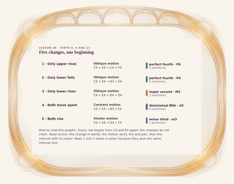

**Step(s):** 2B:8, 2B:9, 2B:11 · **Status:** Revised (rebuilt as transparent foreground)

**What it teaches:** All five changes side by side, each restarting from the same C4 + E4: which voice moves, the new pair, its interval and its semitone count.

**How to read it:** Every row begins from C4 and E4 again; the changes do not chain. Read across: the change in words, the motion word, the end pair, then the interval with its colour. Rows 1 and 2 share a colour because they give the same interval size.

Files: desktop [PNG](assets/2B-08/2B-08.desktop.png) / [SVG](assets/2B-08/2B-08.desktop.svg) · phone [PNG](assets/2B-08/2B-08.phone.png) / [SVG](assets/2B-08/2B-08.phone.svg) · print [PNG](assets/2B-08/2B-08.print.png) / [SVG](assets/2B-08/2B-08.print.svg) · [proof on cream and slate](proof/2B-08.proof.jpg) · art [prompt](art/2B-08.prompt.json), [raw art (JPEG q93 of the original PNG; sha256 in ledger is of the PNG)](art/2B-08.raw.jpg), [alpha art](art/2B-08.alpha.png)

Art: sha256 `91612ab8c99c977c…`, $0.1381 · hues in art: none (neutral) · alpha QA: pass

### 2B-09 — Similar, and strict parallel
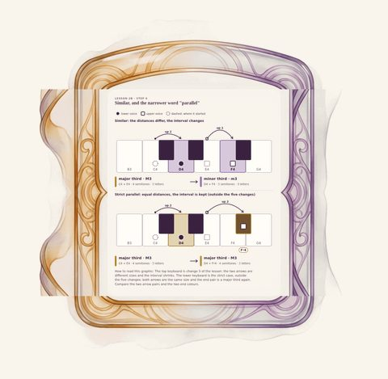

**Step(s):** 2B:6 · **Status:** New

**What it teaches:** Same direction is not always strict parallel. In the course vocabulary strict parallel needs equal distances and an unchanged interval size. Some books use the word "parallel" more widely; both uses are respectable.

**How to read it:** The top keyboard is change 5 of the lesson: the two arrows are different sizes and the interval shrinks. The lower keyboard is the strict case, outside the five changes: both arrows are the same size and the end pair is a major third again. Compare the two arrow pairs and the two end colours.

Files: desktop [PNG](assets/2B-09/2B-09.desktop.png) / [SVG](assets/2B-09/2B-09.desktop.svg) · phone [PNG](assets/2B-09/2B-09.phone.png) / [SVG](assets/2B-09/2B-09.phone.svg) · print [PNG](assets/2B-09/2B-09.print.png) / [SVG](assets/2B-09/2B-09.print.svg) · [proof on cream and slate](proof/2B-09.proof.jpg) · art [prompt](art/2B-09.prompt.json), [raw art (JPEG q93 of the original PNG; sha256 in ledger is of the PNG)](art/2B-09.raw.jpg), [alpha art](art/2B-09.alpha.png)

Art: sha256 `bc27cbf3aed194b5…`, $0.1381 · hues in art: #AB812D, #8964A4 · alpha QA: pass

### 2B-10 — A two-voice path in four stages
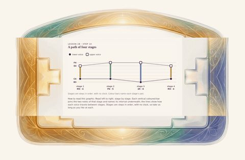

**Step(s):** 2B:10 · **Status:** Revised (rebuilt as transparent foreground)

**What it teaches:** A short path through four stages that uses the lesson's changes in a row. Each stage has its own pair and colour, and the path ends where it began.

**How to read it:** Read left to right, stage by stage. Each vertical coloured bar joins the two notes of that stage and names its interval underneath; the lines show how each voice travels between stages. Stages are steps in order, with no clock, so take as long as you like at each.

Files: desktop [PNG](assets/2B-10/2B-10.desktop.png) / [SVG](assets/2B-10/2B-10.desktop.svg) · phone [PNG](assets/2B-10/2B-10.phone.png) / [SVG](assets/2B-10/2B-10.phone.svg) · print [PNG](assets/2B-10/2B-10.print.png) / [SVG](assets/2B-10/2B-10.print.svg) · [proof on cream and slate](proof/2B-10.proof.jpg) · art [prompt](art/2B-10.prompt.json), [raw art (JPEG q93 of the original PNG; sha256 in ledger is of the PNG)](art/2B-10.raw.jpg), [alpha art](art/2B-10.alpha.png)

Art: sha256 `b01c6890b9f00d42…`, $0.1381 · hues in art: #AB812D, #4F816B, #5366A0 · alpha QA: pass

### 2B-10b — Your two-voice path sheet
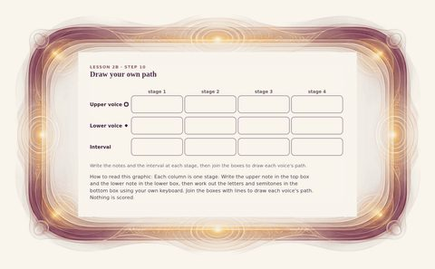

**Step(s):** 2B:10 · **Status:** Revised (rebuilt as transparent foreground)

**What it teaches:** A paper sheet for drawing your own four-stage path: write the upper and lower note at each stage, then the interval you find.

**How to read it:** Each column is one stage. Write the upper note in the top box and the lower note in the lower box, then work out the letters and semitones in the bottom box using your own keyboard. Join the boxes with lines to draw each voice's path. Nothing is scored.

Files: desktop [PNG](assets/2B-10b/2B-10b.desktop.png) / [SVG](assets/2B-10b/2B-10b.desktop.svg) · phone [PNG](assets/2B-10b/2B-10b.phone.png) / [SVG](assets/2B-10b/2B-10b.phone.svg) · print [PNG](assets/2B-10b/2B-10b.print.png) / [SVG](assets/2B-10b/2B-10b.print.svg) · [proof on cream and slate](proof/2B-10b.proof.jpg) · art [prompt](art/2B-10b.prompt.json), [raw art (JPEG q93 of the original PNG; sha256 in ledger is of the PNG)](art/2B-10b.raw.jpg), [alpha art](art/2B-10b.alpha.png)

Art: sha256 `6f297bd8bd6f8515…`, $0.1381 · hues in art: none (neutral) · alpha QA: pass

### 2B-11n — Contrary motion, together: the voices move toward each other
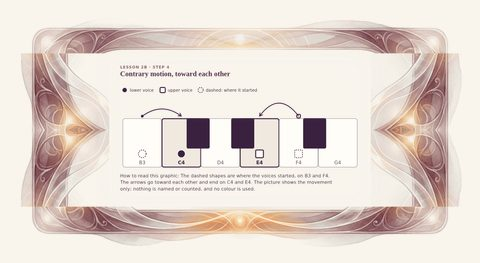

**Step(s):** 2B:4 · **Status:** Revised (rebuilt as transparent foreground)

**What it teaches:** Contrary motion also covers voices that move toward each other: the lower voice rises and the upper voice falls, and the gap between them closes.

**How to read it:** The dashed shapes are where the voices started, on B3 and F4. The arrows go toward each other and end on C4 and E4. The picture shows the movement only; nothing is named or counted, and no colour is used.

Files: desktop [PNG](assets/2B-11n/2B-11n.desktop.png) / [SVG](assets/2B-11n/2B-11n.desktop.svg) · phone [PNG](assets/2B-11n/2B-11n.phone.png) / [SVG](assets/2B-11n/2B-11n.phone.svg) · print [PNG](assets/2B-11n/2B-11n.print.png) / [SVG](assets/2B-11n/2B-11n.print.svg) · [proof on cream and slate](proof/2B-11n.proof.jpg) · art [prompt](art/2B-11n.prompt.json), [raw art (JPEG q93 of the original PNG; sha256 in ledger is of the PNG)](art/2B-11n.raw.jpg), [alpha art](art/2B-11n.alpha.png)

Art: sha256 `c8bc4d904f7a8efd…`, $0.1381 · hues in art: none (neutral) · alpha QA: pass

### 2B-11 — Contrary motion, together: B3 + F4 to C4 + E4
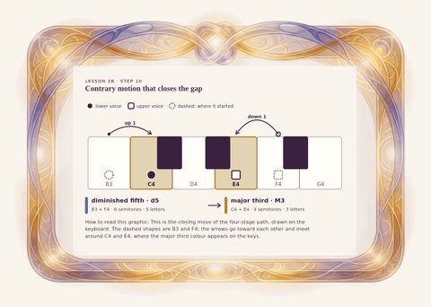

**Step(s):** 2B:10 · **Status:** Revised (rebuilt as transparent foreground)

**What it teaches:** Contrary motion can also go together: the lower voice rises one semitone and the upper falls one, closing the gap from a diminished fifth to a major third.

**How to read it:** This is the closing move of the four-stage path, drawn on the keyboard. The dashed shapes are B3 and F4; the arrows go toward each other and meet around C4 and E4, where the major third colour appears on the keys.

Files: desktop [PNG](assets/2B-11/2B-11.desktop.png) / [SVG](assets/2B-11/2B-11.desktop.svg) · phone [PNG](assets/2B-11/2B-11.phone.png) / [SVG](assets/2B-11/2B-11.phone.svg) · print [PNG](assets/2B-11/2B-11.print.png) / [SVG](assets/2B-11/2B-11.print.svg) · [proof on cream and slate](proof/2B-11.proof.jpg) · art [prompt](art/2B-11.prompt.json), [raw art (JPEG q93 of the original PNG; sha256 in ledger is of the PNG)](art/2B-11.raw.jpg), [alpha art](art/2B-11.alpha.png)

Art: sha256 `695e3085ebb8701a…`, $0.1381 · hues in art: #5366A0, #AB812D · alpha QA: pass

### 2B-12 — Two kinds of words: along a path, up a stage
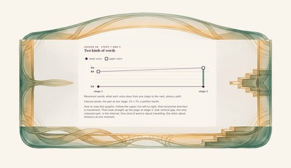

**Step(s):** 2B:7, 2B:9 · **Status:** New

**What it teaches:** Movement words (oblique, contrary, similar, parallel) describe what voices do between stages, along the path. Interval words (the names of intervals) describe a pair of notes at a single stage, up the page.

**How to read it:** Follow the upper line left to right: that horizontal direction is movement. Then look straight up the page at stage 2: that vertical gap, the only coloured part, is the interval. One kind of word is about travelling, the other about distance at one moment.

Files: desktop [PNG](assets/2B-12/2B-12.desktop.png) / [SVG](assets/2B-12/2B-12.desktop.svg) · phone [PNG](assets/2B-12/2B-12.phone.png) / [SVG](assets/2B-12/2B-12.phone.svg) · print [PNG](assets/2B-12/2B-12.print.png) / [SVG](assets/2B-12/2B-12.print.svg) · [proof on cream and slate](proof/2B-12.proof.jpg) · art [prompt](art/2B-12.prompt.json), [raw art (JPEG q93 of the original PNG; sha256 in ledger is of the PNG)](art/2B-12.raw.jpg), [alpha art](art/2B-12.alpha.png)

Art: sha256 `83a13091a11b785b…`, $0.1381 · hues in art: #4F816B · alpha QA: pass

### 2B-13 — The tritone family: B3–F4 beside the Palette card C4–F♯4
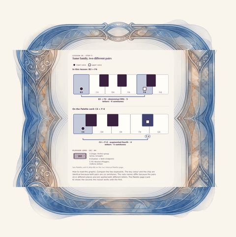

**Step(s):** 2B:5 · **Status:** Revised (rebuilt as transparent foreground)

**What it teaches:** Two different pairs, one tritone colour and one chip. B3–F4 (five letters) and C4–F♯4 (four letters) are both six semitones. The lesson uses B3–F4; the Palette card draws C4–F♯4. They are separate examples of the same family.

**How to read it:** Compare the two keyboards. The key colour and the chip are identical because both pairs are six semitones. The note names differ because the pairs sit in different places and are spelled with different letters. The Palette page (card 6) shows the second; this lesson works with the first.

Files: desktop [PNG](assets/2B-13/2B-13.desktop.png) / [SVG](assets/2B-13/2B-13.desktop.svg) · phone [PNG](assets/2B-13/2B-13.phone.png) / [SVG](assets/2B-13/2B-13.phone.svg) · print [PNG](assets/2B-13/2B-13.print.png) / [SVG](assets/2B-13/2B-13.print.svg) · [proof on cream and slate](proof/2B-13.proof.jpg) · art [prompt](art/2B-13.prompt.json), [raw art (JPEG q93 of the original PNG; sha256 in ledger is of the PNG)](art/2B-13.raw.jpg), [alpha art](art/2B-13.alpha.png)

Art: sha256 `de0874daec71b64d…`, $0.1382 · hues in art: #5366A0 · alpha QA: pass

## Lesson 2C — Two voices through time

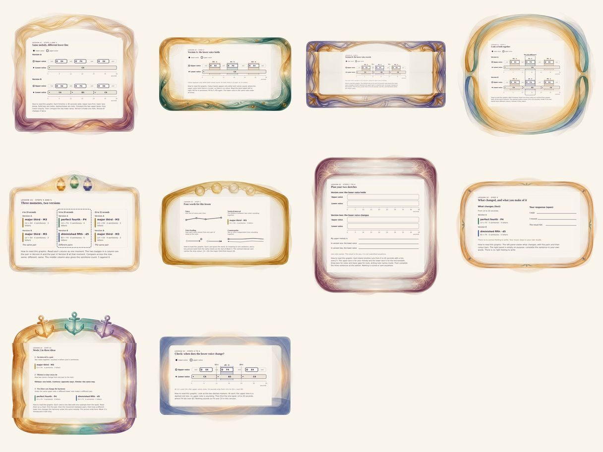

### 2C-01 — Two 36-second sketches: same upper line, different lower line
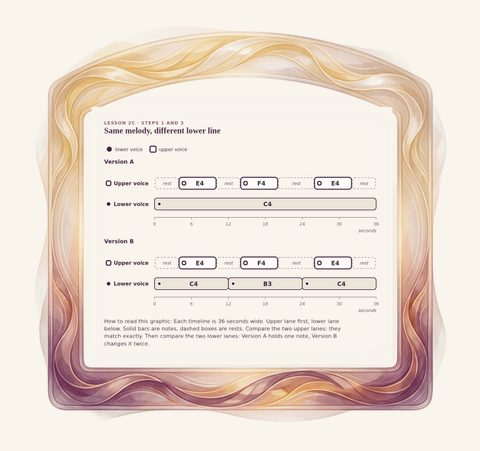

**Step(s):** 2C:1, 2C:3 · **Status:** Revised (rebuilt as transparent foreground)

**What it teaches:** Two sketches of the same melody over different lower lines. The upper line is identical in both; only the lower voice differs.

**How to read it:** Each timeline is 36 seconds wide. Upper lane first, lower lane below. Solid bars are notes, dashed boxes are rests. Compare the two upper lanes: they match exactly. Then compare the two lower lanes: Version A holds one note, Version B changes it twice.

Files: desktop [PNG](assets/2C-01/2C-01.desktop.png) / [SVG](assets/2C-01/2C-01.desktop.svg) · phone [PNG](assets/2C-01/2C-01.phone.png) / [SVG](assets/2C-01/2C-01.phone.svg) · print [PNG](assets/2C-01/2C-01.print.png) / [SVG](assets/2C-01/2C-01.print.svg) · [proof on cream and slate](proof/2C-01.proof.jpg) · art [prompt](art/2C-01.prompt.json), [raw art (JPEG q93 of the original PNG; sha256 in ledger is of the PNG)](art/2C-01.raw.jpg), [alpha art](art/2C-01.alpha.png)

Art: sha256 `a0a1a8a236404fb9…`, $0.1381 · hues in art: none (neutral) · alpha QA: pass

### 2C-02 — Version A: one voice holds the landscape
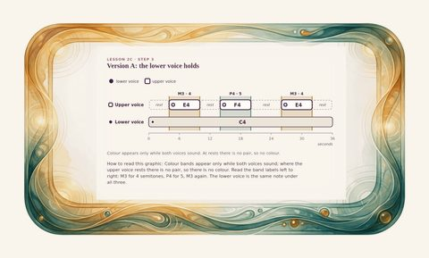

**Step(s):** 2C:3 · **Status:** Revised (rebuilt as transparent foreground)

**What it teaches:** With a held lower note, the pair changes only when the upper voice moves: C4 + E4 (major third), C4 + F4 (perfect fourth), then C4 + E4 again.

**How to read it:** Colour bands appear only while both voices sound; where the upper voice rests there is no pair, so there is no colour. Read the band labels left to right: M3 for 4 semitones, P4 for 5, M3 again. The lower voice is the same note under all three.

Files: desktop [PNG](assets/2C-02/2C-02.desktop.png) / [SVG](assets/2C-02/2C-02.desktop.svg) · phone [PNG](assets/2C-02/2C-02.phone.png) / [SVG](assets/2C-02/2C-02.phone.svg) · print [PNG](assets/2C-02/2C-02.print.png) / [SVG](assets/2C-02/2C-02.print.svg) · [proof on cream and slate](proof/2C-02.proof.jpg) · art [prompt](art/2C-02.prompt.json), [raw art (JPEG q93 of the original PNG; sha256 in ledger is of the PNG)](art/2C-02.raw.jpg), [alpha art](art/2C-02.alpha.png)

Art: sha256 `eadc891a552b4f61…`, $0.1381 · hues in art: #AB812D, #4F816B · alpha QA: pass

### 2C-03 — Version B: the landscape begins to travel
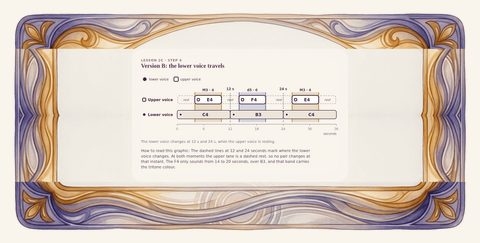

**Step(s):** 2C:4 · **Status:** Revised (rebuilt as transparent foreground)

**What it teaches:** When the lower voice moves under the same melody, one moment changes: from 14 to 20 seconds the pair is B3 + F4, a diminished fifth, instead of C4 + F4.

**How to read it:** The dashed lines at 12 and 24 seconds mark where the lower voice changes. At both moments the upper lane is a dashed rest, so no pair changes at that instant. The F4 only sounds from 14 to 20 seconds, over B3, and that band carries the tritone colour.

Files: desktop [PNG](assets/2C-03/2C-03.desktop.png) / [SVG](assets/2C-03/2C-03.desktop.svg) · phone [PNG](assets/2C-03/2C-03.phone.png) / [SVG](assets/2C-03/2C-03.phone.svg) · print [PNG](assets/2C-03/2C-03.print.png) / [SVG](assets/2C-03/2C-03.print.svg) · [proof on cream and slate](proof/2C-03.proof.jpg) · art [prompt](art/2C-03.prompt.json), [raw art (JPEG q93 of the original PNG; sha256 in ledger is of the PNG)](art/2C-03.raw.jpg), [alpha art](art/2C-03.alpha.png)

Art: sha256 `619a067d05ee3539…`, $0.1381 · hues in art: #AB812D, #5366A0 · alpha QA: pass

### 2C-04 — Same melody, one moment different: A above B
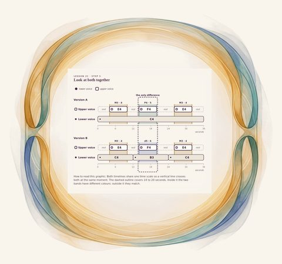

**Step(s):** 2C:5 · **Status:** Revised (rebuilt as transparent foreground)

**What it teaches:** Stack the two versions and look: the upper line and the first and last pairs are identical. Only from 14 to 20 seconds does the lower voice change what the pair is.

**How to read it:** Both timelines share one time scale so a vertical line crosses both at the same moment. The dashed outline covers 14 to 20 seconds. Inside it the two bands have different colours; outside it they match.

Files: desktop [PNG](assets/2C-04/2C-04.desktop.png) / [SVG](assets/2C-04/2C-04.desktop.svg) · phone [PNG](assets/2C-04/2C-04.phone.png) / [SVG](assets/2C-04/2C-04.phone.svg) · print [PNG](assets/2C-04/2C-04.print.png) / [SVG](assets/2C-04/2C-04.print.svg) · [proof on cream and slate](proof/2C-04.proof.jpg) · art [prompt](art/2C-04.prompt.json), [raw art (JPEG q93 of the original PNG; sha256 in ledger is of the PNG)](art/2C-04.raw.jpg), [alpha art](art/2C-04.alpha.png)

Art: sha256 `8d6c15143c4b062e…`, $0.1381 · hues in art: #AB812D, #4F816B, #5366A0 · alpha QA: pass

### 2C-05 — Three snapshots: what stayed, what changed
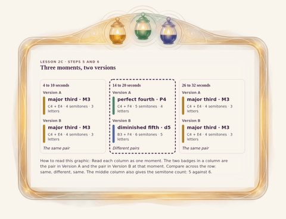

**Step(s):** 2C:5, 2C:6 · **Status:** Derived (new context from fixtures)

**What it teaches:** Three moments side by side. In two of them the two versions have the same pair; in exactly one, the middle, they differ.

**How to read it:** Read each column as one moment. The two badges in a column are the pair in Version A and the pair in Version B at that moment. Compare across the row: same, different, same. The middle column also gives the semitone count: 5 against 6.

Files: desktop [PNG](assets/2C-05/2C-05.desktop.png) / [SVG](assets/2C-05/2C-05.desktop.svg) · phone [PNG](assets/2C-05/2C-05.phone.png) / [SVG](assets/2C-05/2C-05.phone.svg) · print [PNG](assets/2C-05/2C-05.print.png) / [SVG](assets/2C-05/2C-05.print.svg) · [proof on cream and slate](proof/2C-05.proof.jpg) · art [prompt](art/2C-05.prompt.json), [raw art (JPEG q93 of the original PNG; sha256 in ledger is of the PNG)](art/2C-05.raw.jpg), [alpha art](art/2C-05.alpha.png)

Art: sha256 `d6f0349e2645b783…`, $0.1381 · hues in art: #AB812D, #4F816B, #5366A0 · alpha QA: pass

### 2C-06 — Four words: voice, vertical interval, voice leading, counterpoint

**Step(s):** 2C:2, 2C:6 · **Status:** New

**What it teaches:** Four words for the week's ideas, each with a small picture: one line, the gap between two notes at one moment, how lines travel between moments, and independent lines together.

**How to read it:** Each card gives the word, its meaning in one sentence, and a tiny picture built from the same marks as the rest of Week 2. The vertical interval card carries the only colour: C4 + E4, the major third from lesson 2A.

Files: desktop [PNG](assets/2C-06/2C-06.desktop.png) / [SVG](assets/2C-06/2C-06.desktop.svg) · phone [PNG](assets/2C-06/2C-06.phone.png) / [SVG](assets/2C-06/2C-06.phone.svg) · print [PNG](assets/2C-06/2C-06.print.png) / [SVG](assets/2C-06/2C-06.print.svg) · [proof on cream and slate](proof/2C-06.proof.jpg) · art [prompt](art/2C-06.prompt.json), [raw art (JPEG q93 of the original PNG; sha256 in ledger is of the PNG)](art/2C-06.raw.jpg), [alpha art](art/2C-06.alpha.png)

Art: sha256 `fd946b5a788c2925…`, $0.1381 · hues in art: #AB812D · alpha QA: pass

### 2C-07 — Plan your miniature: two blank timelines

**Step(s):** 2C:8, 2C:9 · **Status:** Revised (rebuilt as transparent foreground)

**What it teaches:** A paper planning sheet for your own two sketches: draw where each voice sounds and rests, write note names, and finish three plan sentences.

**How to read it:** Each blank timeline runs from 0 to 45 seconds with a tick every 5. The upper lane is for your melody and the lower lane is for the line beneath. Draw bars for notes and leave gaps for rests, writing note names inside. Then complete the three sentences at the bottom. Nothing is scored or sent anywhere.

Files: desktop [PNG](assets/2C-07/2C-07.desktop.png) / [SVG](assets/2C-07/2C-07.desktop.svg) · phone [PNG](assets/2C-07/2C-07.phone.png) / [SVG](assets/2C-07/2C-07.phone.svg) · print [PNG](assets/2C-07/2C-07.print.png) / [SVG](assets/2C-07/2C-07.print.svg) · [proof on cream and slate](proof/2C-07.proof.jpg) · art [prompt](art/2C-07.prompt.json), [raw art (JPEG q93 of the original PNG; sha256 in ledger is of the PNG)](art/2C-07.raw.jpg), [alpha art](art/2C-07.alpha.png)

Art: sha256 `c892b9a69dbfd9cd…`, $0.1381 · hues in art: none (neutral) · alpha QA: pass

### 2C-08 — What changes, and your response

**Step(s):** 2C:9 · **Status:** Revised (rebuilt as transparent foreground)

**What it teaches:** Separate what the notes did (a fact) from what you make of it (your response). The facts are shown; the response is yours and has no correct answer.

**How to read it:** The left panel states what changed, with the pairs and their colour bars. The right panel is empty on purpose: complete the sentence in your own words. There is no right feeling to write.

Files: desktop [PNG](assets/2C-08/2C-08.desktop.png) / [SVG](assets/2C-08/2C-08.desktop.svg) · phone [PNG](assets/2C-08/2C-08.phone.png) / [SVG](assets/2C-08/2C-08.phone.svg) · print [PNG](assets/2C-08/2C-08.print.png) / [SVG](assets/2C-08/2C-08.print.svg) · [proof on cream and slate](proof/2C-08.proof.jpg) · art [prompt](art/2C-08.prompt.json), [raw art (JPEG q93 of the original PNG; sha256 in ledger is of the PNG)](art/2C-08.raw.jpg), [alpha art](art/2C-08.alpha.png)

Art: sha256 `8b2094d6c42bab36…`, $0.1381 · hues in art: #4F816B, #5366A0 · alpha QA: pass

### 2C-09 — Week 2 in three anchors

**Step(s):** 2C:10 · **Status:** Revised (rebuilt as transparent foreground)

**What it teaches:** The whole week in three sentences: an interval is a pair counted two ways; motion is what two voices do between pairs; two lines are enough to make changing harmony.

**How to read it:** Each card is one idea with one example from the week. Read them as a chain: first the pair, then the movement between pairs, then how a different lower line changes the harmony under the same melody. The picture ends here; Week 3 is introduced in text only.

Files: desktop [PNG](assets/2C-09/2C-09.desktop.png) / [SVG](assets/2C-09/2C-09.desktop.svg) · phone [PNG](assets/2C-09/2C-09.phone.png) / [SVG](assets/2C-09/2C-09.phone.svg) · print [PNG](assets/2C-09/2C-09.print.png) / [SVG](assets/2C-09/2C-09.print.svg) · [proof on cream and slate](proof/2C-09.proof.jpg) · art [prompt](art/2C-09.prompt.json), [raw art (JPEG q93 of the original PNG; sha256 in ledger is of the PNG)](art/2C-09.raw.jpg), [alpha art](art/2C-09.alpha.png)

Art: sha256 `764c92bb6d2e8e49…`, $0.1381 · hues in art: #AB812D, #4F816B, #5366A0 · alpha QA: pass

### 2C-10 — The truth check: the lower voice moves while the upper rests

**Step(s):** 2C:4, 2C:5, 2C:6 · **Status:** Derived (new context from fixtures)

**What it teaches:** A check on the sketch: the lower voice changes at 12 and 24 seconds, but the upper voice is resting then, so F4 is never sounding when the lower note changes. F4 appears only from 14 to 20 seconds, over B3.

**How to read it:** Look at the two dashed markers. At each, the upper lane is a dashed rest box: no upper note is sounding. Then find the one band, 14 to 20 seconds, where F4 sits over B3. Nothing sounds as F4 over C4 in this version.

Files: desktop [PNG](assets/2C-10/2C-10.desktop.png) / [SVG](assets/2C-10/2C-10.desktop.svg) · phone [PNG](assets/2C-10/2C-10.phone.png) / [SVG](assets/2C-10/2C-10.phone.svg) · print [PNG](assets/2C-10/2C-10.print.png) / [SVG](assets/2C-10/2C-10.print.svg) · [proof on cream and slate](proof/2C-10.proof.jpg) · art [prompt](art/2C-10.prompt.json), [raw art (JPEG q93 of the original PNG; sha256 in ledger is of the PNG)](art/2C-10.raw.jpg), [alpha art](art/2C-10.alpha.png)

Art: sha256 `f998a59fa3f11b68…`, $0.1381 · hues in art: #5366A0 · alpha QA: pass

