# M08 — Week 2 transparent infographics: review index

**For founder visual review. Not integrated, not deployed, not merged.** Click any picture to open that figure's own page with the **full-size PNG** and links for phone, print and editable SVG. Each page has ⟵ / ⟶ to step through all 50 figures.

- **Zoom tip:** on a figure page click "Open the full-size … PNG directly". That opens the raw file in its own browser tab, where pinch-zoom / Ctrl+scroll / click-to-actual-size work. (Transparent areas show the browser's own backdrop; use the proof sheet to see cream and slate.)
- **Standalone viewer (zoom/pan, fit/actual size, prev/next, desktop/phone/print, background switcher):** [`viewer.html`](viewer.html). GitHub shows HTML as source, so use it from a clone/download (open the file in a browser), or [via htmlpreview](https://htmlpreview.github.io/?https://github.com/epaulson2/amf-app/blob/feat/ajourne-m08-week2-transparent-infographics-20261107/docs/m08/viewer.html) (third-party relay; it loads images from this branch).
- Full text list (previous README): [FULL_LIST.md](FULL_LIST.md) · Contact sheets: [shared](contact/shared.jpg), [hub](contact/hub.jpg), [2A](contact/2A.jpg), [2B](contact/2B.jpg), [2C](contact/2C.jpg) · [manifest.json](manifest.json) · [ledger.json](ledger.json) · [alpha QA](qa.alpha.json)

## Shared references

| | | |
|---|---|---|
| [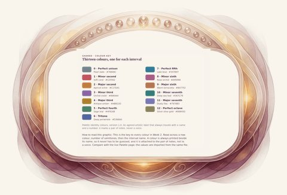 **A-02** The thirteen interval identity colours](review/A-02.desktop.md) [phone](review/A-02.phone.md) · [print](review/A-02.print.md) · [SVG](assets/A-02/A-02.desktop.svg) | [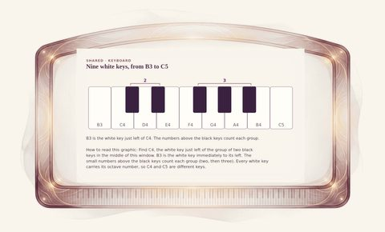 **A-03** The Week 2 keyboard window, B3 to C5](review/A-03.desktop.md) [phone](review/A-03.phone.md) · [print](review/A-03.print.md) · [SVG](assets/A-03/A-03.desktop.svg) | [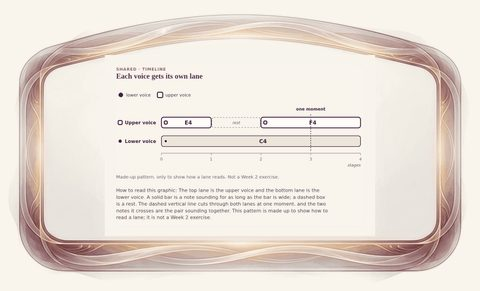 **A-04** Reading a two-lane timeline](review/A-04.desktop.md) [phone](review/A-04.phone.md) · [print](review/A-04.print.md) · [SVG](assets/A-04/A-04.desktop.svg) |
| [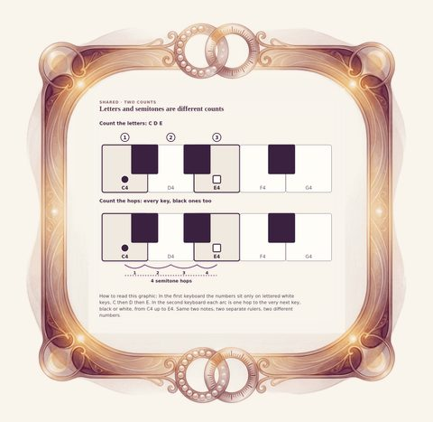 **A-05** Counting letters is not counting semitones](review/A-05.desktop.md) [phone](review/A-05.phone.md) · [print](review/A-05.print.md) · [SVG](assets/A-05/A-05.desktop.svg) | [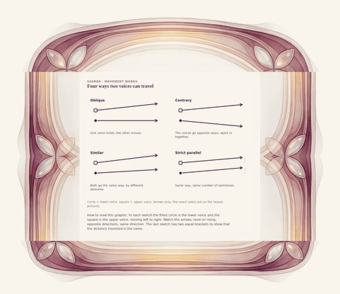 **A-06** Four motion glyphs](review/A-06.desktop.md) [phone](review/A-06.phone.md) · [print](review/A-06.print.md) · [SVG](assets/A-06/A-06.desktop.svg) | [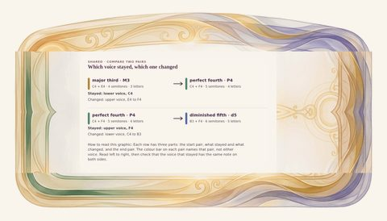 **A-07** What stayed, what changed](review/A-07.desktop.md) [phone](review/A-07.phone.md) · [print](review/A-07.print.md) · [SVG](assets/A-07/A-07.desktop.svg) |
| [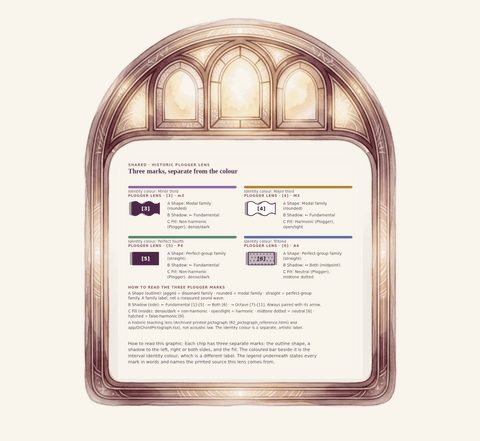 **A-09** Plogger lens for the four named pairs](review/A-09.desktop.md) [phone](review/A-09.phone.md) · [print](review/A-09.print.md) · [SVG](assets/A-09/A-09.desktop.svg) | [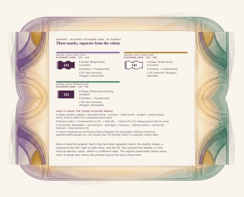 **A-09a** Plogger lens for the 2A pairs](review/A-09a.desktop.md) [phone](review/A-09a.phone.md) · [print](review/A-09a.print.md) · [SVG](assets/A-09a/A-09a.desktop.svg) | [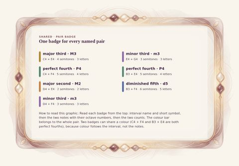 **A-11** Pair badges used in Week 2](review/A-11.desktop.md) [phone](review/A-11.phone.md) · [print](review/A-11.print.md) · [SVG](assets/A-11/A-11.desktop.svg) |
| [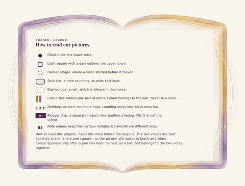 **A-12** How to read our pictures](review/A-12.desktop.md) [phone](review/A-12.phone.md) · [print](review/A-12.print.md) · [SVG](assets/A-12/A-12.desktop.svg) |  |  |

## Week 2 hub

| | | |
|---|---|---|
| [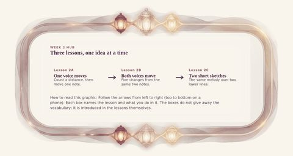 **H-01** The Week 2 path: three lessons](review/H-01.desktop.md) [phone](review/H-01.phone.md) · [print](review/H-01.print.md) · [SVG](assets/H-01/H-01.desktop.svg) | [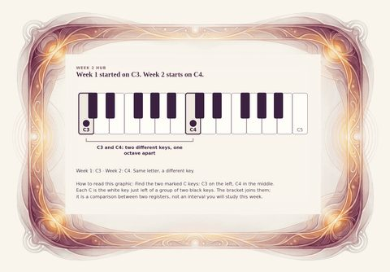 **H-02** Week 1 used C3; Week 2 starts at C4](review/H-02.desktop.md) [phone](review/H-02.phone.md) · [print](review/H-02.print.md) · [SVG](assets/H-02/H-02.desktop.svg) | [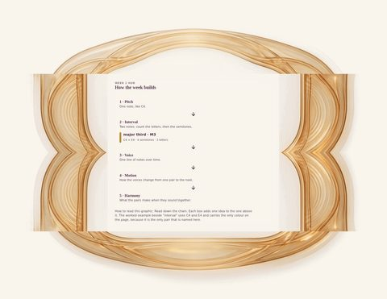 **H-03** From a note to harmony](review/H-03.desktop.md) [phone](review/H-03.phone.md) · [print](review/H-03.print.md) · [SVG](assets/H-03/H-03.desktop.svg) |
| [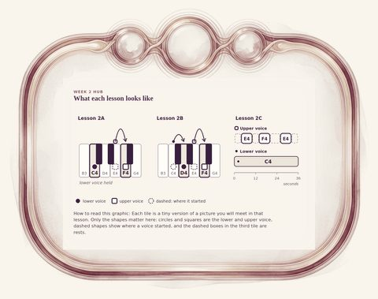 **H-04** Three lessons in miniature](review/H-04.desktop.md) [phone](review/H-04.phone.md) · [print](review/H-04.print.md) · [SVG](assets/H-04/H-04.desktop.svg) |  |  |

## Lesson 2A — Same letters, different size

| | | |
|---|---|---|
| [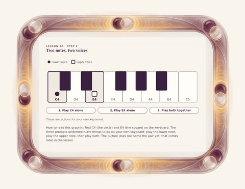 **2A-01** Two notes, two voices: C4 and E4](review/2A-01.desktop.md) [phone](review/2A-01.phone.md) · [print](review/2A-01.print.md) · [SVG](assets/2A-01/2A-01.desktop.svg) | [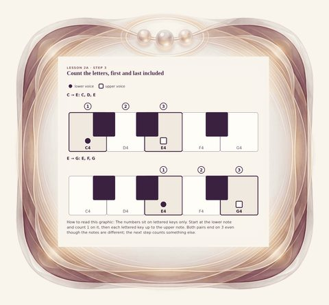 **2A-02** Count the letters: C D E and E F G](review/2A-02.desktop.md) [phone](review/2A-02.phone.md) · [print](review/2A-02.print.md) · [SVG](assets/2A-02/2A-02.desktop.svg) | [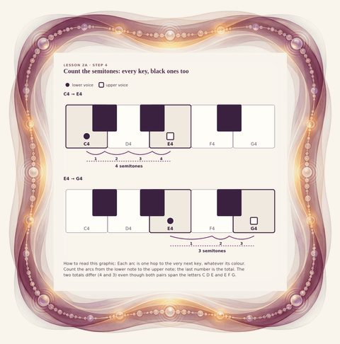 **2A-03** Count the semitones: every key counts](review/2A-03.desktop.md) [phone](review/2A-03.phone.md) · [print](review/2A-03.print.md) · [SVG](assets/2A-03/2A-03.desktop.svg) |
| [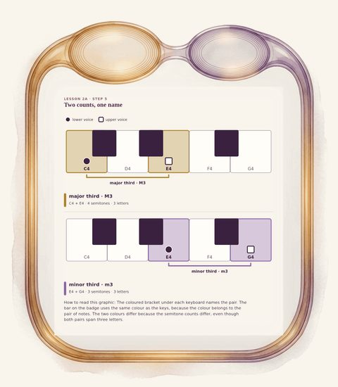 **2A-04** Same letters, different size: major and minor third](review/2A-04.desktop.md) [phone](review/2A-04.phone.md) · [print](review/2A-04.print.md) · [SVG](assets/2A-04/2A-04.desktop.svg) | [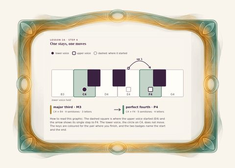 **2A-05** One voice moves: a major third becomes a perfect fourth](review/2A-05.desktop.md) [phone](review/2A-05.phone.md) · [print](review/2A-05.print.md) · [SVG](assets/2A-05/2A-05.desktop.svg) | [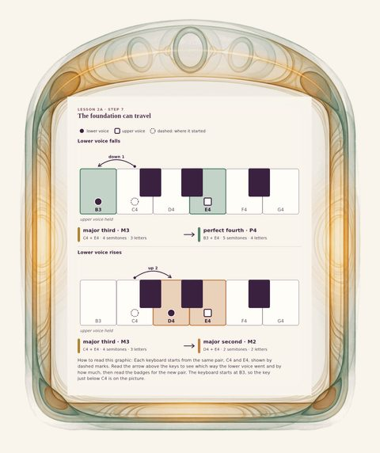 **2A-06** The foundation can travel](review/2A-06.desktop.md) [phone](review/2A-06.phone.md) · [print](review/2A-06.print.md) · [SVG](assets/2A-06/2A-06.desktop.svg) |
| [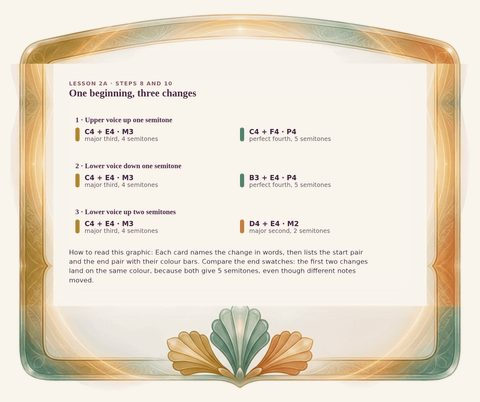 **2A-07** Three changes from one beginning](review/2A-07.desktop.md) [phone](review/2A-07.phone.md) · [print](review/2A-07.print.md) · [SVG](assets/2A-07/2A-07.desktop.svg) | [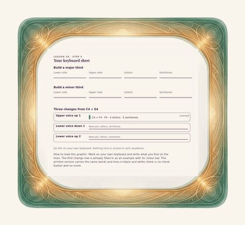 **2A-08** Your keyboard sheet: build, then change](review/2A-08.desktop.md) [phone](review/2A-08.phone.md) · [print](review/2A-08.print.md) · [SVG](assets/2A-08/2A-08.desktop.svg) | [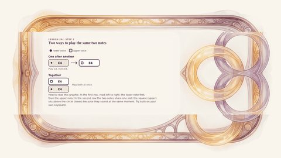 **2A-09** One after another, and together](review/2A-09.desktop.md) [phone](review/2A-09.phone.md) · [print](review/2A-09.print.md) · [SVG](assets/2A-09/2A-09.desktop.svg) |
| [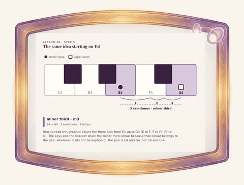 **2A-10** The foundation moves: E4 and G4, a minor third](review/2A-10.desktop.md) [phone](review/2A-10.phone.md) · [print](review/2A-10.print.md) · [SVG](assets/2A-10/2A-10.desktop.svg) |  |  |

## Lesson 2B — How two voices move

| | | |
|---|---|---|
| [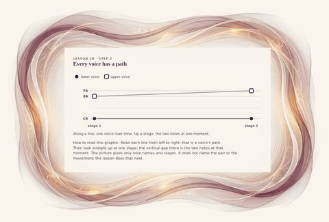 **2B-01a** Two paths through time](review/2B-01a.desktop.md) [phone](review/2B-01a.phone.md) · [print](review/2B-01a.print.md) · [SVG](assets/2B-01a/2B-01a.desktop.svg) | [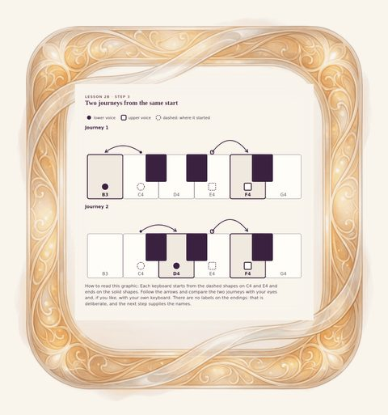 **2B-01b** Before we name it: two journeys](review/2B-01b.desktop.md) [phone](review/2B-01b.phone.md) · [print](review/2B-01b.print.md) · [SVG](assets/2B-01b/2B-01b.desktop.svg) | [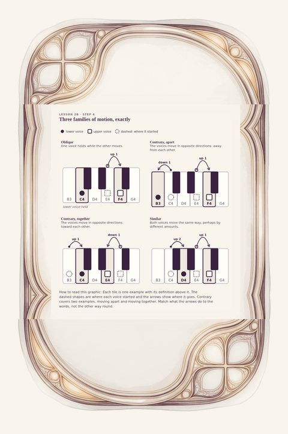 **2B-02** Three families of motion, with exact examples](review/2B-02.desktop.md) [phone](review/2B-02.phone.md) · [print](review/2B-02.print.md) · [SVG](assets/2B-02/2B-02.desktop.svg) |
| [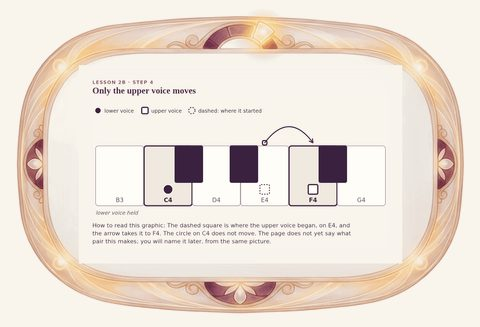 **2B-03** Change 1: only the upper voice rises](review/2B-03.desktop.md) [phone](review/2B-03.phone.md) · [print](review/2B-03.print.md) · [SVG](assets/2B-03/2B-03.desktop.svg) | [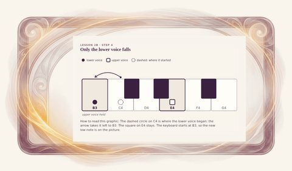 **2B-04** Change 2: only the lower voice falls](review/2B-04.desktop.md) [phone](review/2B-04.phone.md) · [print](review/2B-04.print.md) · [SVG](assets/2B-04/2B-04.desktop.svg) | [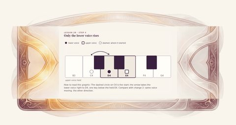 **2B-05** Change 3: only the lower voice rises](review/2B-05.desktop.md) [phone](review/2B-05.phone.md) · [print](review/2B-05.print.md) · [SVG](assets/2B-05/2B-05.desktop.svg) |
| [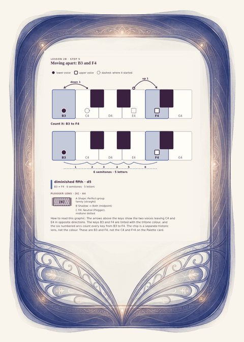 **2B-06** Change 4: moving apart, B3 and F4, a diminished fifth](review/2B-06.desktop.md) [phone](review/2B-06.phone.md) · [print](review/2B-06.print.md) · [SVG](assets/2B-06/2B-06.desktop.svg) | [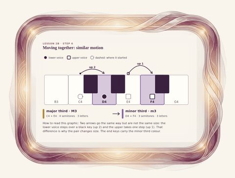 **2B-07** Change 5: both rise, a major third becomes a minor third](review/2B-07.desktop.md) [phone](review/2B-07.phone.md) · [print](review/2B-07.print.md) · [SVG](assets/2B-07/2B-07.desktop.svg) | [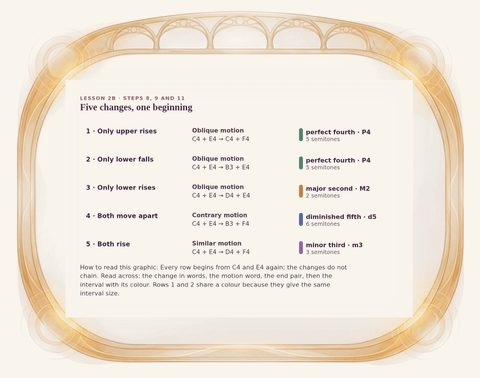 **2B-08** The five changes, all from C4 + E4](review/2B-08.desktop.md) [phone](review/2B-08.phone.md) · [print](review/2B-08.print.md) · [SVG](assets/2B-08/2B-08.desktop.svg) |
| [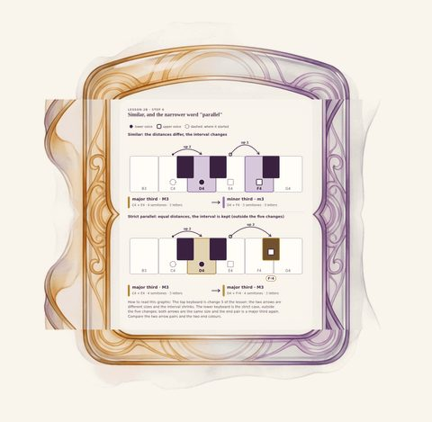 **2B-09** Similar, and strict parallel](review/2B-09.desktop.md) [phone](review/2B-09.phone.md) · [print](review/2B-09.print.md) · [SVG](assets/2B-09/2B-09.desktop.svg) | [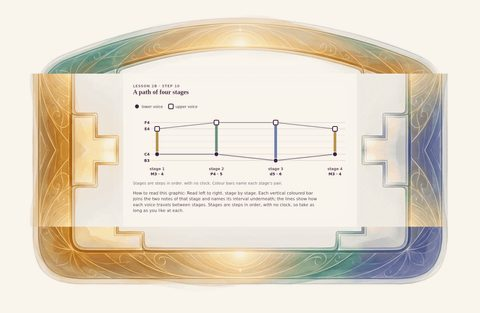 **2B-10** A two-voice path in four stages](review/2B-10.desktop.md) [phone](review/2B-10.phone.md) · [print](review/2B-10.print.md) · [SVG](assets/2B-10/2B-10.desktop.svg) | [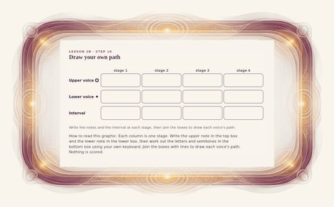 **2B-10b** Your two-voice path sheet](review/2B-10b.desktop.md) [phone](review/2B-10b.phone.md) · [print](review/2B-10b.print.md) · [SVG](assets/2B-10b/2B-10b.desktop.svg) |
| [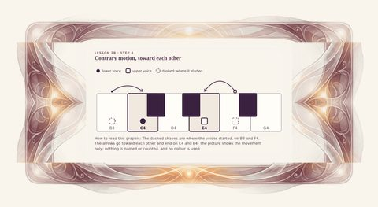 **2B-11n** Contrary motion, together: the voices move toward each other](review/2B-11n.desktop.md) [phone](review/2B-11n.phone.md) · [print](review/2B-11n.print.md) · [SVG](assets/2B-11n/2B-11n.desktop.svg) | [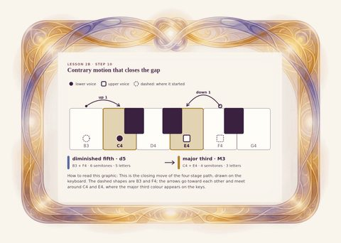 **2B-11** Contrary motion, together: B3 + F4 to C4 + E4](review/2B-11.desktop.md) [phone](review/2B-11.phone.md) · [print](review/2B-11.print.md) · [SVG](assets/2B-11/2B-11.desktop.svg) | [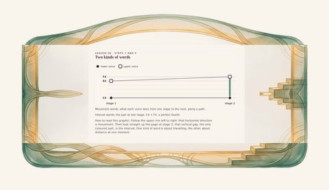 **2B-12** Two kinds of words: along a path, up a stage](review/2B-12.desktop.md) [phone](review/2B-12.phone.md) · [print](review/2B-12.print.md) · [SVG](assets/2B-12/2B-12.desktop.svg) |
| [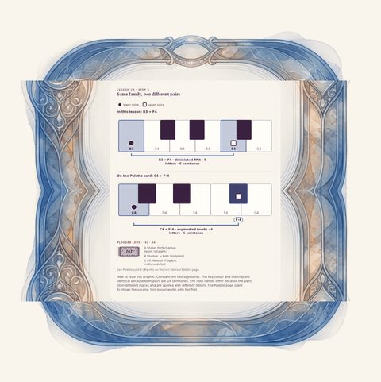 **2B-13** The tritone family: B3–F4 beside the Palette card C4–F♯4](review/2B-13.desktop.md) [phone](review/2B-13.phone.md) · [print](review/2B-13.print.md) · [SVG](assets/2B-13/2B-13.desktop.svg) |  |  |

## Lesson 2C — Two voices through time

| | | |
|---|---|---|
| [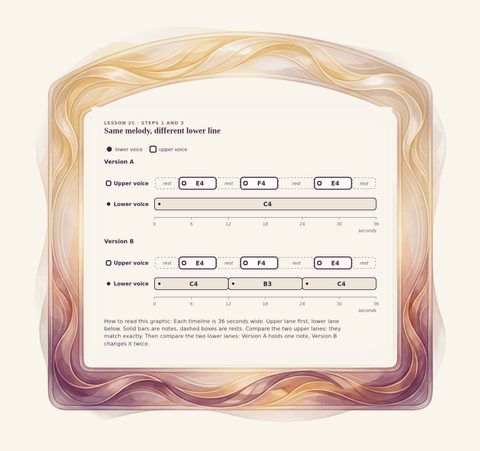 **2C-01** Two 36-second sketches: same upper line, different lower line](review/2C-01.desktop.md) [phone](review/2C-01.phone.md) · [print](review/2C-01.print.md) · [SVG](assets/2C-01/2C-01.desktop.svg) | [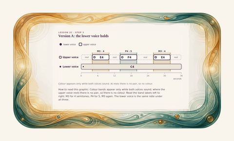 **2C-02** Version A: one voice holds the landscape](review/2C-02.desktop.md) [phone](review/2C-02.phone.md) · [print](review/2C-02.print.md) · [SVG](assets/2C-02/2C-02.desktop.svg) | [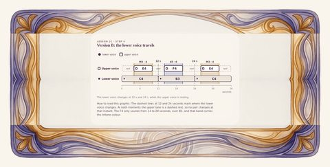 **2C-03** Version B: the landscape begins to travel](review/2C-03.desktop.md) [phone](review/2C-03.phone.md) · [print](review/2C-03.print.md) · [SVG](assets/2C-03/2C-03.desktop.svg) |
| [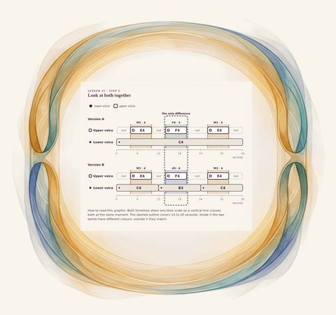 **2C-04** Same melody, one moment different: A above B](review/2C-04.desktop.md) [phone](review/2C-04.phone.md) · [print](review/2C-04.print.md) · [SVG](assets/2C-04/2C-04.desktop.svg) | [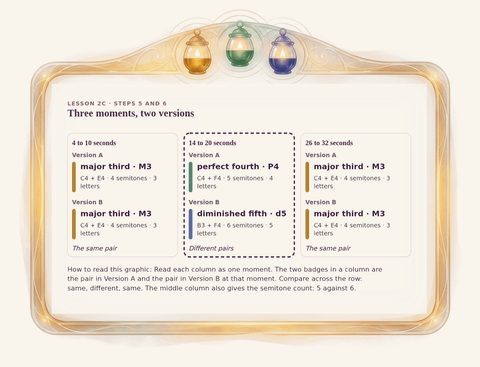 **2C-05** Three snapshots: what stayed, what changed](review/2C-05.desktop.md) [phone](review/2C-05.phone.md) · [print](review/2C-05.print.md) · [SVG](assets/2C-05/2C-05.desktop.svg) | [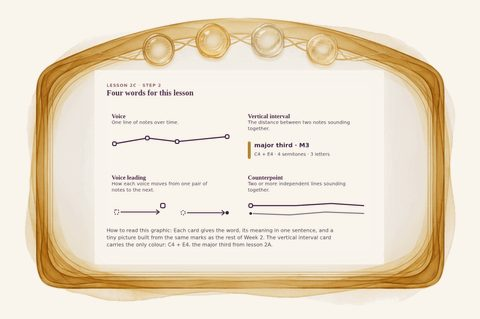 **2C-06** Four words: voice, vertical interval, voice leading, counterpoint](review/2C-06.desktop.md) [phone](review/2C-06.phone.md) · [print](review/2C-06.print.md) · [SVG](assets/2C-06/2C-06.desktop.svg) |
| [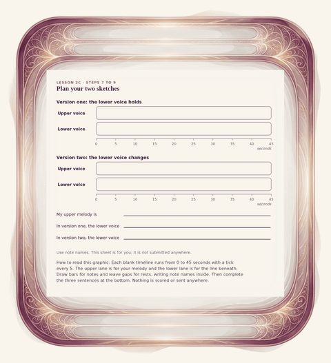 **2C-07** Plan your miniature: two blank timelines](review/2C-07.desktop.md) [phone](review/2C-07.phone.md) · [print](review/2C-07.print.md) · [SVG](assets/2C-07/2C-07.desktop.svg) | [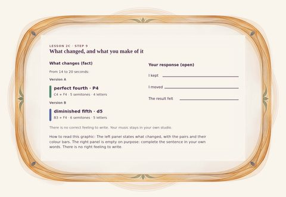 **2C-08** What changes, and your response](review/2C-08.desktop.md) [phone](review/2C-08.phone.md) · [print](review/2C-08.print.md) · [SVG](assets/2C-08/2C-08.desktop.svg) | [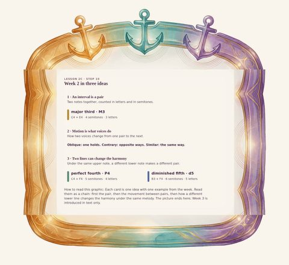 **2C-09** Week 2 in three anchors](review/2C-09.desktop.md) [phone](review/2C-09.phone.md) · [print](review/2C-09.print.md) · [SVG](assets/2C-09/2C-09.desktop.svg) |
| [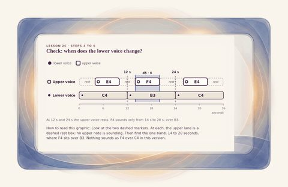 **2C-10** The truth check: the lower voice moves while the upper rests](review/2C-10.desktop.md) [phone](review/2C-10.phone.md) · [print](review/2C-10.print.md) · [SVG](assets/2C-10/2C-10.desktop.svg) |  |  |

