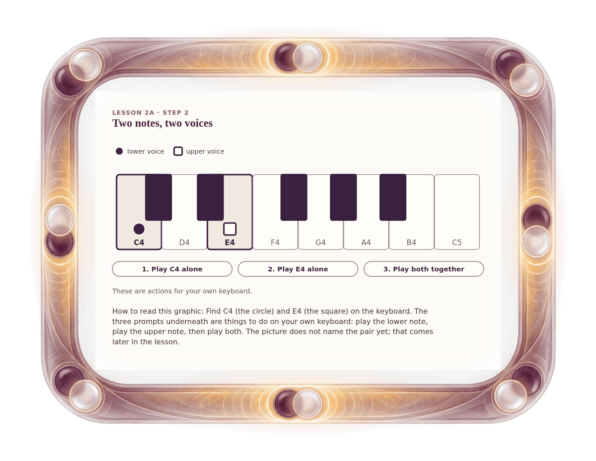

[⟵ H-04](H-04.desktop.md) · [**Index**](../README.md) · [2A-02 ⟶](2A-02.desktop.md)

# 2A-01 — Two notes, two voices: C4 and E4

**View:** **[ desktop ]** · [phone](2A-01.phone.md) · [print](2A-01.print.md)  
**Section:** Lesson 2A — Same letters, different size · **Step(s):** 2A:2 · 15 of 50

### Zoom the real file
- 🔍 **[Open the full-size desktop PNG directly (browser pinch/zoom, 332 KB)](https://github.com/epaulson2/amf-app/raw/feat/ajourne-m08-week2-transparent-infographics-20261107/docs/m08/assets/2A-01/2A-01.desktop.png)**
- [GitHub image viewer page](../assets/2A-01/2A-01.desktop.png) · [Download / view editable SVG](../assets/2A-01/2A-01.desktop.svg) ([raw SVG](https://github.com/epaulson2/amf-app/raw/feat/ajourne-m08-week2-transparent-infographics-20261107/docs/m08/assets/2A-01/2A-01.desktop.svg))

*The picture above is the actual desktop PNG file (transparent; GitHub shows it on its own page colour). Click it to open the raw full-size file.*

**What it teaches:** Two notes can be two voices: a lower one and an upper one. You play C4, then E4, then both together, on your own keyboard.

**How to read it:** Find C4 (the circle) and E4 (the square) on the keyboard. The three prompts underneath are things to do on your own keyboard: play the lower note, play the upper note, then play both. The picture does not name the pair yet; that comes later in the lesson.

All files: desktop [PNG](../assets/2A-01/2A-01.desktop.png) / [SVG](../assets/2A-01/2A-01.desktop.svg) · phone [PNG](../assets/2A-01/2A-01.phone.png) / [SVG](../assets/2A-01/2A-01.phone.svg) · print [PNG](../assets/2A-01/2A-01.print.png) / [SVG](../assets/2A-01/2A-01.print.svg) · [proof on cream and slate](../proof/2A-01.proof.jpg)

[⟵ H-04](H-04.desktop.md) · [**Index**](../README.md) · [2A-02 ⟶](2A-02.desktop.md)
