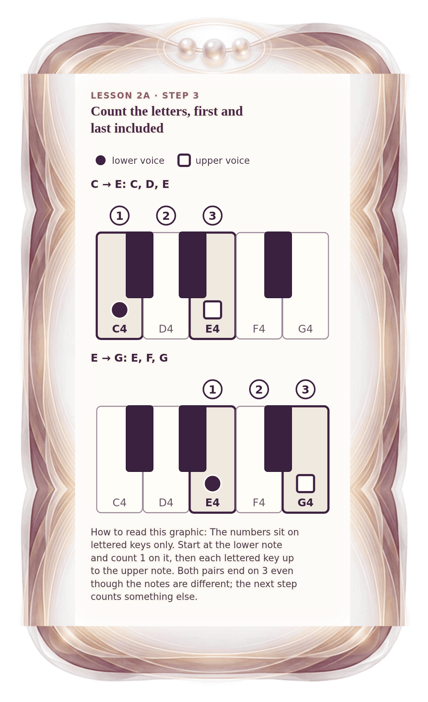

[⟵ 2A-01](2A-01.phone.md) · [**Index**](../README.md) · [2A-03 ⟶](2A-03.phone.md)

# 2A-02 — Count the letters: C D E and E F G

**View:** [desktop](2A-02.desktop.md) · **[ phone ]** · [print](2A-02.print.md)  
**Section:** Lesson 2A — Same letters, different size · **Step(s):** 2A:3 · 16 of 50

### Zoom the real file
- 🔍 **[Open the full-size phone PNG directly (browser pinch/zoom, 378 KB)](https://github.com/epaulson2/amf-app/raw/feat/ajourne-m08-week2-transparent-infographics-20261107/docs/m08/assets/2A-02/2A-02.phone.png)**
- [GitHub image viewer page](../assets/2A-02/2A-02.phone.png) · [Download / view editable SVG](../assets/2A-02/2A-02.phone.svg) ([raw SVG](https://github.com/epaulson2/amf-app/raw/feat/ajourne-m08-week2-transparent-infographics-20261107/docs/m08/assets/2A-02/2A-02.phone.svg))

*The picture above is the actual phone PNG file (transparent; GitHub shows it on its own page colour). Click it to open the raw full-size file.*

**What it teaches:** Counting letters, first and last included: C to E is three letters, and E to G is also three letters. At this point no semitones are counted.

**How to read it:** The numbers sit on lettered keys only. Start at the lower note and count 1 on it, then each lettered key up to the upper note. Both pairs end on 3 even though the notes are different; the next step counts something else.

All files: desktop [PNG](../assets/2A-02/2A-02.desktop.png) / [SVG](../assets/2A-02/2A-02.desktop.svg) · phone [PNG](../assets/2A-02/2A-02.phone.png) / [SVG](../assets/2A-02/2A-02.phone.svg) · print [PNG](../assets/2A-02/2A-02.print.png) / [SVG](../assets/2A-02/2A-02.print.svg) · [proof on cream and slate](../proof/2A-02.proof.jpg)

[⟵ 2A-01](2A-01.phone.md) · [**Index**](../README.md) · [2A-03 ⟶](2A-03.phone.md)
