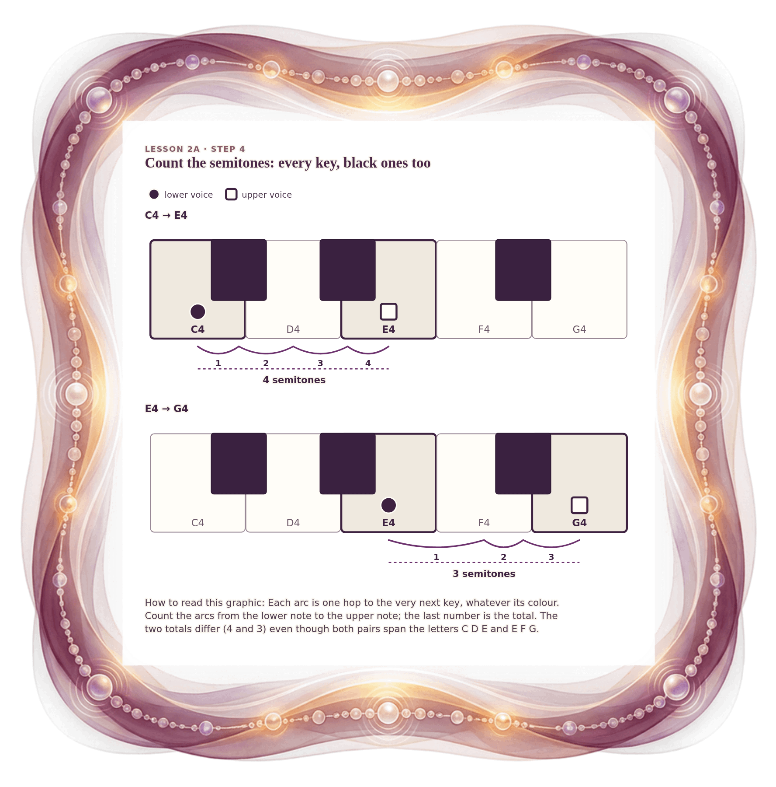

[⟵ 2A-02](2A-02.print.md) · [**Index**](../README.md) · [2A-04 ⟶](2A-04.print.md)

# 2A-03 — Count the semitones: every key counts

**View:** [desktop](2A-03.desktop.md) · [phone](2A-03.phone.md) · **[ print ]**  
**Section:** Lesson 2A — Same letters, different size · **Step(s):** 2A:4 · 17 of 50

### Zoom the real file
- 🔍 **[Open the full-size print PNG directly (browser pinch/zoom, 492 KB)](https://github.com/epaulson2/amf-app/raw/feat/ajourne-m08-week2-transparent-infographics-20261107/docs/m08/assets/2A-03/2A-03.print.png)**
- [GitHub image viewer page](../assets/2A-03/2A-03.print.png) · [Download / view editable SVG](../assets/2A-03/2A-03.print.svg) ([raw SVG](https://github.com/epaulson2/amf-app/raw/feat/ajourne-m08-week2-transparent-infographics-20261107/docs/m08/assets/2A-03/2A-03.print.svg))

*The picture above is the actual print PNG file (transparent; GitHub shows it on its own page colour). Click it to open the raw full-size file.*

**What it teaches:** Semitones count every key, black or white. C4 to E4 is four hops and E4 to G4 is three hops, although both span three letters.

**How to read it:** Each arc is one hop to the very next key, whatever its colour. Count the arcs from the lower note to the upper note; the last number is the total. The two totals differ (4 and 3) even though both pairs span the letters C D E and E F G.

All files: desktop [PNG](../assets/2A-03/2A-03.desktop.png) / [SVG](../assets/2A-03/2A-03.desktop.svg) · phone [PNG](../assets/2A-03/2A-03.phone.png) / [SVG](../assets/2A-03/2A-03.phone.svg) · print [PNG](../assets/2A-03/2A-03.print.png) / [SVG](../assets/2A-03/2A-03.print.svg) · [proof on cream and slate](../proof/2A-03.proof.jpg)

[⟵ 2A-02](2A-02.print.md) · [**Index**](../README.md) · [2A-04 ⟶](2A-04.print.md)
