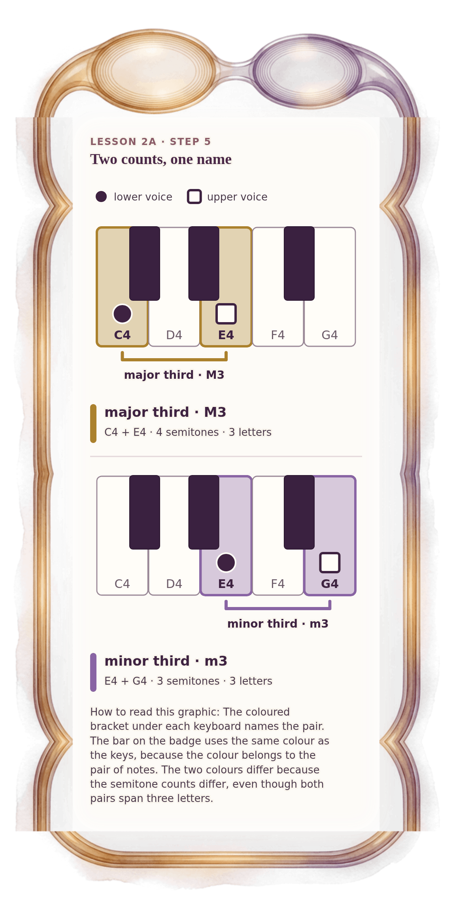

[⟵ 2A-03](2A-03.phone.md) · [**Index**](../README.md) · [2A-05 ⟶](2A-05.phone.md)

# 2A-04 — Same letters, different size: major and minor third

**View:** [desktop](2A-04.desktop.md) · **[ phone ]** · [print](2A-04.print.md)  
**Section:** Lesson 2A — Same letters, different size · **Step(s):** 2A:5 · 18 of 50

### Zoom the real file
- 🔍 **[Open the full-size phone PNG directly (browser pinch/zoom, 303 KB)](https://github.com/epaulson2/amf-app/raw/feat/ajourne-m08-week2-transparent-infographics-20261107/docs/m08/assets/2A-04/2A-04.phone.png)**
- [GitHub image viewer page](../assets/2A-04/2A-04.phone.png) · [Download / view editable SVG](../assets/2A-04/2A-04.phone.svg) ([raw SVG](https://github.com/epaulson2/amf-app/raw/feat/ajourne-m08-week2-transparent-infographics-20261107/docs/m08/assets/2A-04/2A-04.phone.svg))

*The picture above is the actual phone PNG file (transparent; GitHub shows it on its own page colour). Click it to open the raw full-size file.*

**What it teaches:** Two thirds, three letters each, but four semitones (major third) against three (minor third). E4 and G4 are an actual minor third with its own colour, not the Palette's C4 and E♭4.

**How to read it:** The coloured bracket under each keyboard names the pair. The bar on the badge uses the same colour as the keys, because the colour belongs to the pair of notes. The two colours differ because the semitone counts differ, even though both pairs span three letters.

All files: desktop [PNG](../assets/2A-04/2A-04.desktop.png) / [SVG](../assets/2A-04/2A-04.desktop.svg) · phone [PNG](../assets/2A-04/2A-04.phone.png) / [SVG](../assets/2A-04/2A-04.phone.svg) · print [PNG](../assets/2A-04/2A-04.print.png) / [SVG](../assets/2A-04/2A-04.print.svg) · [proof on cream and slate](../proof/2A-04.proof.jpg)

[⟵ 2A-03](2A-03.phone.md) · [**Index**](../README.md) · [2A-05 ⟶](2A-05.phone.md)
