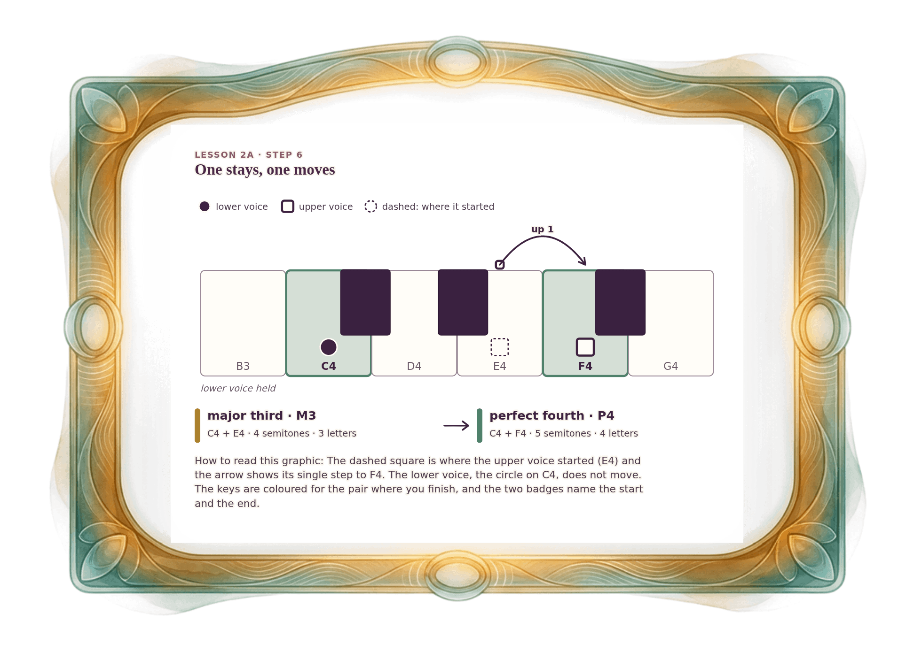

[⟵ 2A-04](2A-04.print.md) · [**Index**](../README.md) · [2A-06 ⟶](2A-06.print.md)

# 2A-05 — One voice moves: a major third becomes a perfect fourth

**View:** [desktop](2A-05.desktop.md) · [phone](2A-05.phone.md) · **[ print ]**  
**Section:** Lesson 2A — Same letters, different size · **Step(s):** 2A:6 · 19 of 50

### Zoom the real file
- 🔍 **[Open the full-size print PNG directly (browser pinch/zoom, 334 KB)](https://github.com/epaulson2/amf-app/raw/feat/ajourne-m08-week2-transparent-infographics-20261107/docs/m08/assets/2A-05/2A-05.print.png)**
- [GitHub image viewer page](../assets/2A-05/2A-05.print.png) · [Download / view editable SVG](../assets/2A-05/2A-05.print.svg) ([raw SVG](https://github.com/epaulson2/amf-app/raw/feat/ajourne-m08-week2-transparent-infographics-20261107/docs/m08/assets/2A-05/2A-05.print.svg))

*The picture above is the actual print PNG file (transparent; GitHub shows it on its own page colour). Click it to open the raw full-size file.*

**What it teaches:** When only the upper voice moves up by one semitone, the interval grows from a major third (4 semitones) to a perfect fourth (5). The lower voice stays on C4.

**How to read it:** The dashed square is where the upper voice started (E4) and the arrow shows its single step to F4. The lower voice, the circle on C4, does not move. The keys are coloured for the pair where you finish, and the two badges name the start and the end.

All files: desktop [PNG](../assets/2A-05/2A-05.desktop.png) / [SVG](../assets/2A-05/2A-05.desktop.svg) · phone [PNG](../assets/2A-05/2A-05.phone.png) / [SVG](../assets/2A-05/2A-05.phone.svg) · print [PNG](../assets/2A-05/2A-05.print.png) / [SVG](../assets/2A-05/2A-05.print.svg) · [proof on cream and slate](../proof/2A-05.proof.jpg)

[⟵ 2A-04](2A-04.print.md) · [**Index**](../README.md) · [2A-06 ⟶](2A-06.print.md)
