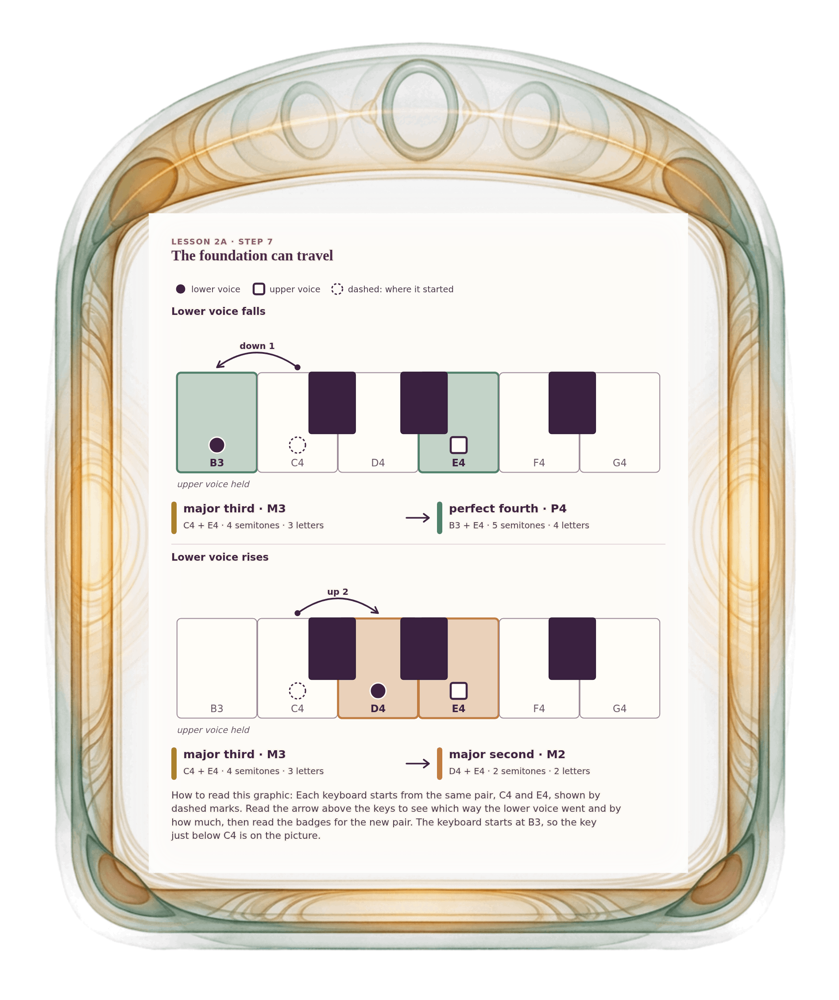

[⟵ 2A-05](2A-05.desktop.md) · [**Index**](../README.md) · [2A-07 ⟶](2A-07.desktop.md)

# 2A-06 — The foundation can travel

**View:** **[ desktop ]** · [phone](2A-06.phone.md) · [print](2A-06.print.md)  
**Section:** Lesson 2A — Same letters, different size · **Step(s):** 2A:7 · 20 of 50

### Zoom the real file
- 🔍 **[Open the full-size desktop PNG directly (browser pinch/zoom, 497 KB)](https://github.com/epaulson2/amf-app/raw/feat/ajourne-m08-week2-transparent-infographics-20261107/docs/m08/assets/2A-06/2A-06.desktop.png)**
- [GitHub image viewer page](../assets/2A-06/2A-06.desktop.png) · [Download / view editable SVG](../assets/2A-06/2A-06.desktop.svg) ([raw SVG](https://github.com/epaulson2/amf-app/raw/feat/ajourne-m08-week2-transparent-infographics-20261107/docs/m08/assets/2A-06/2A-06.desktop.svg))

*The picture above is the actual desktop PNG file (transparent; GitHub shows it on its own page colour). Click it to open the raw full-size file.*

**What it teaches:** The lower voice can move too. C4 down to B3 under E4 makes a perfect fourth (5 semitones); C4 up to D4 makes a major second (2 semitones).

**How to read it:** Each keyboard starts from the same pair, C4 and E4, shown by dashed marks. Read the arrow above the keys to see which way the lower voice went and by how much, then read the badges for the new pair. The keyboard starts at B3, so the key just below C4 is on the picture.

All files: desktop [PNG](../assets/2A-06/2A-06.desktop.png) / [SVG](../assets/2A-06/2A-06.desktop.svg) · phone [PNG](../assets/2A-06/2A-06.phone.png) / [SVG](../assets/2A-06/2A-06.phone.svg) · print [PNG](../assets/2A-06/2A-06.print.png) / [SVG](../assets/2A-06/2A-06.print.svg) · [proof on cream and slate](../proof/2A-06.proof.jpg)

[⟵ 2A-05](2A-05.desktop.md) · [**Index**](../README.md) · [2A-07 ⟶](2A-07.desktop.md)
