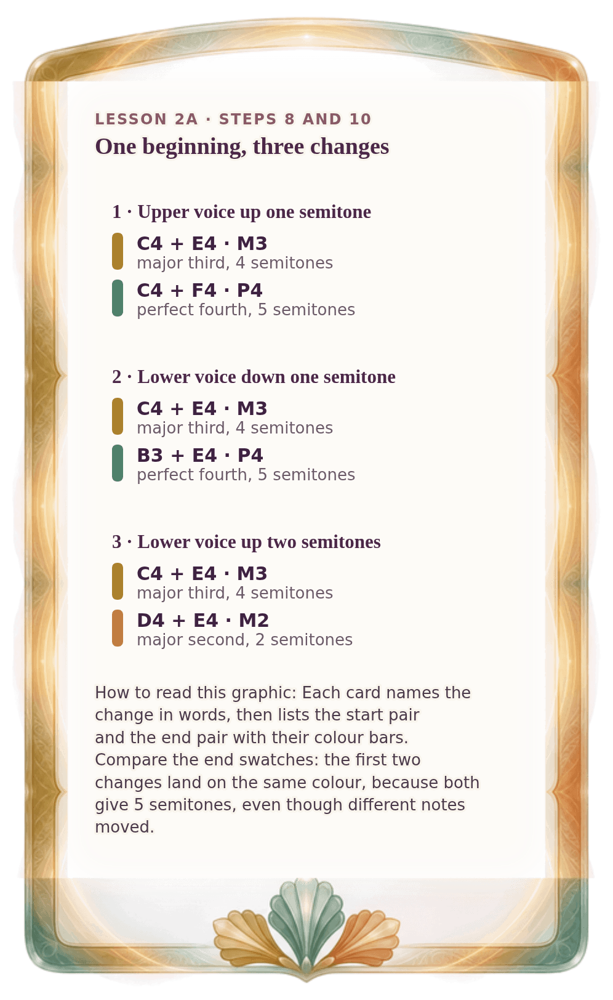

[⟵ 2A-06](2A-06.phone.md) · [**Index**](../README.md) · [2A-08 ⟶](2A-08.phone.md)

# 2A-07 — Three changes from one beginning

**View:** [desktop](2A-07.desktop.md) · **[ phone ]** · [print](2A-07.print.md)  
**Section:** Lesson 2A — Same letters, different size · **Step(s):** 2A:8, 2A:10 · 21 of 50

### Zoom the real file
- 🔍 **[Open the full-size phone PNG directly (browser pinch/zoom, 195 KB)](https://github.com/epaulson2/amf-app/raw/feat/ajourne-m08-week2-transparent-infographics-20261107/docs/m08/assets/2A-07/2A-07.phone.png)**
- [GitHub image viewer page](../assets/2A-07/2A-07.phone.png) · [Download / view editable SVG](../assets/2A-07/2A-07.phone.svg) ([raw SVG](https://github.com/epaulson2/amf-app/raw/feat/ajourne-m08-week2-transparent-infographics-20261107/docs/m08/assets/2A-07/2A-07.phone.svg))

*The picture above is the actual phone PNG file (transparent; GitHub shows it on its own page colour). Click it to open the raw full-size file.*

**What it teaches:** One beginning, three small changes, three different results: perfect fourth, perfect fourth, major second. The summary the lesson ends on.

**How to read it:** Each card names the change in words, then lists the start pair and the end pair with their colour bars. Compare the end swatches: the first two changes land on the same colour, because both give 5 semitones, even though different notes moved.

All files: desktop [PNG](../assets/2A-07/2A-07.desktop.png) / [SVG](../assets/2A-07/2A-07.desktop.svg) · phone [PNG](../assets/2A-07/2A-07.phone.png) / [SVG](../assets/2A-07/2A-07.phone.svg) · print [PNG](../assets/2A-07/2A-07.print.png) / [SVG](../assets/2A-07/2A-07.print.svg) · [proof on cream and slate](../proof/2A-07.proof.jpg)

[⟵ 2A-06](2A-06.phone.md) · [**Index**](../README.md) · [2A-08 ⟶](2A-08.phone.md)
