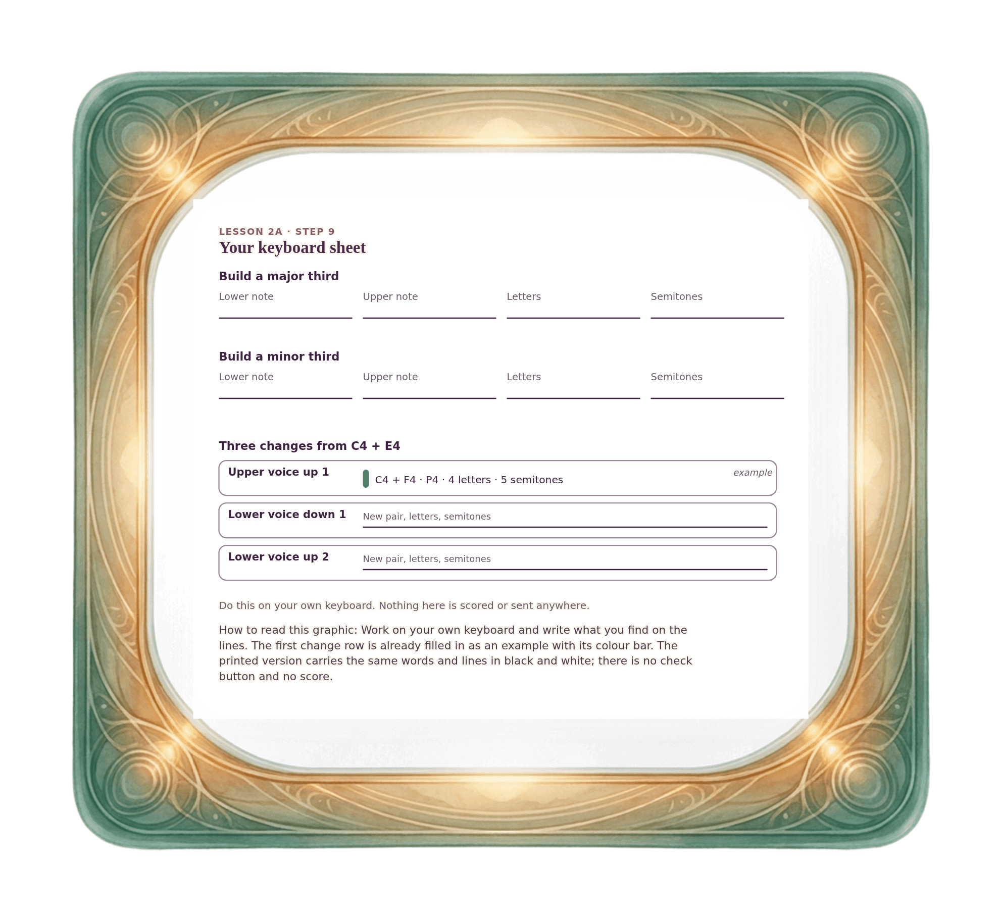

[⟵ 2A-07](2A-07.print.md) · [**Index**](../README.md) · [2A-09 ⟶](2A-09.print.md)

# 2A-08 — Your keyboard sheet: build, then change

**View:** [desktop](2A-08.desktop.md) · [phone](2A-08.phone.md) · **[ print ]**  
**Section:** Lesson 2A — Same letters, different size · **Step(s):** 2A:9 · 22 of 50

### Zoom the real file
- 🔍 **[Open the full-size print PNG directly (browser pinch/zoom, 469 KB)](https://github.com/epaulson2/amf-app/raw/feat/ajourne-m08-week2-transparent-infographics-20261107/docs/m08/assets/2A-08/2A-08.print.png)**
- [GitHub image viewer page](../assets/2A-08/2A-08.print.png) · [Download / view editable SVG](../assets/2A-08/2A-08.print.svg) ([raw SVG](https://github.com/epaulson2/amf-app/raw/feat/ajourne-m08-week2-transparent-infographics-20261107/docs/m08/assets/2A-08/2A-08.print.svg))

*The picture above is the actual print PNG file (transparent; GitHub shows it on its own page colour). Click it to open the raw full-size file.*

**What it teaches:** A paper companion for working at your own keyboard: write down the notes and counts for a major third, a minor third and three changes. Nothing is scored.

**How to read it:** Work on your own keyboard and write what you find on the lines. The first change row is already filled in as an example with its colour bar. The printed version carries the same words and lines in black and white; there is no check button and no score.

All files: desktop [PNG](../assets/2A-08/2A-08.desktop.png) / [SVG](../assets/2A-08/2A-08.desktop.svg) · phone [PNG](../assets/2A-08/2A-08.phone.png) / [SVG](../assets/2A-08/2A-08.phone.svg) · print [PNG](../assets/2A-08/2A-08.print.png) / [SVG](../assets/2A-08/2A-08.print.svg) · [proof on cream and slate](../proof/2A-08.proof.jpg)

[⟵ 2A-07](2A-07.print.md) · [**Index**](../README.md) · [2A-09 ⟶](2A-09.print.md)
