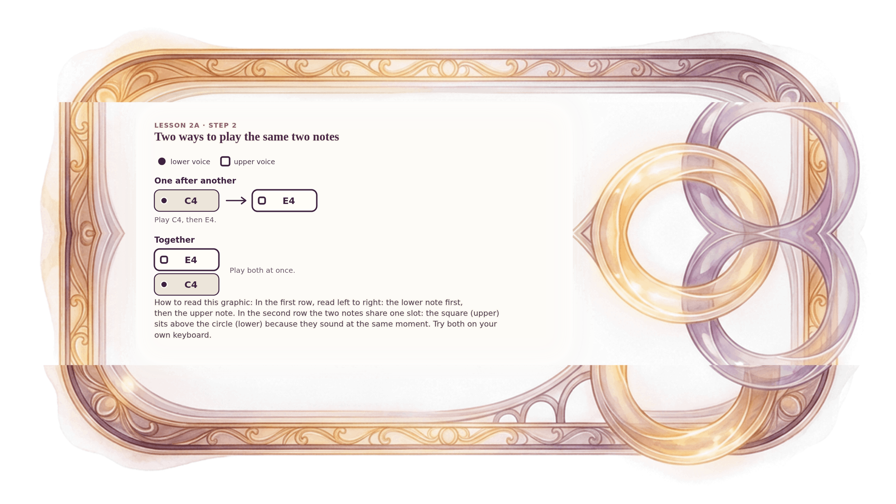

[⟵ 2A-08](2A-08.desktop.md) · [**Index**](../README.md) · [2A-10 ⟶](2A-10.desktop.md)

# 2A-09 — One after another, and together

**View:** **[ desktop ]** · [phone](2A-09.phone.md) · [print](2A-09.print.md)  
**Section:** Lesson 2A — Same letters, different size · **Step(s):** 2A:2 · 23 of 50

### Zoom the real file
- 🔍 **[Open the full-size desktop PNG directly (browser pinch/zoom, 619 KB)](https://github.com/epaulson2/amf-app/raw/feat/ajourne-m08-week2-transparent-infographics-20261107/docs/m08/assets/2A-09/2A-09.desktop.png)**
- [GitHub image viewer page](../assets/2A-09/2A-09.desktop.png) · [Download / view editable SVG](../assets/2A-09/2A-09.desktop.svg) ([raw SVG](https://github.com/epaulson2/amf-app/raw/feat/ajourne-m08-week2-transparent-infographics-20261107/docs/m08/assets/2A-09/2A-09.desktop.svg))

*The picture above is the actual desktop PNG file (transparent; GitHub shows it on its own page colour). Click it to open the raw full-size file.*

**What it teaches:** Two notes can be played one after another or at the same time. Together, the lower note sits under the upper note.

**How to read it:** In the first row, read left to right: the lower note first, then the upper note. In the second row the two notes share one slot: the square (upper) sits above the circle (lower) because they sound at the same moment. Try both on your own keyboard.

All files: desktop [PNG](../assets/2A-09/2A-09.desktop.png) / [SVG](../assets/2A-09/2A-09.desktop.svg) · phone [PNG](../assets/2A-09/2A-09.phone.png) / [SVG](../assets/2A-09/2A-09.phone.svg) · print [PNG](../assets/2A-09/2A-09.print.png) / [SVG](../assets/2A-09/2A-09.print.svg) · [proof on cream and slate](../proof/2A-09.proof.jpg)

[⟵ 2A-08](2A-08.desktop.md) · [**Index**](../README.md) · [2A-10 ⟶](2A-10.desktop.md)
