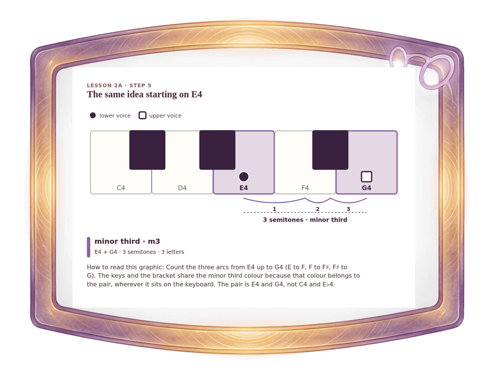

[⟵ 2A-09](2A-09.print.md) · [**Index**](../README.md) · [2B-01a ⟶](2B-01a.print.md)

# 2A-10 — The foundation moves: E4 and G4, a minor third

**View:** [desktop](2A-10.desktop.md) · [phone](2A-10.phone.md) · **[ print ]**  
**Section:** Lesson 2A — Same letters, different size · **Step(s):** 2A:5 · 24 of 50

### Zoom the real file
- 🔍 **[Open the full-size print PNG directly (browser pinch/zoom, 281 KB)](https://github.com/epaulson2/amf-app/raw/feat/ajourne-m08-week2-transparent-infographics-20261107/docs/m08/assets/2A-10/2A-10.print.png)**
- [GitHub image viewer page](../assets/2A-10/2A-10.print.png) · [Download / view editable SVG](../assets/2A-10/2A-10.print.svg) ([raw SVG](https://github.com/epaulson2/amf-app/raw/feat/ajourne-m08-week2-transparent-infographics-20261107/docs/m08/assets/2A-10/2A-10.print.svg))

*The picture above is the actual print PNG file (transparent; GitHub shows it on its own page colour). Click it to open the raw full-size file.*

**What it teaches:** A third does not have to start on C. E4 to G4 spans three letters and three semitones: a minor third, in the minor third colour.

**How to read it:** Count the three arcs from E4 up to G4 (E to F, F to F♯, F♯ to G). The keys and the bracket share the minor third colour because that colour belongs to the pair, wherever it sits on the keyboard. The pair is E4 and G4, not C4 and E♭4.

All files: desktop [PNG](../assets/2A-10/2A-10.desktop.png) / [SVG](../assets/2A-10/2A-10.desktop.svg) · phone [PNG](../assets/2A-10/2A-10.phone.png) / [SVG](../assets/2A-10/2A-10.phone.svg) · print [PNG](../assets/2A-10/2A-10.print.png) / [SVG](../assets/2A-10/2A-10.print.svg) · [proof on cream and slate](../proof/2A-10.proof.jpg)

[⟵ 2A-09](2A-09.print.md) · [**Index**](../README.md) · [2B-01a ⟶](2B-01a.print.md)
