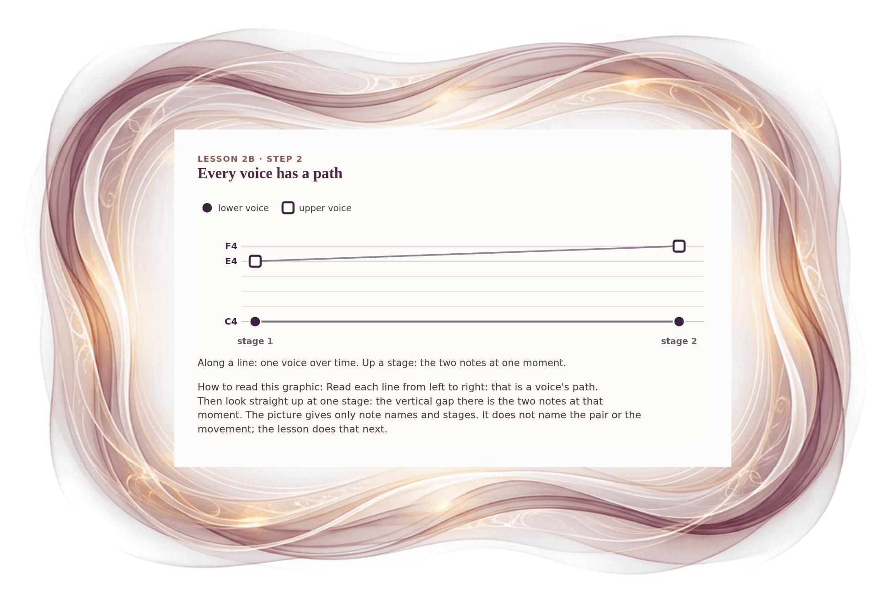

[⟵ 2A-10](2A-10.desktop.md) · [**Index**](../README.md) · [2B-01b ⟶](2B-01b.desktop.md)

# 2B-01a — Two paths through time

**View:** **[ desktop ]** · [phone](2B-01a.phone.md) · [print](2B-01a.print.md)  
**Section:** Lesson 2B — How two voices move · **Step(s):** 2B:1, 2B:2 · 25 of 50

### Zoom the real file
- 🔍 **[Open the full-size desktop PNG directly (browser pinch/zoom, 438 KB)](https://github.com/epaulson2/amf-app/raw/feat/ajourne-m08-week2-transparent-infographics-20261107/docs/m08/assets/2B-01a/2B-01a.desktop.png)**
- [GitHub image viewer page](../assets/2B-01a/2B-01a.desktop.png) · [Download / view editable SVG](../assets/2B-01a/2B-01a.desktop.svg) ([raw SVG](https://github.com/epaulson2/amf-app/raw/feat/ajourne-m08-week2-transparent-infographics-20261107/docs/m08/assets/2B-01a/2B-01a.desktop.svg))

*The picture above is the actual desktop PNG file (transparent; GitHub shows it on its own page colour). Click it to open the raw full-size file.*

**What it teaches:** Each voice has its own path across time (horizontal), and at any one stage the two notes make a gap (vertical). Two directions to look in: along a path, and between the voices.

**How to read it:** Read each line from left to right: that is a voice's path. Then look straight up at one stage: the vertical gap there is the two notes at that moment. The picture gives only note names and stages. It does not name the pair or the movement; the lesson does that next.

All files: desktop [PNG](../assets/2B-01a/2B-01a.desktop.png) / [SVG](../assets/2B-01a/2B-01a.desktop.svg) · phone [PNG](../assets/2B-01a/2B-01a.phone.png) / [SVG](../assets/2B-01a/2B-01a.phone.svg) · print [PNG](../assets/2B-01a/2B-01a.print.png) / [SVG](../assets/2B-01a/2B-01a.print.svg) · [proof on cream and slate](../proof/2B-01a.proof.jpg)

[⟵ 2A-10](2A-10.desktop.md) · [**Index**](../README.md) · [2B-01b ⟶](2B-01b.desktop.md)
