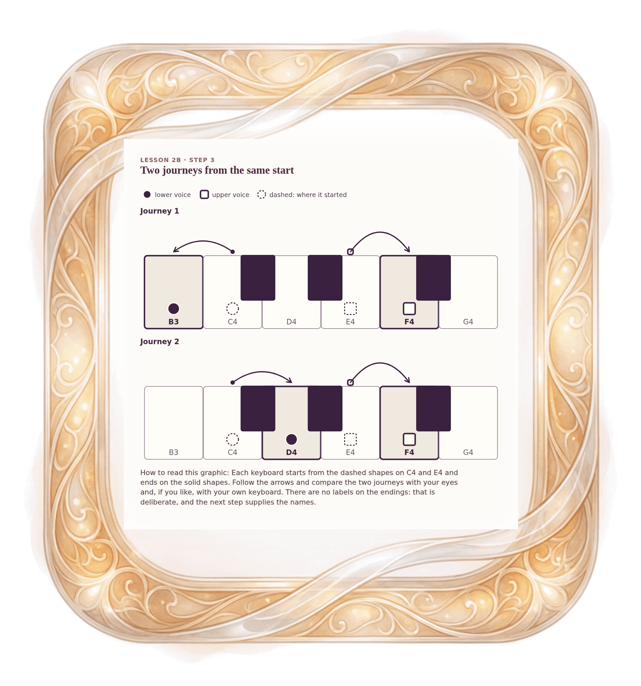

[⟵ 2B-01a](2B-01a.desktop.md) · [**Index**](../README.md) · [2B-02 ⟶](2B-02.desktop.md)

# 2B-01b — Before we name it: two journeys

**View:** **[ desktop ]** · [phone](2B-01b.phone.md) · [print](2B-01b.print.md)  
**Section:** Lesson 2B — How two voices move · **Step(s):** 2B:3 · 26 of 50

### Zoom the real file
- 🔍 **[Open the full-size desktop PNG directly (browser pinch/zoom, 724 KB)](https://github.com/epaulson2/amf-app/raw/feat/ajourne-m08-week2-transparent-infographics-20261107/docs/m08/assets/2B-01b/2B-01b.desktop.png)**
- [GitHub image viewer page](../assets/2B-01b/2B-01b.desktop.png) · [Download / view editable SVG](../assets/2B-01b/2B-01b.desktop.svg) ([raw SVG](https://github.com/epaulson2/amf-app/raw/feat/ajourne-m08-week2-transparent-infographics-20261107/docs/m08/assets/2B-01b/2B-01b.desktop.svg))

*The picture above is the actual desktop PNG file (transparent; GitHub shows it on its own page colour). Click it to open the raw full-size file.*

**What it teaches:** Two journeys from the same two notes. Compare them: in each, one voice does something different. The picture shows only the notes and the arrows, so you can decide what you notice before it is named.

**How to read it:** Each keyboard starts from the dashed shapes on C4 and E4 and ends on the solid shapes. Follow the arrows and compare the two journeys with your eyes and, if you like, with your own keyboard. There are no labels on the endings: that is deliberate, and the next step supplies the names.

All files: desktop [PNG](../assets/2B-01b/2B-01b.desktop.png) / [SVG](../assets/2B-01b/2B-01b.desktop.svg) · phone [PNG](../assets/2B-01b/2B-01b.phone.png) / [SVG](../assets/2B-01b/2B-01b.phone.svg) · print [PNG](../assets/2B-01b/2B-01b.print.png) / [SVG](../assets/2B-01b/2B-01b.print.svg) · [proof on cream and slate](../proof/2B-01b.proof.jpg)

[⟵ 2B-01a](2B-01a.desktop.md) · [**Index**](../README.md) · [2B-02 ⟶](2B-02.desktop.md)
