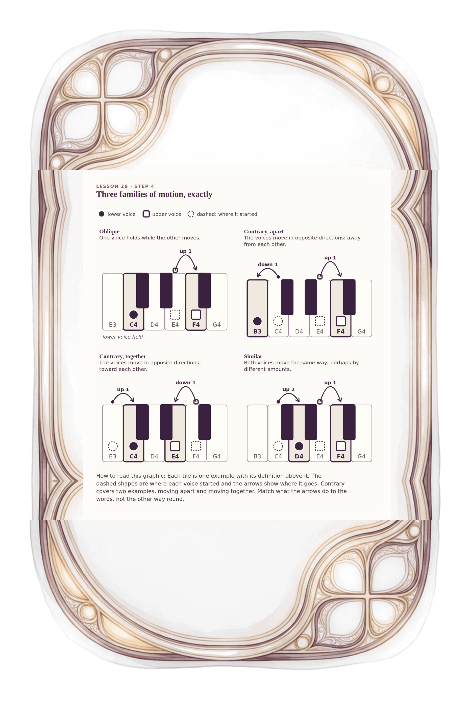

[⟵ 2B-01b](2B-01b.desktop.md) · [**Index**](../README.md) · [2B-03 ⟶](2B-03.desktop.md)

# 2B-02 — Three families of motion, with exact examples

**View:** **[ desktop ]** · [phone](2B-02.phone.md) · [print](2B-02.print.md)  
**Section:** Lesson 2B — How two voices move · **Step(s):** 2B:4 · 27 of 50

### Zoom the real file
- 🔍 **[Open the full-size desktop PNG directly (browser pinch/zoom, 830 KB)](https://github.com/epaulson2/amf-app/raw/feat/ajourne-m08-week2-transparent-infographics-20261107/docs/m08/assets/2B-02/2B-02.desktop.png)**
- [GitHub image viewer page](../assets/2B-02/2B-02.desktop.png) · [Download / view editable SVG](../assets/2B-02/2B-02.desktop.svg) ([raw SVG](https://github.com/epaulson2/amf-app/raw/feat/ajourne-m08-week2-transparent-infographics-20261107/docs/m08/assets/2B-02/2B-02.desktop.svg))

*The picture above is the actual desktop PNG file (transparent; GitHub shows it on its own page colour). Click it to open the raw full-size file.*

**What it teaches:** The three families of motion as exact keyboard examples: oblique, contrary (both apart and together) and similar. The narrower word "parallel" comes later, in step 6.

**How to read it:** Each tile is one example with its definition above it. The dashed shapes are where each voice started and the arrows show where it goes. Contrary covers two examples, moving apart and moving together. Match what the arrows do to the words, not the other way round.

All files: desktop [PNG](../assets/2B-02/2B-02.desktop.png) / [SVG](../assets/2B-02/2B-02.desktop.svg) · phone [PNG](../assets/2B-02/2B-02.phone.png) / [SVG](../assets/2B-02/2B-02.phone.svg) · print [PNG](../assets/2B-02/2B-02.print.png) / [SVG](../assets/2B-02/2B-02.print.svg) · [proof on cream and slate](../proof/2B-02.proof.jpg)

[⟵ 2B-01b](2B-01b.desktop.md) · [**Index**](../README.md) · [2B-03 ⟶](2B-03.desktop.md)
