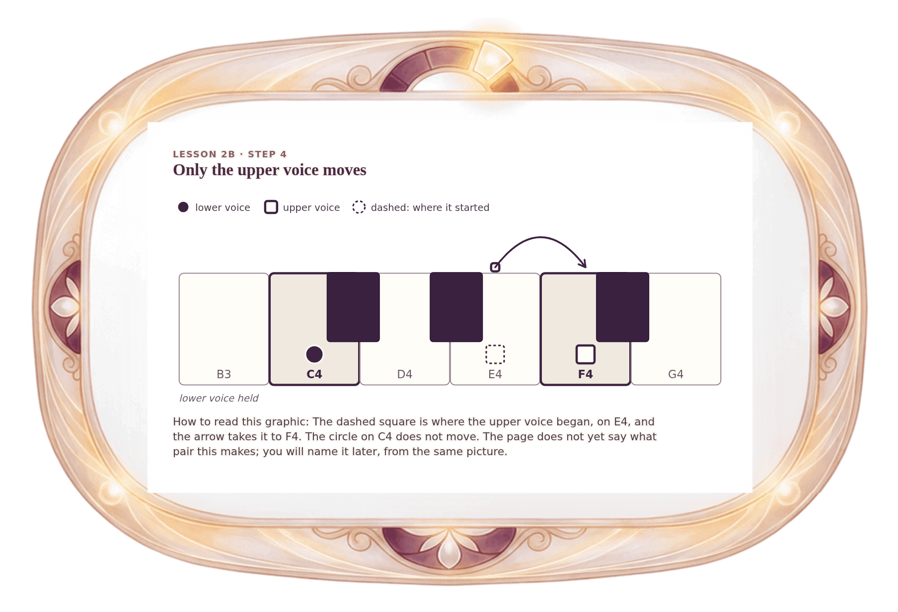

[⟵ 2B-02](2B-02.print.md) · [**Index**](../README.md) · [2B-04 ⟶](2B-04.print.md)

# 2B-03 — Change 1: only the upper voice rises

**View:** [desktop](2B-03.desktop.md) · [phone](2B-03.phone.md) · **[ print ]**  
**Section:** Lesson 2B — How two voices move · **Step(s):** 2B:4, 2B:8 · 28 of 50

### Zoom the real file
- 🔍 **[Open the full-size print PNG directly (browser pinch/zoom, 308 KB)](https://github.com/epaulson2/amf-app/raw/feat/ajourne-m08-week2-transparent-infographics-20261107/docs/m08/assets/2B-03/2B-03.print.png)**
- [GitHub image viewer page](../assets/2B-03/2B-03.print.png) · [Download / view editable SVG](../assets/2B-03/2B-03.print.svg) ([raw SVG](https://github.com/epaulson2/amf-app/raw/feat/ajourne-m08-week2-transparent-infographics-20261107/docs/m08/assets/2B-03/2B-03.print.svg))

*The picture above is the actual print PNG file (transparent; GitHub shows it on its own page colour). Click it to open the raw full-size file.*

**What it teaches:** The first of the five changes: C4 holds while E4 rises to F4. One voice holds and one moves, which is oblique motion.

**How to read it:** The dashed square is where the upper voice began, on E4, and the arrow takes it to F4. The circle on C4 does not move. The page does not yet say what pair this makes; you will name it later, from the same picture.

All files: desktop [PNG](../assets/2B-03/2B-03.desktop.png) / [SVG](../assets/2B-03/2B-03.desktop.svg) · phone [PNG](../assets/2B-03/2B-03.phone.png) / [SVG](../assets/2B-03/2B-03.phone.svg) · print [PNG](../assets/2B-03/2B-03.print.png) / [SVG](../assets/2B-03/2B-03.print.svg) · [proof on cream and slate](../proof/2B-03.proof.jpg)

[⟵ 2B-02](2B-02.print.md) · [**Index**](../README.md) · [2B-04 ⟶](2B-04.print.md)
