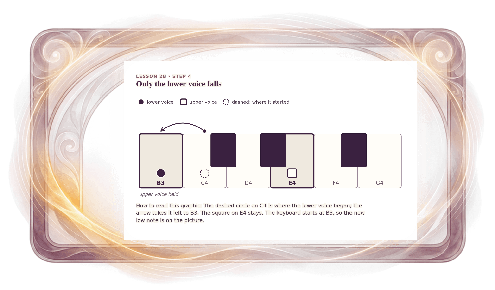

[⟵ 2B-03](2B-03.print.md) · [**Index**](../README.md) · [2B-05 ⟶](2B-05.print.md)

# 2B-04 — Change 2: only the lower voice falls

**View:** [desktop](2B-04.desktop.md) · [phone](2B-04.phone.md) · **[ print ]**  
**Section:** Lesson 2B — How two voices move · **Step(s):** 2B:4, 2B:8 · 29 of 50

### Zoom the real file
- 🔍 **[Open the full-size print PNG directly (browser pinch/zoom, 386 KB)](https://github.com/epaulson2/amf-app/raw/feat/ajourne-m08-week2-transparent-infographics-20261107/docs/m08/assets/2B-04/2B-04.print.png)**
- [GitHub image viewer page](../assets/2B-04/2B-04.print.png) · [Download / view editable SVG](../assets/2B-04/2B-04.print.svg) ([raw SVG](https://github.com/epaulson2/amf-app/raw/feat/ajourne-m08-week2-transparent-infographics-20261107/docs/m08/assets/2B-04/2B-04.print.svg))

*The picture above is the actual print PNG file (transparent; GitHub shows it on its own page colour). Click it to open the raw full-size file.*

**What it teaches:** The second of the five changes: E4 holds while C4 falls to B3. One voice holds, one moves, so this is also oblique.

**How to read it:** The dashed circle on C4 is where the lower voice began; the arrow takes it left to B3. The square on E4 stays. The keyboard starts at B3, so the new low note is on the picture.

All files: desktop [PNG](../assets/2B-04/2B-04.desktop.png) / [SVG](../assets/2B-04/2B-04.desktop.svg) · phone [PNG](../assets/2B-04/2B-04.phone.png) / [SVG](../assets/2B-04/2B-04.phone.svg) · print [PNG](../assets/2B-04/2B-04.print.png) / [SVG](../assets/2B-04/2B-04.print.svg) · [proof on cream and slate](../proof/2B-04.proof.jpg)

[⟵ 2B-03](2B-03.print.md) · [**Index**](../README.md) · [2B-05 ⟶](2B-05.print.md)
