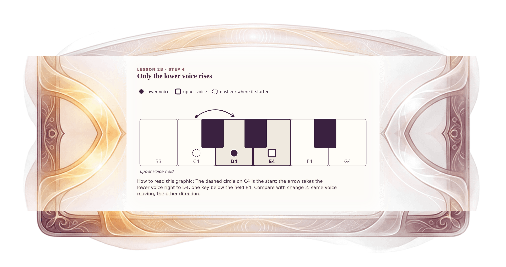

[⟵ 2B-04](2B-04.desktop.md) · [**Index**](../README.md) · [2B-06 ⟶](2B-06.desktop.md)

# 2B-05 — Change 3: only the lower voice rises

**View:** **[ desktop ]** · [phone](2B-05.phone.md) · [print](2B-05.print.md)  
**Section:** Lesson 2B — How two voices move · **Step(s):** 2B:4, 2B:8 · 30 of 50

### Zoom the real file
- 🔍 **[Open the full-size desktop PNG directly (browser pinch/zoom, 432 KB)](https://github.com/epaulson2/amf-app/raw/feat/ajourne-m08-week2-transparent-infographics-20261107/docs/m08/assets/2B-05/2B-05.desktop.png)**
- [GitHub image viewer page](../assets/2B-05/2B-05.desktop.png) · [Download / view editable SVG](../assets/2B-05/2B-05.desktop.svg) ([raw SVG](https://github.com/epaulson2/amf-app/raw/feat/ajourne-m08-week2-transparent-infographics-20261107/docs/m08/assets/2B-05/2B-05.desktop.svg))

*The picture above is the actual desktop PNG file (transparent; GitHub shows it on its own page colour). Click it to open the raw full-size file.*

**What it teaches:** The third of the five changes: E4 holds while C4 rises to D4. Again one voice holds and one moves, oblique motion, but the lower voice now moves up.

**How to read it:** The dashed circle on C4 is the start; the arrow takes the lower voice right to D4, one key below the held E4. Compare with change 2: same voice moving, the other direction.

All files: desktop [PNG](../assets/2B-05/2B-05.desktop.png) / [SVG](../assets/2B-05/2B-05.desktop.svg) · phone [PNG](../assets/2B-05/2B-05.phone.png) / [SVG](../assets/2B-05/2B-05.phone.svg) · print [PNG](../assets/2B-05/2B-05.print.png) / [SVG](../assets/2B-05/2B-05.print.svg) · [proof on cream and slate](../proof/2B-05.proof.jpg)

[⟵ 2B-04](2B-04.desktop.md) · [**Index**](../README.md) · [2B-06 ⟶](2B-06.desktop.md)
