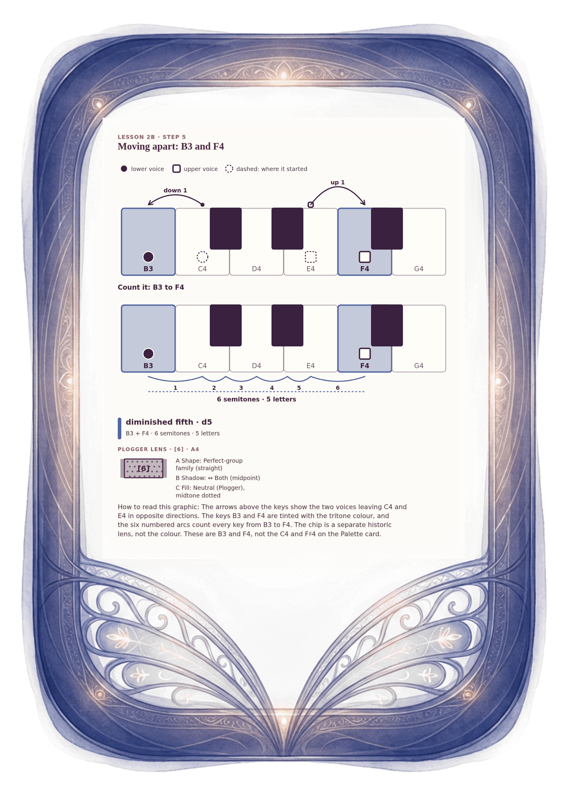

[⟵ 2B-05](2B-05.desktop.md) · [**Index**](../README.md) · [2B-07 ⟶](2B-07.desktop.md)

# 2B-06 — Change 4: moving apart, B3 and F4, a diminished fifth

**View:** **[ desktop ]** · [phone](2B-06.phone.md) · [print](2B-06.print.md)  
**Section:** Lesson 2B — How two voices move · **Step(s):** 2B:5, 2B:8 · 31 of 50

### Zoom the real file
- 🔍 **[Open the full-size desktop PNG directly (browser pinch/zoom, 963 KB)](https://github.com/epaulson2/amf-app/raw/feat/ajourne-m08-week2-transparent-infographics-20261107/docs/m08/assets/2B-06/2B-06.desktop.png)**
- [GitHub image viewer page](../assets/2B-06/2B-06.desktop.png) · [Download / view editable SVG](../assets/2B-06/2B-06.desktop.svg) ([raw SVG](https://github.com/epaulson2/amf-app/raw/feat/ajourne-m08-week2-transparent-infographics-20261107/docs/m08/assets/2B-06/2B-06.desktop.svg))

*The picture above is the actual desktop PNG file (transparent; GitHub shows it on its own page colour). Click it to open the raw full-size file.*

**What it teaches:** Moving apart: both voices go in opposite directions, C4 down to B3 and E4 up to F4. The new pair B3 + F4 spans five letters and six semitones: a diminished fifth, shown in the tritone colour with its Plogger chip.

**How to read it:** The arrows above the keys show the two voices leaving C4 and E4 in opposite directions. The keys B3 and F4 are tinted with the tritone colour, and the six numbered arcs count every key from B3 to F4. The chip is a separate historic lens, not the colour. These are B3 and F4, not the C4 and F♯4 on the Palette card.

All files: desktop [PNG](../assets/2B-06/2B-06.desktop.png) / [SVG](../assets/2B-06/2B-06.desktop.svg) · phone [PNG](../assets/2B-06/2B-06.phone.png) / [SVG](../assets/2B-06/2B-06.phone.svg) · print [PNG](../assets/2B-06/2B-06.print.png) / [SVG](../assets/2B-06/2B-06.print.svg) · [proof on cream and slate](../proof/2B-06.proof.jpg)

[⟵ 2B-05](2B-05.desktop.md) · [**Index**](../README.md) · [2B-07 ⟶](2B-07.desktop.md)
