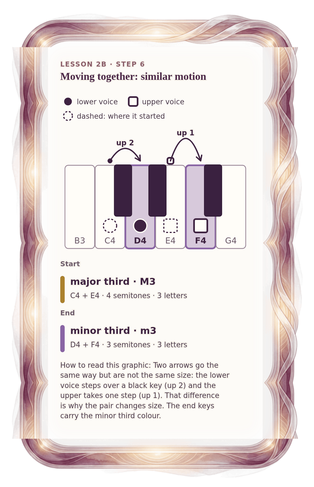

[⟵ 2B-06](2B-06.phone.md) · [**Index**](../README.md) · [2B-08 ⟶](2B-08.phone.md)

# 2B-07 — Change 5: both rise, a major third becomes a minor third

**View:** [desktop](2B-07.desktop.md) · **[ phone ]** · [print](2B-07.print.md)  
**Section:** Lesson 2B — How two voices move · **Step(s):** 2B:6, 2B:8 · 32 of 50

### Zoom the real file
- 🔍 **[Open the full-size phone PNG directly (browser pinch/zoom, 280 KB)](https://github.com/epaulson2/amf-app/raw/feat/ajourne-m08-week2-transparent-infographics-20261107/docs/m08/assets/2B-07/2B-07.phone.png)**
- [GitHub image viewer page](../assets/2B-07/2B-07.phone.png) · [Download / view editable SVG](../assets/2B-07/2B-07.phone.svg) ([raw SVG](https://github.com/epaulson2/amf-app/raw/feat/ajourne-m08-week2-transparent-infographics-20261107/docs/m08/assets/2B-07/2B-07.phone.svg))

*The picture above is the actual phone PNG file (transparent; GitHub shows it on its own page colour). Click it to open the raw full-size file.*

**What it teaches:** Similar motion: both voices rise, the lower by 2 semitones and the upper by 1. Because the distances differ, the interval shrinks from a major third to a minor third, so this is similar and not strict parallel in this course.

**How to read it:** Two arrows go the same way but are not the same size: the lower voice steps over a black key (up 2) and the upper takes one step (up 1). That difference is why the pair changes size. The end keys carry the minor third colour.

All files: desktop [PNG](../assets/2B-07/2B-07.desktop.png) / [SVG](../assets/2B-07/2B-07.desktop.svg) · phone [PNG](../assets/2B-07/2B-07.phone.png) / [SVG](../assets/2B-07/2B-07.phone.svg) · print [PNG](../assets/2B-07/2B-07.print.png) / [SVG](../assets/2B-07/2B-07.print.svg) · [proof on cream and slate](../proof/2B-07.proof.jpg)

[⟵ 2B-06](2B-06.phone.md) · [**Index**](../README.md) · [2B-08 ⟶](2B-08.phone.md)
