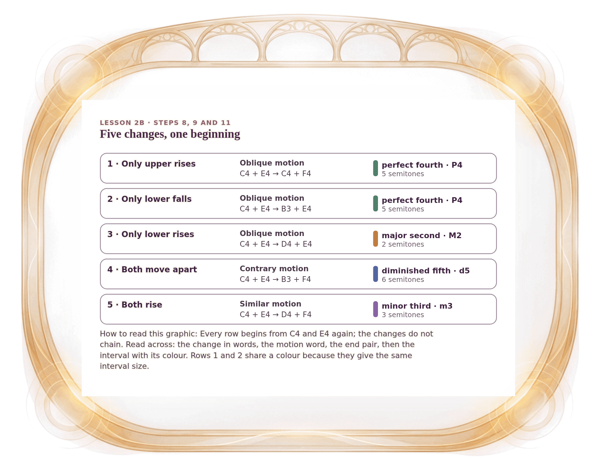

[⟵ 2B-07](2B-07.print.md) · [**Index**](../README.md) · [2B-09 ⟶](2B-09.print.md)

# 2B-08 — The five changes, all from C4 + E4

**View:** [desktop](2B-08.desktop.md) · [phone](2B-08.phone.md) · **[ print ]**  
**Section:** Lesson 2B — How two voices move · **Step(s):** 2B:8, 2B:9, 2B:11 · 33 of 50

### Zoom the real file
- 🔍 **[Open the full-size print PNG directly (browser pinch/zoom, 319 KB)](https://github.com/epaulson2/amf-app/raw/feat/ajourne-m08-week2-transparent-infographics-20261107/docs/m08/assets/2B-08/2B-08.print.png)**
- [GitHub image viewer page](../assets/2B-08/2B-08.print.png) · [Download / view editable SVG](../assets/2B-08/2B-08.print.svg) ([raw SVG](https://github.com/epaulson2/amf-app/raw/feat/ajourne-m08-week2-transparent-infographics-20261107/docs/m08/assets/2B-08/2B-08.print.svg))

*The picture above is the actual print PNG file (transparent; GitHub shows it on its own page colour). Click it to open the raw full-size file.*

**What it teaches:** All five changes side by side, each restarting from the same C4 + E4: which voice moves, the new pair, its interval and its semitone count.

**How to read it:** Every row begins from C4 and E4 again; the changes do not chain. Read across: the change in words, the motion word, the end pair, then the interval with its colour. Rows 1 and 2 share a colour because they give the same interval size.

All files: desktop [PNG](../assets/2B-08/2B-08.desktop.png) / [SVG](../assets/2B-08/2B-08.desktop.svg) · phone [PNG](../assets/2B-08/2B-08.phone.png) / [SVG](../assets/2B-08/2B-08.phone.svg) · print [PNG](../assets/2B-08/2B-08.print.png) / [SVG](../assets/2B-08/2B-08.print.svg) · [proof on cream and slate](../proof/2B-08.proof.jpg)

[⟵ 2B-07](2B-07.print.md) · [**Index**](../README.md) · [2B-09 ⟶](2B-09.print.md)
