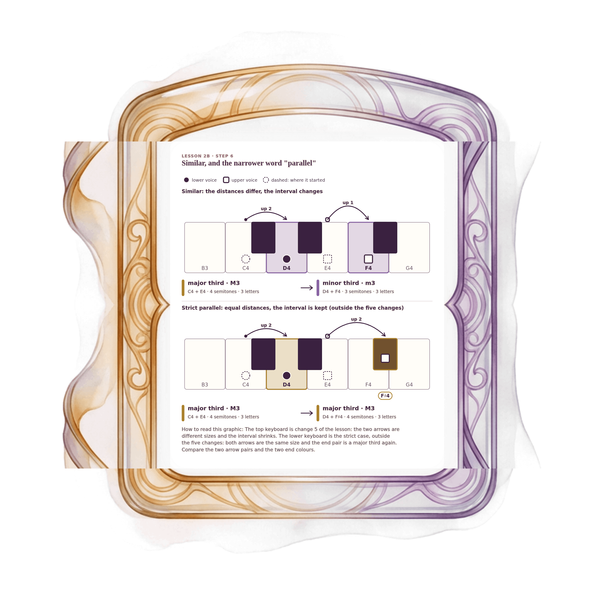

[⟵ 2B-08](2B-08.print.md) · [**Index**](../README.md) · [2B-10 ⟶](2B-10.print.md)

# 2B-09 — Similar, and strict parallel

**View:** [desktop](2B-09.desktop.md) · [phone](2B-09.phone.md) · **[ print ]**  
**Section:** Lesson 2B — How two voices move · **Step(s):** 2B:6 · 34 of 50

### Zoom the real file
- 🔍 **[Open the full-size print PNG directly (browser pinch/zoom, 733 KB)](https://github.com/epaulson2/amf-app/raw/feat/ajourne-m08-week2-transparent-infographics-20261107/docs/m08/assets/2B-09/2B-09.print.png)**
- [GitHub image viewer page](../assets/2B-09/2B-09.print.png) · [Download / view editable SVG](../assets/2B-09/2B-09.print.svg) ([raw SVG](https://github.com/epaulson2/amf-app/raw/feat/ajourne-m08-week2-transparent-infographics-20261107/docs/m08/assets/2B-09/2B-09.print.svg))

*The picture above is the actual print PNG file (transparent; GitHub shows it on its own page colour). Click it to open the raw full-size file.*

**What it teaches:** Same direction is not always strict parallel. In the course vocabulary strict parallel needs equal distances and an unchanged interval size. Some books use the word "parallel" more widely; both uses are respectable.

**How to read it:** The top keyboard is change 5 of the lesson: the two arrows are different sizes and the interval shrinks. The lower keyboard is the strict case, outside the five changes: both arrows are the same size and the end pair is a major third again. Compare the two arrow pairs and the two end colours.

All files: desktop [PNG](../assets/2B-09/2B-09.desktop.png) / [SVG](../assets/2B-09/2B-09.desktop.svg) · phone [PNG](../assets/2B-09/2B-09.phone.png) / [SVG](../assets/2B-09/2B-09.phone.svg) · print [PNG](../assets/2B-09/2B-09.print.png) / [SVG](../assets/2B-09/2B-09.print.svg) · [proof on cream and slate](../proof/2B-09.proof.jpg)

[⟵ 2B-08](2B-08.print.md) · [**Index**](../README.md) · [2B-10 ⟶](2B-10.print.md)
