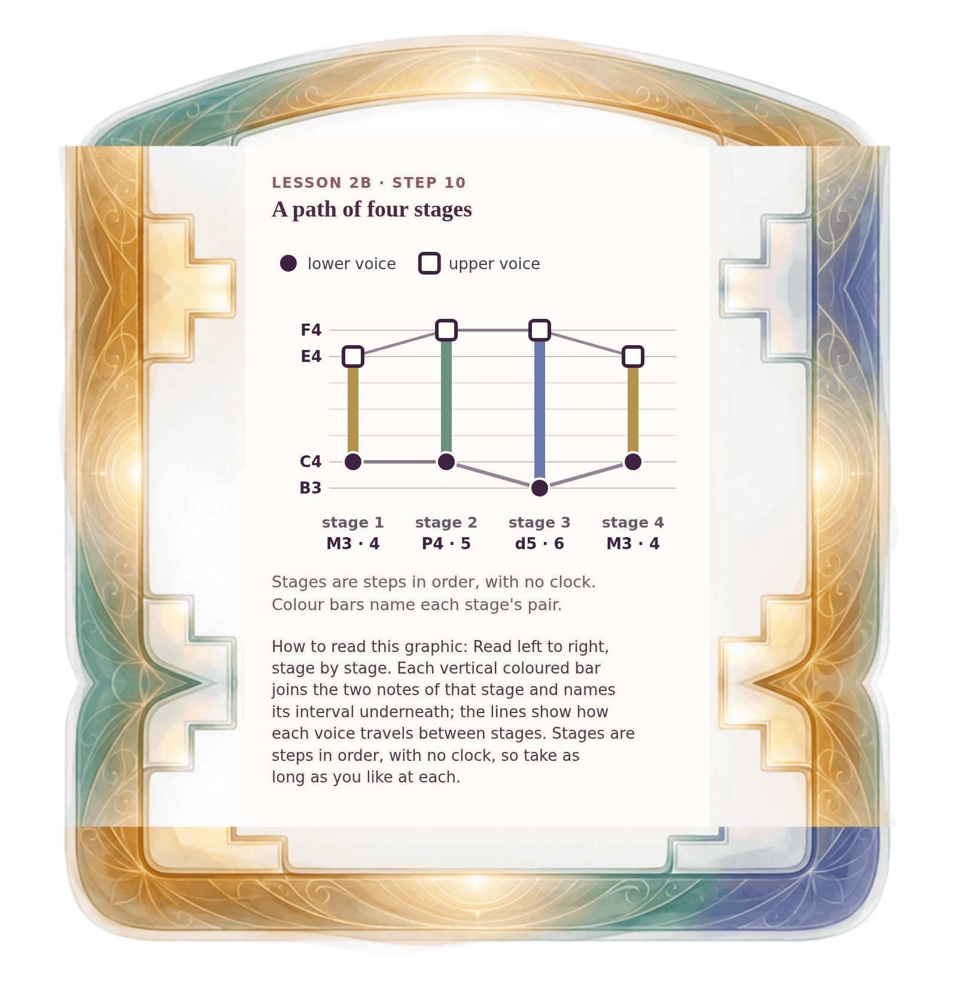

[⟵ 2B-09](2B-09.phone.md) · [**Index**](../README.md) · [2B-10b ⟶](2B-10b.phone.md)

# 2B-10 — A two-voice path in four stages

**View:** [desktop](2B-10.desktop.md) · **[ phone ]** · [print](2B-10.print.md)  
**Section:** Lesson 2B — How two voices move · **Step(s):** 2B:10 · 35 of 50

### Zoom the real file
- 🔍 **[Open the full-size phone PNG directly (browser pinch/zoom, 393 KB)](https://github.com/epaulson2/amf-app/raw/feat/ajourne-m08-week2-transparent-infographics-20261107/docs/m08/assets/2B-10/2B-10.phone.png)**
- [GitHub image viewer page](../assets/2B-10/2B-10.phone.png) · [Download / view editable SVG](../assets/2B-10/2B-10.phone.svg) ([raw SVG](https://github.com/epaulson2/amf-app/raw/feat/ajourne-m08-week2-transparent-infographics-20261107/docs/m08/assets/2B-10/2B-10.phone.svg))

*The picture above is the actual phone PNG file (transparent; GitHub shows it on its own page colour). Click it to open the raw full-size file.*

**What it teaches:** A short path through four stages that uses the lesson's changes in a row. Each stage has its own pair and colour, and the path ends where it began.

**How to read it:** Read left to right, stage by stage. Each vertical coloured bar joins the two notes of that stage and names its interval underneath; the lines show how each voice travels between stages. Stages are steps in order, with no clock, so take as long as you like at each.

All files: desktop [PNG](../assets/2B-10/2B-10.desktop.png) / [SVG](../assets/2B-10/2B-10.desktop.svg) · phone [PNG](../assets/2B-10/2B-10.phone.png) / [SVG](../assets/2B-10/2B-10.phone.svg) · print [PNG](../assets/2B-10/2B-10.print.png) / [SVG](../assets/2B-10/2B-10.print.svg) · [proof on cream and slate](../proof/2B-10.proof.jpg)

[⟵ 2B-09](2B-09.phone.md) · [**Index**](../README.md) · [2B-10b ⟶](2B-10b.phone.md)
