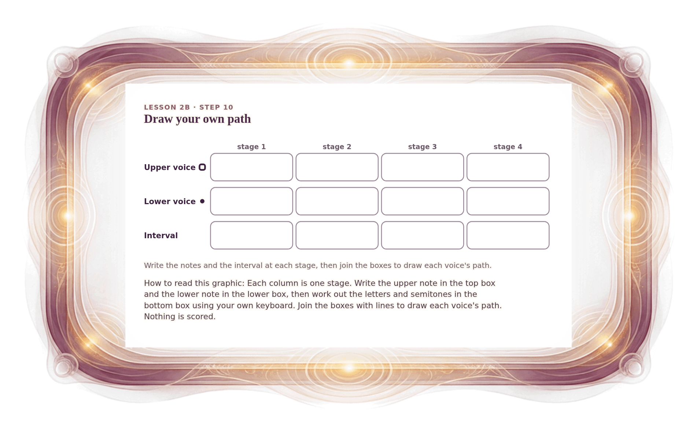

[⟵ 2B-10](2B-10.print.md) · [**Index**](../README.md) · [2B-11n ⟶](2B-11n.print.md)

# 2B-10b — Your two-voice path sheet

**View:** [desktop](2B-10b.desktop.md) · [phone](2B-10b.phone.md) · **[ print ]**  
**Section:** Lesson 2B — How two voices move · **Step(s):** 2B:10 · 36 of 50

### Zoom the real file
- 🔍 **[Open the full-size print PNG directly (browser pinch/zoom, 347 KB)](https://github.com/epaulson2/amf-app/raw/feat/ajourne-m08-week2-transparent-infographics-20261107/docs/m08/assets/2B-10b/2B-10b.print.png)**
- [GitHub image viewer page](../assets/2B-10b/2B-10b.print.png) · [Download / view editable SVG](../assets/2B-10b/2B-10b.print.svg) ([raw SVG](https://github.com/epaulson2/amf-app/raw/feat/ajourne-m08-week2-transparent-infographics-20261107/docs/m08/assets/2B-10b/2B-10b.print.svg))

*The picture above is the actual print PNG file (transparent; GitHub shows it on its own page colour). Click it to open the raw full-size file.*

**What it teaches:** A paper sheet for drawing your own four-stage path: write the upper and lower note at each stage, then the interval you find.

**How to read it:** Each column is one stage. Write the upper note in the top box and the lower note in the lower box, then work out the letters and semitones in the bottom box using your own keyboard. Join the boxes with lines to draw each voice's path. Nothing is scored.

All files: desktop [PNG](../assets/2B-10b/2B-10b.desktop.png) / [SVG](../assets/2B-10b/2B-10b.desktop.svg) · phone [PNG](../assets/2B-10b/2B-10b.phone.png) / [SVG](../assets/2B-10b/2B-10b.phone.svg) · print [PNG](../assets/2B-10b/2B-10b.print.png) / [SVG](../assets/2B-10b/2B-10b.print.svg) · [proof on cream and slate](../proof/2B-10b.proof.jpg)

[⟵ 2B-10](2B-10.print.md) · [**Index**](../README.md) · [2B-11n ⟶](2B-11n.print.md)
