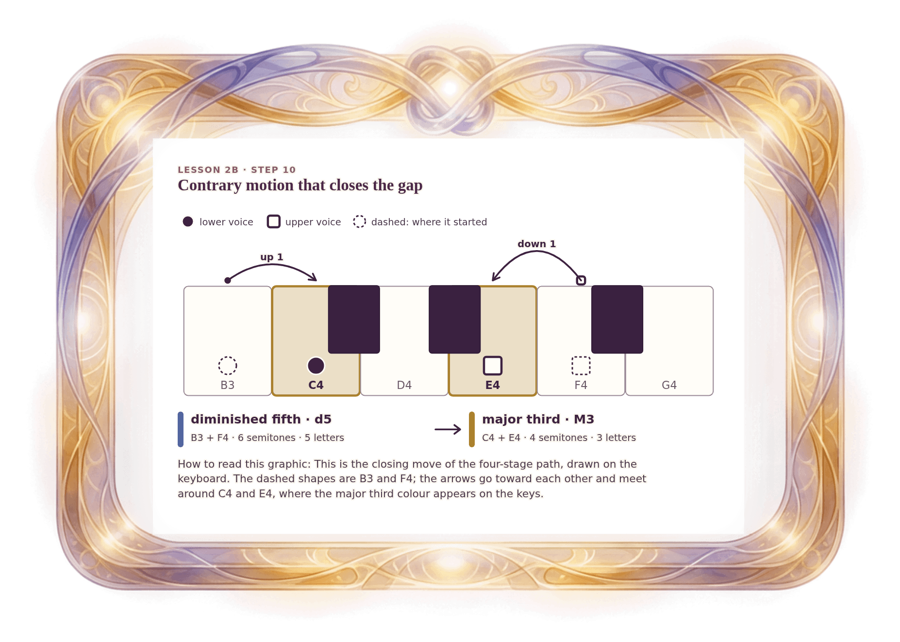

[⟵ 2B-11n](2B-11n.print.md) · [**Index**](../README.md) · [2B-12 ⟶](2B-12.print.md)

# 2B-11 — Contrary motion, together: B3 + F4 to C4 + E4

**View:** [desktop](2B-11.desktop.md) · [phone](2B-11.phone.md) · **[ print ]**  
**Section:** Lesson 2B — How two voices move · **Step(s):** 2B:10 · 38 of 50

### Zoom the real file
- 🔍 **[Open the full-size print PNG directly (browser pinch/zoom, 369 KB)](https://github.com/epaulson2/amf-app/raw/feat/ajourne-m08-week2-transparent-infographics-20261107/docs/m08/assets/2B-11/2B-11.print.png)**
- [GitHub image viewer page](../assets/2B-11/2B-11.print.png) · [Download / view editable SVG](../assets/2B-11/2B-11.print.svg) ([raw SVG](https://github.com/epaulson2/amf-app/raw/feat/ajourne-m08-week2-transparent-infographics-20261107/docs/m08/assets/2B-11/2B-11.print.svg))

*The picture above is the actual print PNG file (transparent; GitHub shows it on its own page colour). Click it to open the raw full-size file.*

**What it teaches:** Contrary motion can also go together: the lower voice rises one semitone and the upper falls one, closing the gap from a diminished fifth to a major third.

**How to read it:** This is the closing move of the four-stage path, drawn on the keyboard. The dashed shapes are B3 and F4; the arrows go toward each other and meet around C4 and E4, where the major third colour appears on the keys.

All files: desktop [PNG](../assets/2B-11/2B-11.desktop.png) / [SVG](../assets/2B-11/2B-11.desktop.svg) · phone [PNG](../assets/2B-11/2B-11.phone.png) / [SVG](../assets/2B-11/2B-11.phone.svg) · print [PNG](../assets/2B-11/2B-11.print.png) / [SVG](../assets/2B-11/2B-11.print.svg) · [proof on cream and slate](../proof/2B-11.proof.jpg)

[⟵ 2B-11n](2B-11n.print.md) · [**Index**](../README.md) · [2B-12 ⟶](2B-12.print.md)
