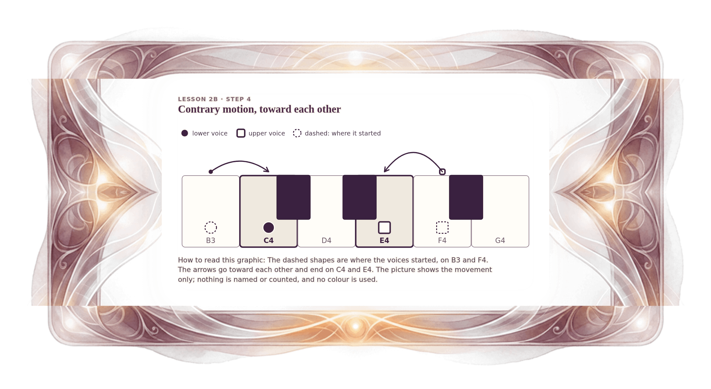

[⟵ 2B-10b](2B-10b.print.md) · [**Index**](../README.md) · [2B-11 ⟶](2B-11.print.md)

# 2B-11n — Contrary motion, together: the voices move toward each other

**View:** [desktop](2B-11n.desktop.md) · [phone](2B-11n.phone.md) · **[ print ]**  
**Section:** Lesson 2B — How two voices move · **Step(s):** 2B:4 · 37 of 50

### Zoom the real file
- 🔍 **[Open the full-size print PNG directly (browser pinch/zoom, 454 KB)](https://github.com/epaulson2/amf-app/raw/feat/ajourne-m08-week2-transparent-infographics-20261107/docs/m08/assets/2B-11n/2B-11n.print.png)**
- [GitHub image viewer page](../assets/2B-11n/2B-11n.print.png) · [Download / view editable SVG](../assets/2B-11n/2B-11n.print.svg) ([raw SVG](https://github.com/epaulson2/amf-app/raw/feat/ajourne-m08-week2-transparent-infographics-20261107/docs/m08/assets/2B-11n/2B-11n.print.svg))

*The picture above is the actual print PNG file (transparent; GitHub shows it on its own page colour). Click it to open the raw full-size file.*

**What it teaches:** Contrary motion also covers voices that move toward each other: the lower voice rises and the upper voice falls, and the gap between them closes.

**How to read it:** The dashed shapes are where the voices started, on B3 and F4. The arrows go toward each other and end on C4 and E4. The picture shows the movement only; nothing is named or counted, and no colour is used.

All files: desktop [PNG](../assets/2B-11n/2B-11n.desktop.png) / [SVG](../assets/2B-11n/2B-11n.desktop.svg) · phone [PNG](../assets/2B-11n/2B-11n.phone.png) / [SVG](../assets/2B-11n/2B-11n.phone.svg) · print [PNG](../assets/2B-11n/2B-11n.print.png) / [SVG](../assets/2B-11n/2B-11n.print.svg) · [proof on cream and slate](../proof/2B-11n.proof.jpg)

[⟵ 2B-10b](2B-10b.print.md) · [**Index**](../README.md) · [2B-11 ⟶](2B-11.print.md)
