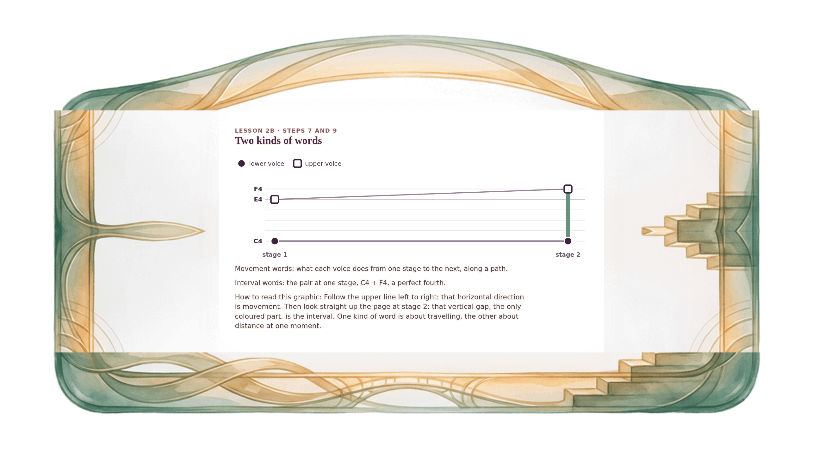

[⟵ 2B-11](2B-11.print.md) · [**Index**](../README.md) · [2B-13 ⟶](2B-13.print.md)

# 2B-12 — Two kinds of words: along a path, up a stage

**View:** [desktop](2B-12.desktop.md) · [phone](2B-12.phone.md) · **[ print ]**  
**Section:** Lesson 2B — How two voices move · **Step(s):** 2B:7, 2B:9 · 39 of 50

### Zoom the real file
- 🔍 **[Open the full-size print PNG directly (browser pinch/zoom, 475 KB)](https://github.com/epaulson2/amf-app/raw/feat/ajourne-m08-week2-transparent-infographics-20261107/docs/m08/assets/2B-12/2B-12.print.png)**
- [GitHub image viewer page](../assets/2B-12/2B-12.print.png) · [Download / view editable SVG](../assets/2B-12/2B-12.print.svg) ([raw SVG](https://github.com/epaulson2/amf-app/raw/feat/ajourne-m08-week2-transparent-infographics-20261107/docs/m08/assets/2B-12/2B-12.print.svg))

*The picture above is the actual print PNG file (transparent; GitHub shows it on its own page colour). Click it to open the raw full-size file.*

**What it teaches:** Movement words (oblique, contrary, similar, parallel) describe what voices do between stages, along the path. Interval words (the names of intervals) describe a pair of notes at a single stage, up the page.

**How to read it:** Follow the upper line left to right: that horizontal direction is movement. Then look straight up the page at stage 2: that vertical gap, the only coloured part, is the interval. One kind of word is about travelling, the other about distance at one moment.

All files: desktop [PNG](../assets/2B-12/2B-12.desktop.png) / [SVG](../assets/2B-12/2B-12.desktop.svg) · phone [PNG](../assets/2B-12/2B-12.phone.png) / [SVG](../assets/2B-12/2B-12.phone.svg) · print [PNG](../assets/2B-12/2B-12.print.png) / [SVG](../assets/2B-12/2B-12.print.svg) · [proof on cream and slate](../proof/2B-12.proof.jpg)

[⟵ 2B-11](2B-11.print.md) · [**Index**](../README.md) · [2B-13 ⟶](2B-13.print.md)
