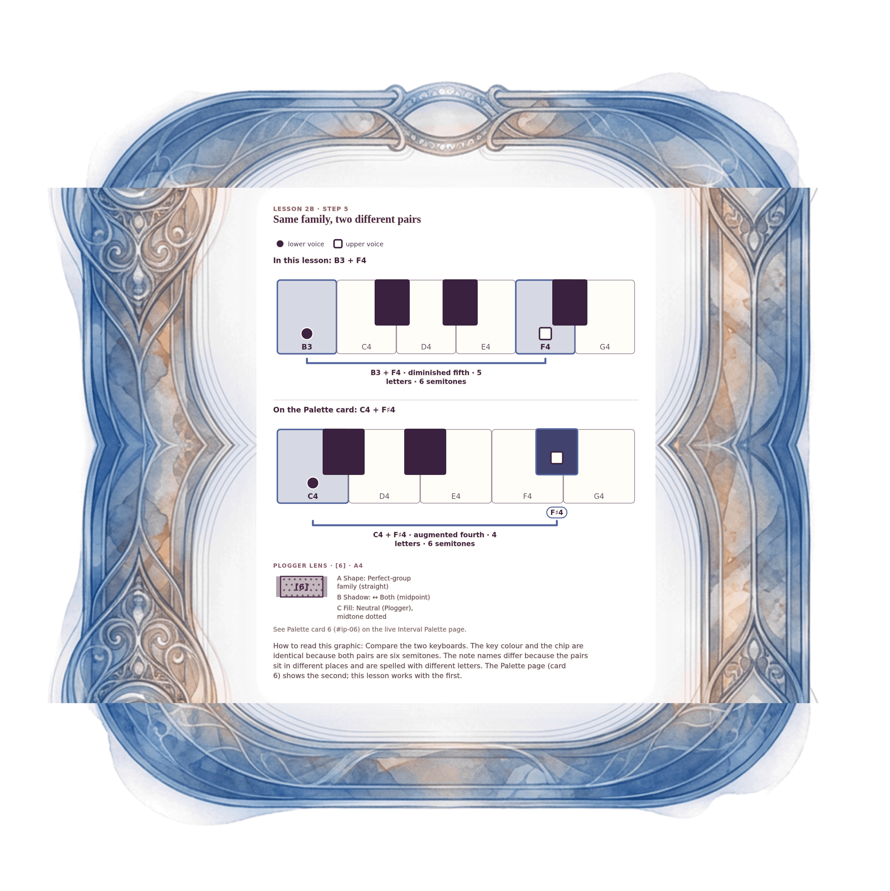

[⟵ 2B-12](2B-12.print.md) · [**Index**](../README.md) · [2C-01 ⟶](2C-01.print.md)

# 2B-13 — The tritone family: B3–F4 beside the Palette card C4–F♯4

**View:** [desktop](2B-13.desktop.md) · [phone](2B-13.phone.md) · **[ print ]**  
**Section:** Lesson 2B — How two voices move · **Step(s):** 2B:5 · 40 of 50

### Zoom the real file
- 🔍 **[Open the full-size print PNG directly (browser pinch/zoom, 1143 KB)](https://github.com/epaulson2/amf-app/raw/feat/ajourne-m08-week2-transparent-infographics-20261107/docs/m08/assets/2B-13/2B-13.print.png)**
- [GitHub image viewer page](../assets/2B-13/2B-13.print.png) · [Download / view editable SVG](../assets/2B-13/2B-13.print.svg) ([raw SVG](https://github.com/epaulson2/amf-app/raw/feat/ajourne-m08-week2-transparent-infographics-20261107/docs/m08/assets/2B-13/2B-13.print.svg))

*The picture above is the actual print PNG file (transparent; GitHub shows it on its own page colour). Click it to open the raw full-size file.*

**What it teaches:** Two different pairs, one tritone colour and one chip. B3–F4 (five letters) and C4–F♯4 (four letters) are both six semitones. The lesson uses B3–F4; the Palette card draws C4–F♯4. They are separate examples of the same family.

**How to read it:** Compare the two keyboards. The key colour and the chip are identical because both pairs are six semitones. The note names differ because the pairs sit in different places and are spelled with different letters. The Palette page (card 6) shows the second; this lesson works with the first.

All files: desktop [PNG](../assets/2B-13/2B-13.desktop.png) / [SVG](../assets/2B-13/2B-13.desktop.svg) · phone [PNG](../assets/2B-13/2B-13.phone.png) / [SVG](../assets/2B-13/2B-13.phone.svg) · print [PNG](../assets/2B-13/2B-13.print.png) / [SVG](../assets/2B-13/2B-13.print.svg) · [proof on cream and slate](../proof/2B-13.proof.jpg)

[⟵ 2B-12](2B-12.print.md) · [**Index**](../README.md) · [2C-01 ⟶](2C-01.print.md)
