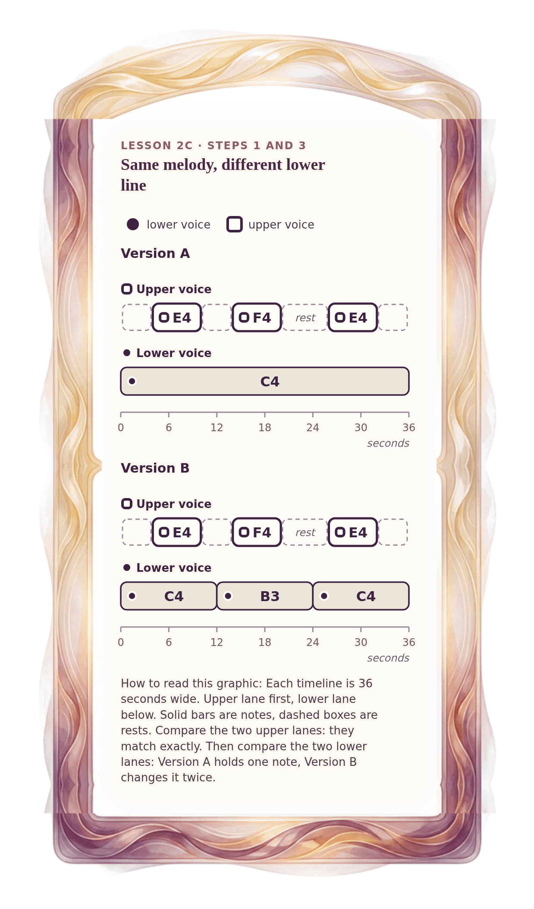

[⟵ 2B-13](2B-13.phone.md) · [**Index**](../README.md) · [2C-02 ⟶](2C-02.phone.md)

# 2C-01 — Two 36-second sketches: same upper line, different lower line

**View:** [desktop](2C-01.desktop.md) · **[ phone ]** · [print](2C-01.print.md)  
**Section:** Lesson 2C — Two voices through time · **Step(s):** 2C:1, 2C:3 · 41 of 50

### Zoom the real file
- 🔍 **[Open the full-size phone PNG directly (browser pinch/zoom, 303 KB)](https://github.com/epaulson2/amf-app/raw/feat/ajourne-m08-week2-transparent-infographics-20261107/docs/m08/assets/2C-01/2C-01.phone.png)**
- [GitHub image viewer page](../assets/2C-01/2C-01.phone.png) · [Download / view editable SVG](../assets/2C-01/2C-01.phone.svg) ([raw SVG](https://github.com/epaulson2/amf-app/raw/feat/ajourne-m08-week2-transparent-infographics-20261107/docs/m08/assets/2C-01/2C-01.phone.svg))

*The picture above is the actual phone PNG file (transparent; GitHub shows it on its own page colour). Click it to open the raw full-size file.*

**What it teaches:** Two sketches of the same melody over different lower lines. The upper line is identical in both; only the lower voice differs.

**How to read it:** Each timeline is 36 seconds wide. Upper lane first, lower lane below. Solid bars are notes, dashed boxes are rests. Compare the two upper lanes: they match exactly. Then compare the two lower lanes: Version A holds one note, Version B changes it twice.

All files: desktop [PNG](../assets/2C-01/2C-01.desktop.png) / [SVG](../assets/2C-01/2C-01.desktop.svg) · phone [PNG](../assets/2C-01/2C-01.phone.png) / [SVG](../assets/2C-01/2C-01.phone.svg) · print [PNG](../assets/2C-01/2C-01.print.png) / [SVG](../assets/2C-01/2C-01.print.svg) · [proof on cream and slate](../proof/2C-01.proof.jpg)

[⟵ 2B-13](2B-13.phone.md) · [**Index**](../README.md) · [2C-02 ⟶](2C-02.phone.md)
