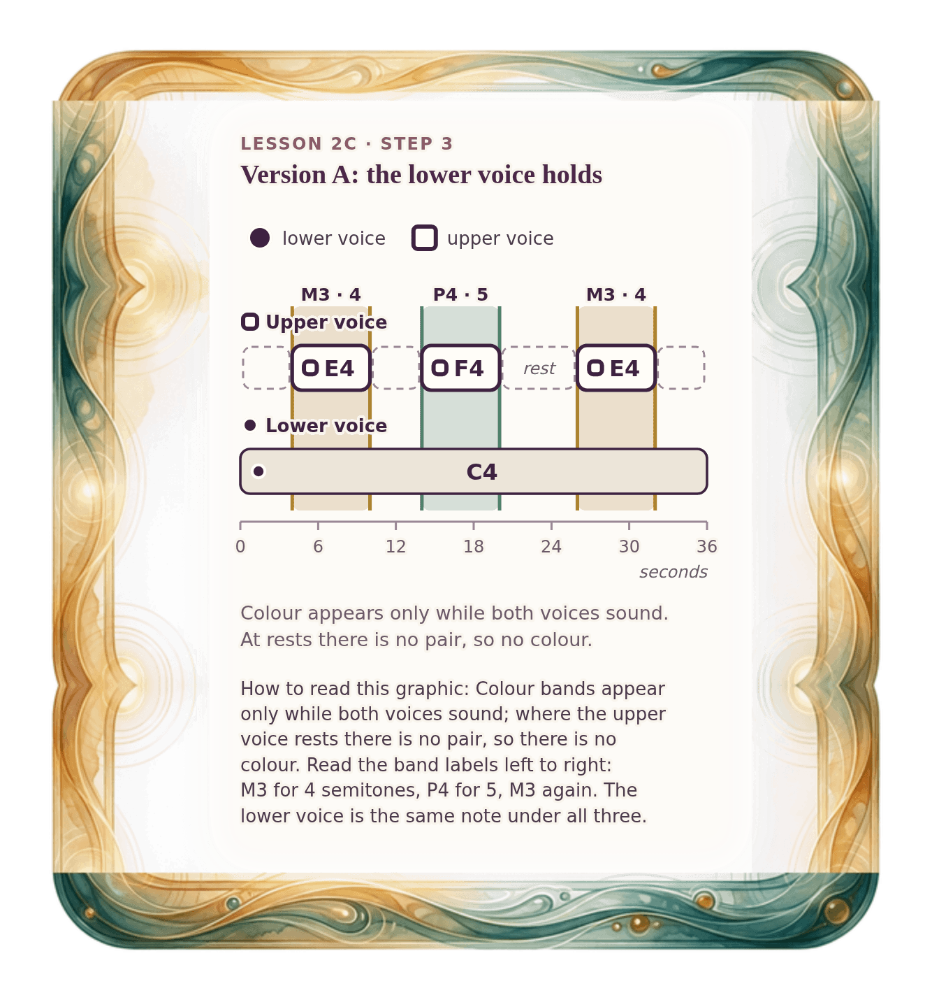

[⟵ 2C-01](2C-01.phone.md) · [**Index**](../README.md) · [2C-03 ⟶](2C-03.phone.md)

# 2C-02 — Version A: one voice holds the landscape

**View:** [desktop](2C-02.desktop.md) · **[ phone ]** · [print](2C-02.print.md)  
**Section:** Lesson 2C — Two voices through time · **Step(s):** 2C:3 · 42 of 50

### Zoom the real file
- 🔍 **[Open the full-size phone PNG directly (browser pinch/zoom, 297 KB)](https://github.com/epaulson2/amf-app/raw/feat/ajourne-m08-week2-transparent-infographics-20261107/docs/m08/assets/2C-02/2C-02.phone.png)**
- [GitHub image viewer page](../assets/2C-02/2C-02.phone.png) · [Download / view editable SVG](../assets/2C-02/2C-02.phone.svg) ([raw SVG](https://github.com/epaulson2/amf-app/raw/feat/ajourne-m08-week2-transparent-infographics-20261107/docs/m08/assets/2C-02/2C-02.phone.svg))

*The picture above is the actual phone PNG file (transparent; GitHub shows it on its own page colour). Click it to open the raw full-size file.*

**What it teaches:** With a held lower note, the pair changes only when the upper voice moves: C4 + E4 (major third), C4 + F4 (perfect fourth), then C4 + E4 again.

**How to read it:** Colour bands appear only while both voices sound; where the upper voice rests there is no pair, so there is no colour. Read the band labels left to right: M3 for 4 semitones, P4 for 5, M3 again. The lower voice is the same note under all three.

All files: desktop [PNG](../assets/2C-02/2C-02.desktop.png) / [SVG](../assets/2C-02/2C-02.desktop.svg) · phone [PNG](../assets/2C-02/2C-02.phone.png) / [SVG](../assets/2C-02/2C-02.phone.svg) · print [PNG](../assets/2C-02/2C-02.print.png) / [SVG](../assets/2C-02/2C-02.print.svg) · [proof on cream and slate](../proof/2C-02.proof.jpg)

[⟵ 2C-01](2C-01.phone.md) · [**Index**](../README.md) · [2C-03 ⟶](2C-03.phone.md)
