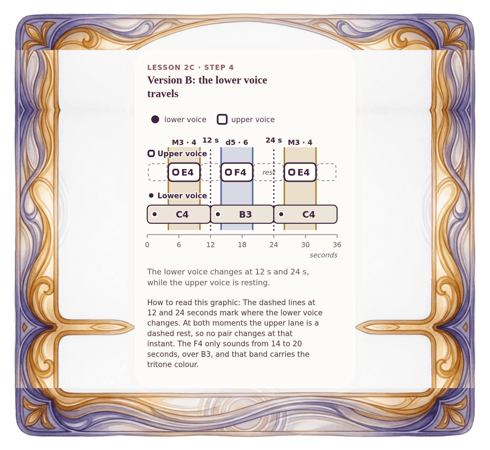

[⟵ 2C-02](2C-02.phone.md) · [**Index**](../README.md) · [2C-04 ⟶](2C-04.phone.md)

# 2C-03 — Version B: the landscape begins to travel

**View:** [desktop](2C-03.desktop.md) · **[ phone ]** · [print](2C-03.print.md)  
**Section:** Lesson 2C — Two voices through time · **Step(s):** 2C:4 · 43 of 50

### Zoom the real file
- 🔍 **[Open the full-size phone PNG directly (browser pinch/zoom, 529 KB)](https://github.com/epaulson2/amf-app/raw/feat/ajourne-m08-week2-transparent-infographics-20261107/docs/m08/assets/2C-03/2C-03.phone.png)**
- [GitHub image viewer page](../assets/2C-03/2C-03.phone.png) · [Download / view editable SVG](../assets/2C-03/2C-03.phone.svg) ([raw SVG](https://github.com/epaulson2/amf-app/raw/feat/ajourne-m08-week2-transparent-infographics-20261107/docs/m08/assets/2C-03/2C-03.phone.svg))

*The picture above is the actual phone PNG file (transparent; GitHub shows it on its own page colour). Click it to open the raw full-size file.*

**What it teaches:** When the lower voice moves under the same melody, one moment changes: from 14 to 20 seconds the pair is B3 + F4, a diminished fifth, instead of C4 + F4.

**How to read it:** The dashed lines at 12 and 24 seconds mark where the lower voice changes. At both moments the upper lane is a dashed rest, so no pair changes at that instant. The F4 only sounds from 14 to 20 seconds, over B3, and that band carries the tritone colour.

All files: desktop [PNG](../assets/2C-03/2C-03.desktop.png) / [SVG](../assets/2C-03/2C-03.desktop.svg) · phone [PNG](../assets/2C-03/2C-03.phone.png) / [SVG](../assets/2C-03/2C-03.phone.svg) · print [PNG](../assets/2C-03/2C-03.print.png) / [SVG](../assets/2C-03/2C-03.print.svg) · [proof on cream and slate](../proof/2C-03.proof.jpg)

[⟵ 2C-02](2C-02.phone.md) · [**Index**](../README.md) · [2C-04 ⟶](2C-04.phone.md)
