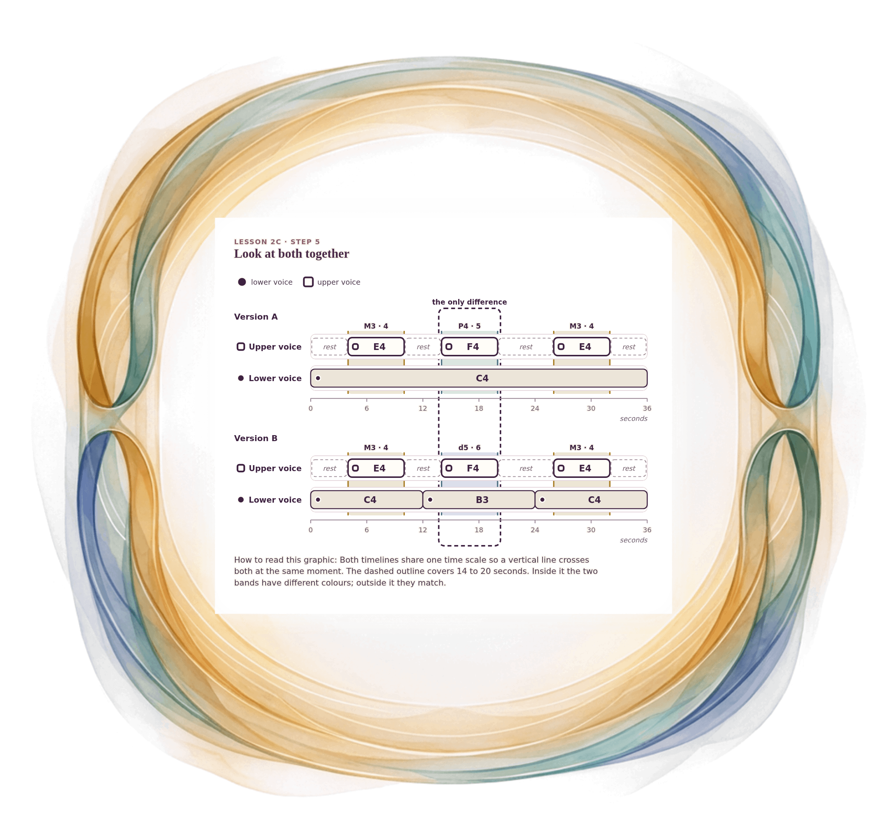

[⟵ 2C-03](2C-03.print.md) · [**Index**](../README.md) · [2C-05 ⟶](2C-05.print.md)

# 2C-04 — Same melody, one moment different: A above B

**View:** [desktop](2C-04.desktop.md) · [phone](2C-04.phone.md) · **[ print ]**  
**Section:** Lesson 2C — Two voices through time · **Step(s):** 2C:5 · 44 of 50

### Zoom the real file
- 🔍 **[Open the full-size print PNG directly (browser pinch/zoom, 740 KB)](https://github.com/epaulson2/amf-app/raw/feat/ajourne-m08-week2-transparent-infographics-20261107/docs/m08/assets/2C-04/2C-04.print.png)**
- [GitHub image viewer page](../assets/2C-04/2C-04.print.png) · [Download / view editable SVG](../assets/2C-04/2C-04.print.svg) ([raw SVG](https://github.com/epaulson2/amf-app/raw/feat/ajourne-m08-week2-transparent-infographics-20261107/docs/m08/assets/2C-04/2C-04.print.svg))

*The picture above is the actual print PNG file (transparent; GitHub shows it on its own page colour). Click it to open the raw full-size file.*

**What it teaches:** Stack the two versions and look: the upper line and the first and last pairs are identical. Only from 14 to 20 seconds does the lower voice change what the pair is.

**How to read it:** Both timelines share one time scale so a vertical line crosses both at the same moment. The dashed outline covers 14 to 20 seconds. Inside it the two bands have different colours; outside it they match.

All files: desktop [PNG](../assets/2C-04/2C-04.desktop.png) / [SVG](../assets/2C-04/2C-04.desktop.svg) · phone [PNG](../assets/2C-04/2C-04.phone.png) / [SVG](../assets/2C-04/2C-04.phone.svg) · print [PNG](../assets/2C-04/2C-04.print.png) / [SVG](../assets/2C-04/2C-04.print.svg) · [proof on cream and slate](../proof/2C-04.proof.jpg)

[⟵ 2C-03](2C-03.print.md) · [**Index**](../README.md) · [2C-05 ⟶](2C-05.print.md)
