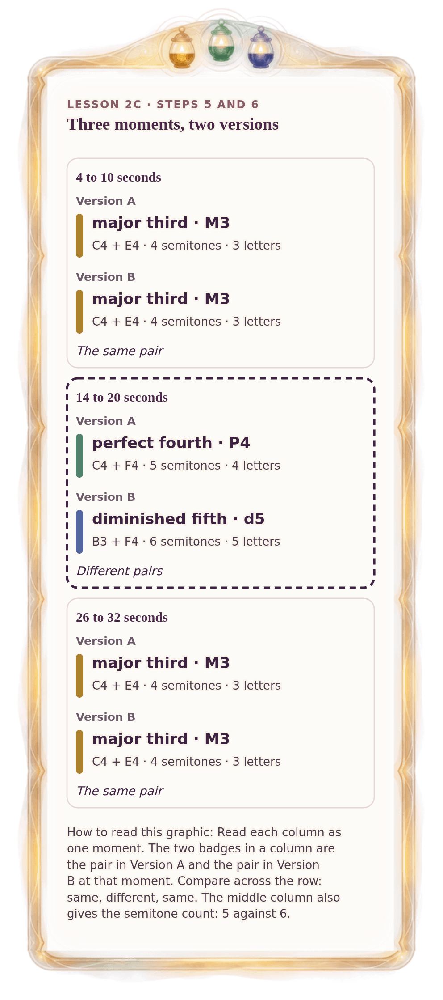

[⟵ 2C-04](2C-04.phone.md) · [**Index**](../README.md) · [2C-06 ⟶](2C-06.phone.md)

# 2C-05 — Three snapshots: what stayed, what changed

**View:** [desktop](2C-05.desktop.md) · **[ phone ]** · [print](2C-05.print.md)  
**Section:** Lesson 2C — Two voices through time · **Step(s):** 2C:5, 2C:6 · 45 of 50

### Zoom the real file
- 🔍 **[Open the full-size phone PNG directly (browser pinch/zoom, 210 KB)](https://github.com/epaulson2/amf-app/raw/feat/ajourne-m08-week2-transparent-infographics-20261107/docs/m08/assets/2C-05/2C-05.phone.png)**
- [GitHub image viewer page](../assets/2C-05/2C-05.phone.png) · [Download / view editable SVG](../assets/2C-05/2C-05.phone.svg) ([raw SVG](https://github.com/epaulson2/amf-app/raw/feat/ajourne-m08-week2-transparent-infographics-20261107/docs/m08/assets/2C-05/2C-05.phone.svg))

*The picture above is the actual phone PNG file (transparent; GitHub shows it on its own page colour). Click it to open the raw full-size file.*

**What it teaches:** Three moments side by side. In two of them the two versions have the same pair; in exactly one, the middle, they differ.

**How to read it:** Read each column as one moment. The two badges in a column are the pair in Version A and the pair in Version B at that moment. Compare across the row: same, different, same. The middle column also gives the semitone count: 5 against 6.

All files: desktop [PNG](../assets/2C-05/2C-05.desktop.png) / [SVG](../assets/2C-05/2C-05.desktop.svg) · phone [PNG](../assets/2C-05/2C-05.phone.png) / [SVG](../assets/2C-05/2C-05.phone.svg) · print [PNG](../assets/2C-05/2C-05.print.png) / [SVG](../assets/2C-05/2C-05.print.svg) · [proof on cream and slate](../proof/2C-05.proof.jpg)

[⟵ 2C-04](2C-04.phone.md) · [**Index**](../README.md) · [2C-06 ⟶](2C-06.phone.md)
