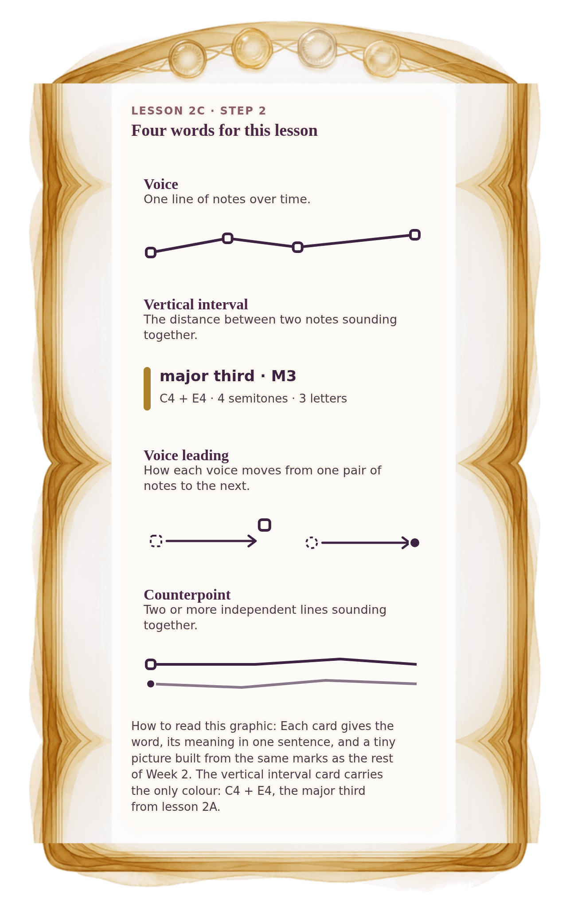

[⟵ 2C-05](2C-05.phone.md) · [**Index**](../README.md) · [2C-07 ⟶](2C-07.phone.md)

# 2C-06 — Four words: voice, vertical interval, voice leading, counterpoint

**View:** [desktop](2C-06.desktop.md) · **[ phone ]** · [print](2C-06.print.md)  
**Section:** Lesson 2C — Two voices through time · **Step(s):** 2C:2, 2C:6 · 46 of 50

### Zoom the real file
- 🔍 **[Open the full-size phone PNG directly (browser pinch/zoom, 363 KB)](https://github.com/epaulson2/amf-app/raw/feat/ajourne-m08-week2-transparent-infographics-20261107/docs/m08/assets/2C-06/2C-06.phone.png)**
- [GitHub image viewer page](../assets/2C-06/2C-06.phone.png) · [Download / view editable SVG](../assets/2C-06/2C-06.phone.svg) ([raw SVG](https://github.com/epaulson2/amf-app/raw/feat/ajourne-m08-week2-transparent-infographics-20261107/docs/m08/assets/2C-06/2C-06.phone.svg))

*The picture above is the actual phone PNG file (transparent; GitHub shows it on its own page colour). Click it to open the raw full-size file.*

**What it teaches:** Four words for the week's ideas, each with a small picture: one line, the gap between two notes at one moment, how lines travel between moments, and independent lines together.

**How to read it:** Each card gives the word, its meaning in one sentence, and a tiny picture built from the same marks as the rest of Week 2. The vertical interval card carries the only colour: C4 + E4, the major third from lesson 2A.

All files: desktop [PNG](../assets/2C-06/2C-06.desktop.png) / [SVG](../assets/2C-06/2C-06.desktop.svg) · phone [PNG](../assets/2C-06/2C-06.phone.png) / [SVG](../assets/2C-06/2C-06.phone.svg) · print [PNG](../assets/2C-06/2C-06.print.png) / [SVG](../assets/2C-06/2C-06.print.svg) · [proof on cream and slate](../proof/2C-06.proof.jpg)

[⟵ 2C-05](2C-05.phone.md) · [**Index**](../README.md) · [2C-07 ⟶](2C-07.phone.md)
