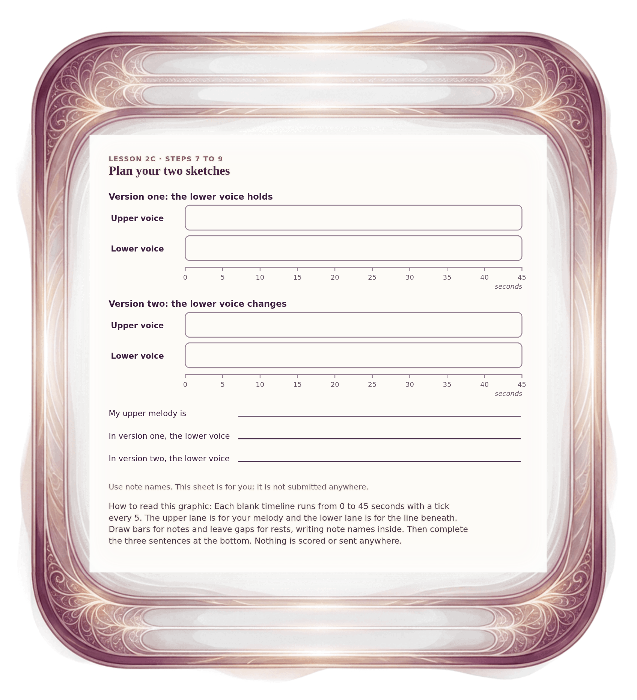

[⟵ 2C-06](2C-06.desktop.md) · [**Index**](../README.md) · [2C-08 ⟶](2C-08.desktop.md)

# 2C-07 — Plan your miniature: two blank timelines

**View:** **[ desktop ]** · [phone](2C-07.phone.md) · [print](2C-07.print.md)  
**Section:** Lesson 2C — Two voices through time · **Step(s):** 2C:8, 2C:9 · 47 of 50

### Zoom the real file
- 🔍 **[Open the full-size desktop PNG directly (browser pinch/zoom, 502 KB)](https://github.com/epaulson2/amf-app/raw/feat/ajourne-m08-week2-transparent-infographics-20261107/docs/m08/assets/2C-07/2C-07.desktop.png)**
- [GitHub image viewer page](../assets/2C-07/2C-07.desktop.png) · [Download / view editable SVG](../assets/2C-07/2C-07.desktop.svg) ([raw SVG](https://github.com/epaulson2/amf-app/raw/feat/ajourne-m08-week2-transparent-infographics-20261107/docs/m08/assets/2C-07/2C-07.desktop.svg))

*The picture above is the actual desktop PNG file (transparent; GitHub shows it on its own page colour). Click it to open the raw full-size file.*

**What it teaches:** A paper planning sheet for your own two sketches: draw where each voice sounds and rests, write note names, and finish three plan sentences.

**How to read it:** Each blank timeline runs from 0 to 45 seconds with a tick every 5. The upper lane is for your melody and the lower lane is for the line beneath. Draw bars for notes and leave gaps for rests, writing note names inside. Then complete the three sentences at the bottom. Nothing is scored or sent anywhere.

All files: desktop [PNG](../assets/2C-07/2C-07.desktop.png) / [SVG](../assets/2C-07/2C-07.desktop.svg) · phone [PNG](../assets/2C-07/2C-07.phone.png) / [SVG](../assets/2C-07/2C-07.phone.svg) · print [PNG](../assets/2C-07/2C-07.print.png) / [SVG](../assets/2C-07/2C-07.print.svg) · [proof on cream and slate](../proof/2C-07.proof.jpg)

[⟵ 2C-06](2C-06.desktop.md) · [**Index**](../README.md) · [2C-08 ⟶](2C-08.desktop.md)
