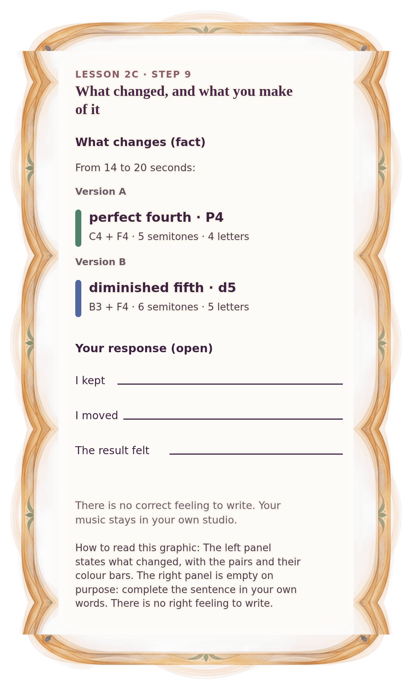

[⟵ 2C-07](2C-07.phone.md) · [**Index**](../README.md) · [2C-09 ⟶](2C-09.phone.md)

# 2C-08 — What changes, and your response

**View:** [desktop](2C-08.desktop.md) · **[ phone ]** · [print](2C-08.print.md)  
**Section:** Lesson 2C — Two voices through time · **Step(s):** 2C:9 · 48 of 50

### Zoom the real file
- 🔍 **[Open the full-size phone PNG directly (browser pinch/zoom, 264 KB)](https://github.com/epaulson2/amf-app/raw/feat/ajourne-m08-week2-transparent-infographics-20261107/docs/m08/assets/2C-08/2C-08.phone.png)**
- [GitHub image viewer page](../assets/2C-08/2C-08.phone.png) · [Download / view editable SVG](../assets/2C-08/2C-08.phone.svg) ([raw SVG](https://github.com/epaulson2/amf-app/raw/feat/ajourne-m08-week2-transparent-infographics-20261107/docs/m08/assets/2C-08/2C-08.phone.svg))

*The picture above is the actual phone PNG file (transparent; GitHub shows it on its own page colour). Click it to open the raw full-size file.*

**What it teaches:** Separate what the notes did (a fact) from what you make of it (your response). The facts are shown; the response is yours and has no correct answer.

**How to read it:** The left panel states what changed, with the pairs and their colour bars. The right panel is empty on purpose: complete the sentence in your own words. There is no right feeling to write.

All files: desktop [PNG](../assets/2C-08/2C-08.desktop.png) / [SVG](../assets/2C-08/2C-08.desktop.svg) · phone [PNG](../assets/2C-08/2C-08.phone.png) / [SVG](../assets/2C-08/2C-08.phone.svg) · print [PNG](../assets/2C-08/2C-08.print.png) / [SVG](../assets/2C-08/2C-08.print.svg) · [proof on cream and slate](../proof/2C-08.proof.jpg)

[⟵ 2C-07](2C-07.phone.md) · [**Index**](../README.md) · [2C-09 ⟶](2C-09.phone.md)
