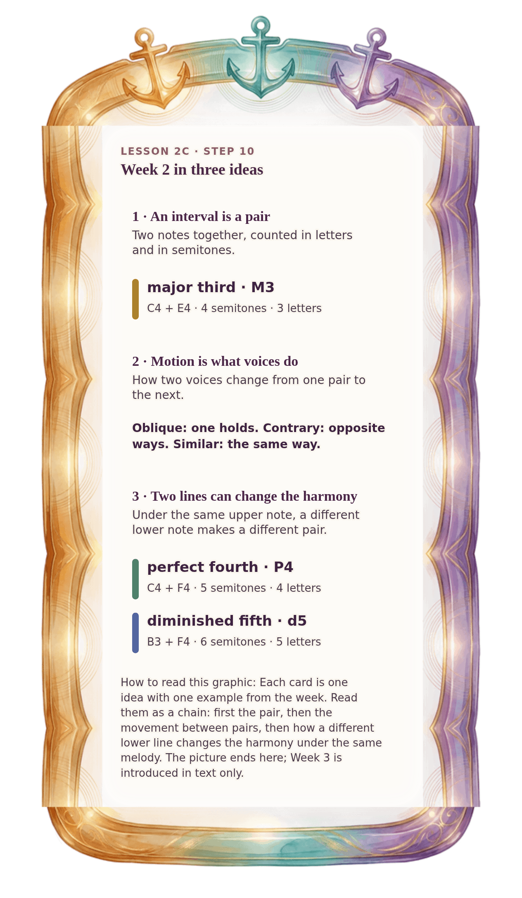

[⟵ 2C-08](2C-08.phone.md) · [**Index**](../README.md) · [2C-10 ⟶](2C-10.phone.md)

# 2C-09 — Week 2 in three anchors

**View:** [desktop](2C-09.desktop.md) · **[ phone ]** · [print](2C-09.print.md)  
**Section:** Lesson 2C — Two voices through time · **Step(s):** 2C:10 · 49 of 50

### Zoom the real file
- 🔍 **[Open the full-size phone PNG directly (browser pinch/zoom, 402 KB)](https://github.com/epaulson2/amf-app/raw/feat/ajourne-m08-week2-transparent-infographics-20261107/docs/m08/assets/2C-09/2C-09.phone.png)**
- [GitHub image viewer page](../assets/2C-09/2C-09.phone.png) · [Download / view editable SVG](../assets/2C-09/2C-09.phone.svg) ([raw SVG](https://github.com/epaulson2/amf-app/raw/feat/ajourne-m08-week2-transparent-infographics-20261107/docs/m08/assets/2C-09/2C-09.phone.svg))

*The picture above is the actual phone PNG file (transparent; GitHub shows it on its own page colour). Click it to open the raw full-size file.*

**What it teaches:** The whole week in three sentences: an interval is a pair counted two ways; motion is what two voices do between pairs; two lines are enough to make changing harmony.

**How to read it:** Each card is one idea with one example from the week. Read them as a chain: first the pair, then the movement between pairs, then how a different lower line changes the harmony under the same melody. The picture ends here; Week 3 is introduced in text only.

All files: desktop [PNG](../assets/2C-09/2C-09.desktop.png) / [SVG](../assets/2C-09/2C-09.desktop.svg) · phone [PNG](../assets/2C-09/2C-09.phone.png) / [SVG](../assets/2C-09/2C-09.phone.svg) · print [PNG](../assets/2C-09/2C-09.print.png) / [SVG](../assets/2C-09/2C-09.print.svg) · [proof on cream and slate](../proof/2C-09.proof.jpg)

[⟵ 2C-08](2C-08.phone.md) · [**Index**](../README.md) · [2C-10 ⟶](2C-10.phone.md)
