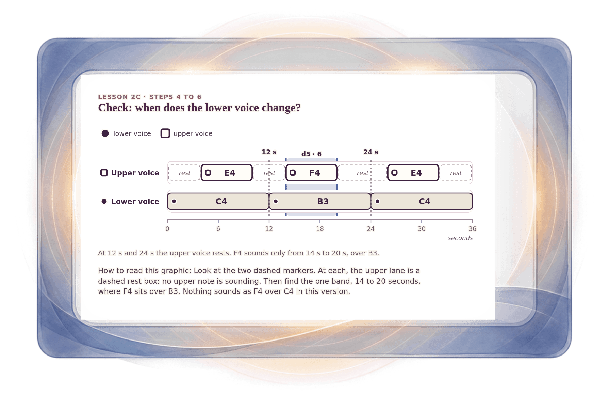

[⟵ 2C-09](2C-09.print.md) · [**Index**](../README.md) · [A-02 ⟶](A-02.print.md)

# 2C-10 — The truth check: the lower voice moves while the upper rests

**View:** [desktop](2C-10.desktop.md) · [phone](2C-10.phone.md) · **[ print ]**  
**Section:** Lesson 2C — Two voices through time · **Step(s):** 2C:4, 2C:5, 2C:6 · 50 of 50

### Zoom the real file
- 🔍 **[Open the full-size print PNG directly (browser pinch/zoom, 253 KB)](https://github.com/epaulson2/amf-app/raw/feat/ajourne-m08-week2-transparent-infographics-20261107/docs/m08/assets/2C-10/2C-10.print.png)**
- [GitHub image viewer page](../assets/2C-10/2C-10.print.png) · [Download / view editable SVG](../assets/2C-10/2C-10.print.svg) ([raw SVG](https://github.com/epaulson2/amf-app/raw/feat/ajourne-m08-week2-transparent-infographics-20261107/docs/m08/assets/2C-10/2C-10.print.svg))

*The picture above is the actual print PNG file (transparent; GitHub shows it on its own page colour). Click it to open the raw full-size file.*

**What it teaches:** A check on the sketch: the lower voice changes at 12 and 24 seconds, but the upper voice is resting then, so F4 is never sounding when the lower note changes. F4 appears only from 14 to 20 seconds, over B3.

**How to read it:** Look at the two dashed markers. At each, the upper lane is a dashed rest box: no upper note is sounding. Then find the one band, 14 to 20 seconds, where F4 sits over B3. Nothing sounds as F4 over C4 in this version.

All files: desktop [PNG](../assets/2C-10/2C-10.desktop.png) / [SVG](../assets/2C-10/2C-10.desktop.svg) · phone [PNG](../assets/2C-10/2C-10.phone.png) / [SVG](../assets/2C-10/2C-10.phone.svg) · print [PNG](../assets/2C-10/2C-10.print.png) / [SVG](../assets/2C-10/2C-10.print.svg) · [proof on cream and slate](../proof/2C-10.proof.jpg)

[⟵ 2C-09](2C-09.print.md) · [**Index**](../README.md) · [A-02 ⟶](A-02.print.md)
