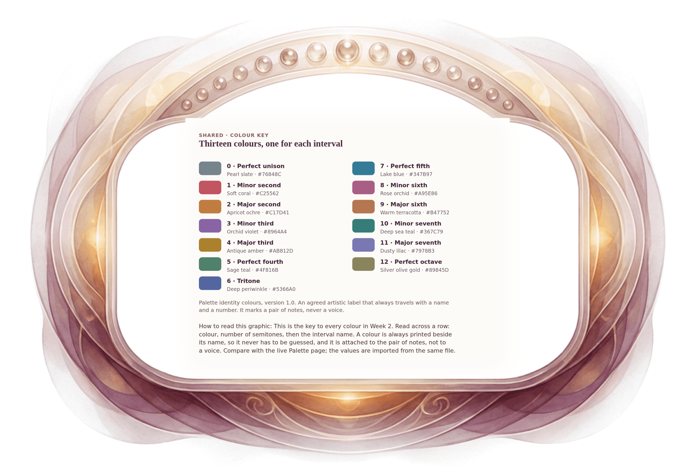

[⟵ 2C-10](2C-10.desktop.md) · [**Index**](../README.md) · [A-03 ⟶](A-03.desktop.md)

# A-02 — The thirteen interval identity colours

**View:** **[ desktop ]** · [phone](A-02.phone.md) · [print](A-02.print.md)  
**Section:** Shared references · **Step(s):** H · 1 of 50

### Zoom the real file
- 🔍 **[Open the full-size desktop PNG directly (browser pinch/zoom, 663 KB)](https://github.com/epaulson2/amf-app/raw/feat/ajourne-m08-week2-transparent-infographics-20261107/docs/m08/assets/A-02/A-02.desktop.png)**
- [GitHub image viewer page](../assets/A-02/A-02.desktop.png) · [Download / view editable SVG](../assets/A-02/A-02.desktop.svg) ([raw SVG](https://github.com/epaulson2/amf-app/raw/feat/ajourne-m08-week2-transparent-infographics-20261107/docs/m08/assets/A-02/A-02.desktop.svg))

*The picture above is the actual desktop PNG file (transparent; GitHub shows it on its own page colour). Click it to open the raw full-size file.*

**What it teaches:** The thirteen identity colours of the Interval Palette, each next to the name and semitone count it belongs to. The colour is an agreed artistic label for a pair of notes, never a property of sound.

**How to read it:** This is the key to every colour in Week 2. Read across a row: colour, number of semitones, then the interval name. A colour is always printed beside its name, so it never has to be guessed, and it is attached to the pair of notes, not to a voice. Compare with the live Palette page; the values are imported from the same file.

All files: desktop [PNG](../assets/A-02/A-02.desktop.png) / [SVG](../assets/A-02/A-02.desktop.svg) · phone [PNG](../assets/A-02/A-02.phone.png) / [SVG](../assets/A-02/A-02.phone.svg) · print [PNG](../assets/A-02/A-02.print.png) / [SVG](../assets/A-02/A-02.print.svg) · [proof on cream and slate](../proof/A-02.proof.jpg)

[⟵ 2C-10](2C-10.desktop.md) · [**Index**](../README.md) · [A-03 ⟶](A-03.desktop.md)
