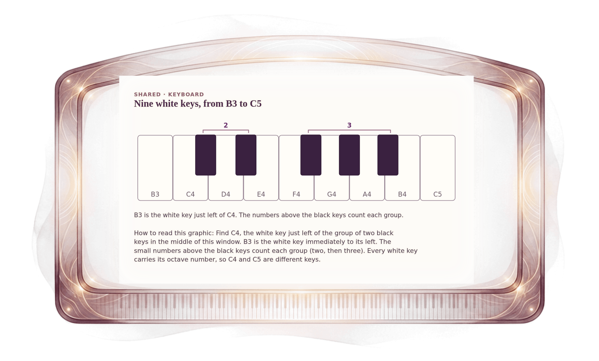

[⟵ A-02](A-02.desktop.md) · [**Index**](../README.md) · [A-04 ⟶](A-04.desktop.md)

# A-03 — The Week 2 keyboard window, B3 to C5

**View:** **[ desktop ]** · [phone](A-03.phone.md) · [print](A-03.print.md)  
**Section:** Shared references · **Step(s):** 2A:1, 2A:7, 2A:9, 2B:3, 2C:7 · 2 of 50

### Zoom the real file
- 🔍 **[Open the full-size desktop PNG directly (browser pinch/zoom, 346 KB)](https://github.com/epaulson2/amf-app/raw/feat/ajourne-m08-week2-transparent-infographics-20261107/docs/m08/assets/A-03/A-03.desktop.png)**
- [GitHub image viewer page](../assets/A-03/A-03.desktop.png) · [Download / view editable SVG](../assets/A-03/A-03.desktop.svg) ([raw SVG](https://github.com/epaulson2/amf-app/raw/feat/ajourne-m08-week2-transparent-infographics-20261107/docs/m08/assets/A-03/A-03.desktop.svg))

*The picture above is the actual desktop PNG file (transparent; GitHub shows it on its own page colour). Click it to open the raw full-size file.*

**What it teaches:** The keyboard window Week 2 uses. It starts on B3, so the note just below C4 is on the picture, and every key is named with its octave number.

**How to read it:** Find C4, the white key just left of the group of two black keys in the middle of this window. B3 is the white key immediately to its left. The small numbers above the black keys count each group (two, then three). Every white key carries its octave number, so C4 and C5 are different keys.

All files: desktop [PNG](../assets/A-03/A-03.desktop.png) / [SVG](../assets/A-03/A-03.desktop.svg) · phone [PNG](../assets/A-03/A-03.phone.png) / [SVG](../assets/A-03/A-03.phone.svg) · print [PNG](../assets/A-03/A-03.print.png) / [SVG](../assets/A-03/A-03.print.svg) · [proof on cream and slate](../proof/A-03.proof.jpg)

[⟵ A-02](A-02.desktop.md) · [**Index**](../README.md) · [A-04 ⟶](A-04.desktop.md)
