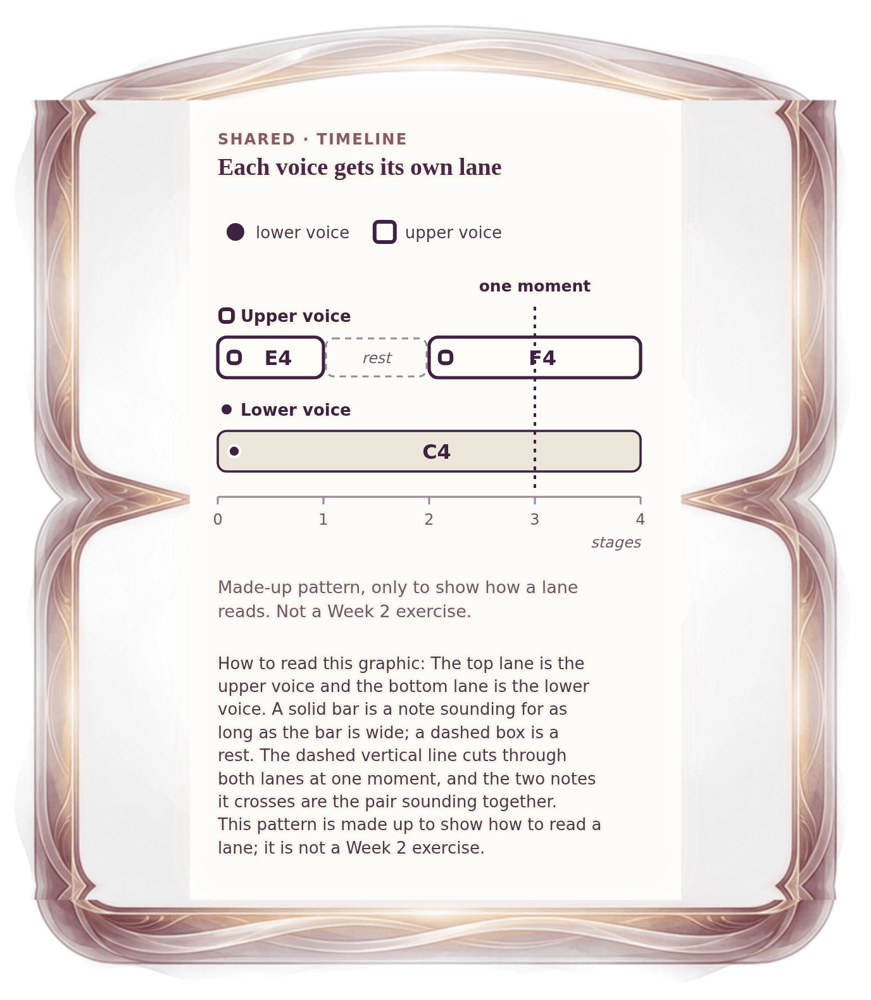

[⟵ A-03](A-03.phone.md) · [**Index**](../README.md) · [A-05 ⟶](A-05.phone.md)

# A-04 — Reading a two-lane timeline

**View:** [desktop](A-04.desktop.md) · **[ phone ]** · [print](A-04.print.md)  
**Section:** Shared references · **Step(s):** 2A:2, 2B:2, 2C:1, 2C:7 · 3 of 50

### Zoom the real file
- 🔍 **[Open the full-size phone PNG directly (browser pinch/zoom, 310 KB)](https://github.com/epaulson2/amf-app/raw/feat/ajourne-m08-week2-transparent-infographics-20261107/docs/m08/assets/A-04/A-04.phone.png)**
- [GitHub image viewer page](../assets/A-04/A-04.phone.png) · [Download / view editable SVG](../assets/A-04/A-04.phone.svg) ([raw SVG](https://github.com/epaulson2/amf-app/raw/feat/ajourne-m08-week2-transparent-infographics-20261107/docs/m08/assets/A-04/A-04.phone.svg))

*The picture above is the actual phone PNG file (transparent; GitHub shows it on its own page colour). Click it to open the raw full-size file.*

**What it teaches:** How a lane works: each voice has its own row, bars are notes, dashed boxes are rests, and one vertical slice is a single moment of two notes together.

**How to read it:** The top lane is the upper voice and the bottom lane is the lower voice. A solid bar is a note sounding for as long as the bar is wide; a dashed box is a rest. The dashed vertical line cuts through both lanes at one moment, and the two notes it crosses are the pair sounding together. This pattern is made up to show how to read a lane; it is not a Week 2 exercise.

All files: desktop [PNG](../assets/A-04/A-04.desktop.png) / [SVG](../assets/A-04/A-04.desktop.svg) · phone [PNG](../assets/A-04/A-04.phone.png) / [SVG](../assets/A-04/A-04.phone.svg) · print [PNG](../assets/A-04/A-04.print.png) / [SVG](../assets/A-04/A-04.print.svg) · [proof on cream and slate](../proof/A-04.proof.jpg)

[⟵ A-03](A-03.phone.md) · [**Index**](../README.md) · [A-05 ⟶](A-05.phone.md)
