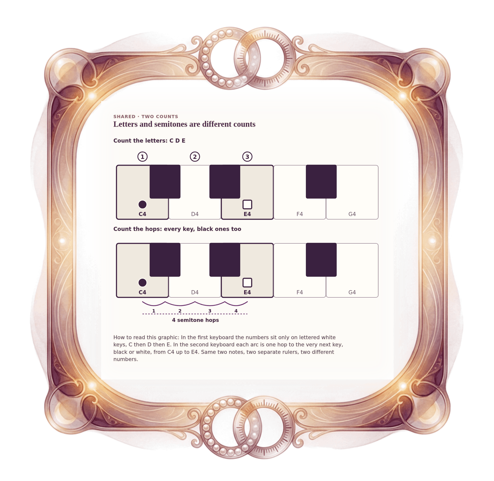

[⟵ A-04](A-04.desktop.md) · [**Index**](../README.md) · [A-06 ⟶](A-06.desktop.md)

# A-05 — Counting letters is not counting semitones

**View:** **[ desktop ]** · [phone](A-05.phone.md) · [print](A-05.print.md)  
**Section:** Shared references · **Step(s):** 2A:3, 2A:4 · 4 of 50

### Zoom the real file
- 🔍 **[Open the full-size desktop PNG directly (browser pinch/zoom, 587 KB)](https://github.com/epaulson2/amf-app/raw/feat/ajourne-m08-week2-transparent-infographics-20261107/docs/m08/assets/A-05/A-05.desktop.png)**
- [GitHub image viewer page](../assets/A-05/A-05.desktop.png) · [Download / view editable SVG](../assets/A-05/A-05.desktop.svg) ([raw SVG](https://github.com/epaulson2/amf-app/raw/feat/ajourne-m08-week2-transparent-infographics-20261107/docs/m08/assets/A-05/A-05.desktop.svg))

*The picture above is the actual desktop PNG file (transparent; GitHub shows it on its own page colour). Click it to open the raw full-size file.*

**What it teaches:** Two different counts for the same two notes: three letters (C, D, E) and four semitone hops from C4 to E4. The black keys count as hops but not as letters.

**How to read it:** In the first keyboard the numbers sit only on lettered white keys, C then D then E. In the second keyboard each arc is one hop to the very next key, black or white, from C4 up to E4. Same two notes, two separate rulers, two different numbers.

All files: desktop [PNG](../assets/A-05/A-05.desktop.png) / [SVG](../assets/A-05/A-05.desktop.svg) · phone [PNG](../assets/A-05/A-05.phone.png) / [SVG](../assets/A-05/A-05.phone.svg) · print [PNG](../assets/A-05/A-05.print.png) / [SVG](../assets/A-05/A-05.print.svg) · [proof on cream and slate](../proof/A-05.proof.jpg)

[⟵ A-04](A-04.desktop.md) · [**Index**](../README.md) · [A-06 ⟶](A-06.desktop.md)
