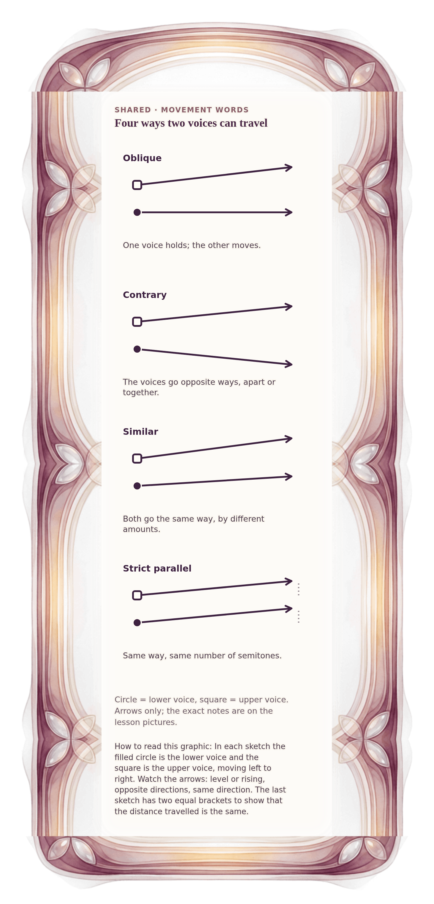

[⟵ A-05](A-05.phone.md) · [**Index**](../README.md) · [A-07 ⟶](A-07.phone.md)

# A-06 — Four motion glyphs

**View:** [desktop](A-06.desktop.md) · **[ phone ]** · [print](A-06.print.md)  
**Section:** Shared references · **Step(s):** 2B:7, 2B:11 · 5 of 50

### Zoom the real file
- 🔍 **[Open the full-size phone PNG directly (browser pinch/zoom, 671 KB)](https://github.com/epaulson2/amf-app/raw/feat/ajourne-m08-week2-transparent-infographics-20261107/docs/m08/assets/A-06/A-06.phone.png)**
- [GitHub image viewer page](../assets/A-06/A-06.phone.png) · [Download / view editable SVG](../assets/A-06/A-06.phone.svg) ([raw SVG](https://github.com/epaulson2/amf-app/raw/feat/ajourne-m08-week2-transparent-infographics-20261107/docs/m08/assets/A-06/A-06.phone.svg))

*The picture above is the actual phone PNG file (transparent; GitHub shows it on its own page colour). Click it to open the raw full-size file.*

**What it teaches:** The four movement words as pure arrows, with no pitch names: one voice holds, voices go opposite ways, voices go the same way by different amounts, and the strict parallel case of equal amounts.

**How to read it:** In each sketch the filled circle is the lower voice and the square is the upper voice, moving left to right. Watch the arrows: level or rising, opposite directions, same direction. The last sketch has two equal brackets to show that the distance travelled is the same.

All files: desktop [PNG](../assets/A-06/A-06.desktop.png) / [SVG](../assets/A-06/A-06.desktop.svg) · phone [PNG](../assets/A-06/A-06.phone.png) / [SVG](../assets/A-06/A-06.phone.svg) · print [PNG](../assets/A-06/A-06.print.png) / [SVG](../assets/A-06/A-06.print.svg) · [proof on cream and slate](../proof/A-06.proof.jpg)

[⟵ A-05](A-05.phone.md) · [**Index**](../README.md) · [A-07 ⟶](A-07.phone.md)
