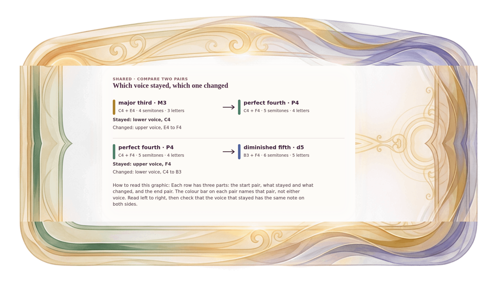

[⟵ A-06](A-06.desktop.md) · [**Index**](../README.md) · [A-09 ⟶](A-09.desktop.md)

# A-07 — What stayed, what changed

**View:** **[ desktop ]** · [phone](A-07.phone.md) · [print](A-07.print.md)  
**Section:** Shared references · **Step(s):** 2B:10, 2B:11, 2C:5 · 6 of 50

### Zoom the real file
- 🔍 **[Open the full-size desktop PNG directly (browser pinch/zoom, 523 KB)](https://github.com/epaulson2/amf-app/raw/feat/ajourne-m08-week2-transparent-infographics-20261107/docs/m08/assets/A-07/A-07.desktop.png)**
- [GitHub image viewer page](../assets/A-07/A-07.desktop.png) · [Download / view editable SVG](../assets/A-07/A-07.desktop.svg) ([raw SVG](https://github.com/epaulson2/amf-app/raw/feat/ajourne-m08-week2-transparent-infographics-20261107/docs/m08/assets/A-07/A-07.desktop.svg))

*The picture above is the actual desktop PNG file (transparent; GitHub shows it on its own page colour). Click it to open the raw full-size file.*

**What it teaches:** A change in a pair can be described by saying which voice stayed and which moved. The interval changes only because one voice did.

**How to read it:** Each row has three parts: the start pair, what stayed and what changed, and the end pair. The colour bar on each pair names that pair, not either voice. Read left to right, then check that the voice that stayed has the same note on both sides.

All files: desktop [PNG](../assets/A-07/A-07.desktop.png) / [SVG](../assets/A-07/A-07.desktop.svg) · phone [PNG](../assets/A-07/A-07.phone.png) / [SVG](../assets/A-07/A-07.phone.svg) · print [PNG](../assets/A-07/A-07.print.png) / [SVG](../assets/A-07/A-07.print.svg) · [proof on cream and slate](../proof/A-07.proof.jpg)

[⟵ A-06](A-06.desktop.md) · [**Index**](../README.md) · [A-09 ⟶](A-09.desktop.md)
