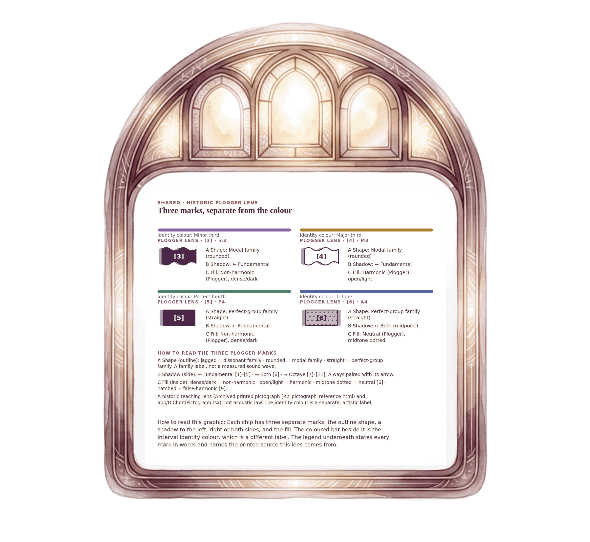

[⟵ A-07](A-07.print.md) · [**Index**](../README.md) · [A-09a ⟶](A-09a.print.md)

# A-09 — Plogger lens for the four named pairs

**View:** [desktop](A-09.desktop.md) · [phone](A-09.phone.md) · **[ print ]**  
**Section:** Shared references · **Step(s):** 2B:5, 2B:6, 2C:5 · 7 of 50

### Zoom the real file
- 🔍 **[Open the full-size print PNG directly (browser pinch/zoom, 648 KB)](https://github.com/epaulson2/amf-app/raw/feat/ajourne-m08-week2-transparent-infographics-20261107/docs/m08/assets/A-09/A-09.print.png)**
- [GitHub image viewer page](../assets/A-09/A-09.print.png) · [Download / view editable SVG](../assets/A-09/A-09.print.svg) ([raw SVG](https://github.com/epaulson2/amf-app/raw/feat/ajourne-m08-week2-transparent-infographics-20261107/docs/m08/assets/A-09/A-09.print.svg))

*The picture above is the actual print PNG file (transparent; GitHub shows it on its own page colour). Click it to open the raw full-size file.*

**What it teaches:** The historic Plogger lens for minor third [3], major third [4], perfect fourth [5], tritone [6]: contour is the family, shadow direction is fundamental or octave, fill is harmonicity. It is a separate label from the identity colour.

**How to read it:** Each chip has three separate marks: the outline shape, a shadow to the left, right or both sides, and the fill. The coloured bar beside it is the interval identity colour, which is a different label. The legend underneath states every mark in words and names the printed source this lens comes from.

All files: desktop [PNG](../assets/A-09/A-09.desktop.png) / [SVG](../assets/A-09/A-09.desktop.svg) · phone [PNG](../assets/A-09/A-09.phone.png) / [SVG](../assets/A-09/A-09.phone.svg) · print [PNG](../assets/A-09/A-09.print.png) / [SVG](../assets/A-09/A-09.print.svg) · [proof on cream and slate](../proof/A-09.proof.jpg)

[⟵ A-07](A-07.print.md) · [**Index**](../README.md) · [A-09a ⟶](A-09a.print.md)
