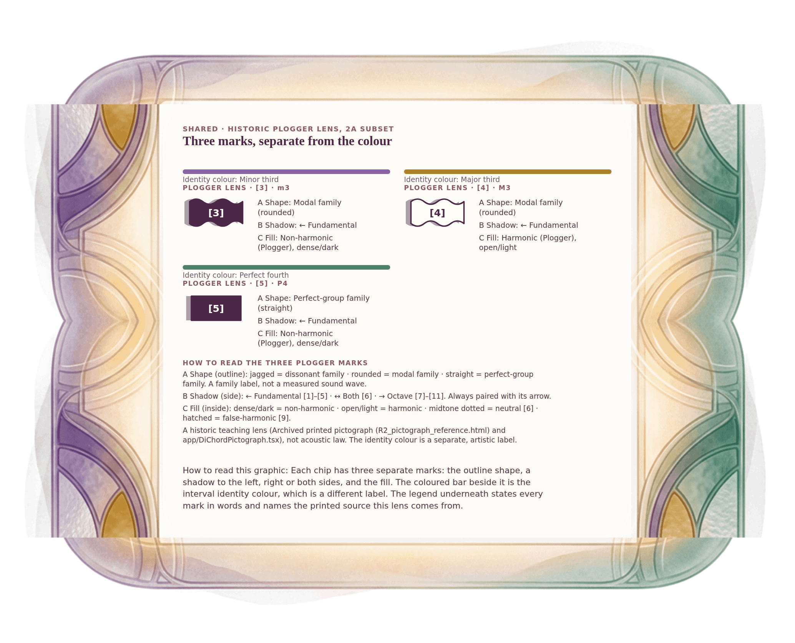

[⟵ A-09](A-09.desktop.md) · [**Index**](../README.md) · [A-11 ⟶](A-11.desktop.md)

# A-09a — Plogger lens for the 2A pairs

**View:** **[ desktop ]** · [phone](A-09a.phone.md) · [print](A-09a.print.md)  
**Section:** Shared references · **Step(s):** 2A:5, 2A:6 · 8 of 50

### Zoom the real file
- 🔍 **[Open the full-size desktop PNG directly (browser pinch/zoom, 475 KB)](https://github.com/epaulson2/amf-app/raw/feat/ajourne-m08-week2-transparent-infographics-20261107/docs/m08/assets/A-09a/A-09a.desktop.png)**
- [GitHub image viewer page](../assets/A-09a/A-09a.desktop.png) · [Download / view editable SVG](../assets/A-09a/A-09a.desktop.svg) ([raw SVG](https://github.com/epaulson2/amf-app/raw/feat/ajourne-m08-week2-transparent-infographics-20261107/docs/m08/assets/A-09a/A-09a.desktop.svg))

*The picture above is the actual desktop PNG file (transparent; GitHub shows it on its own page colour). Click it to open the raw full-size file.*

**What it teaches:** The historic Plogger lens for minor third [3], major third [4], perfect fourth [5]: contour is the family, shadow direction is fundamental or octave, fill is harmonicity. It is a separate label from the identity colour.

**How to read it:** Each chip has three separate marks: the outline shape, a shadow to the left, right or both sides, and the fill. The coloured bar beside it is the interval identity colour, which is a different label. The legend underneath states every mark in words and names the printed source this lens comes from.

All files: desktop [PNG](../assets/A-09a/A-09a.desktop.png) / [SVG](../assets/A-09a/A-09a.desktop.svg) · phone [PNG](../assets/A-09a/A-09a.phone.png) / [SVG](../assets/A-09a/A-09a.phone.svg) · print [PNG](../assets/A-09a/A-09a.print.png) / [SVG](../assets/A-09a/A-09a.print.svg) · [proof on cream and slate](../proof/A-09a.proof.jpg)

[⟵ A-09](A-09.desktop.md) · [**Index**](../README.md) · [A-11 ⟶](A-11.desktop.md)
