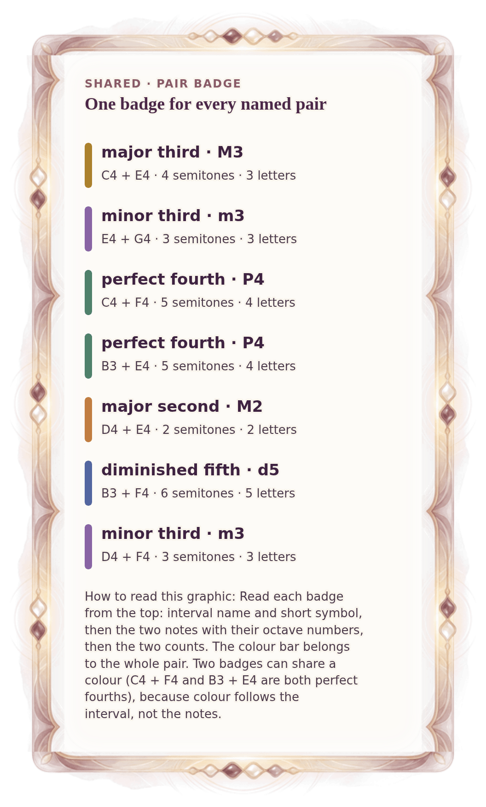

[⟵ A-09a](A-09a.phone.md) · [**Index**](../README.md) · [A-12 ⟶](A-12.phone.md)

# A-11 — Pair badges used in Week 2

**View:** [desktop](A-11.desktop.md) · **[ phone ]** · [print](A-11.print.md)  
**Section:** Shared references · **Step(s):** 2B:5, 2B:6 · 9 of 50

### Zoom the real file
- 🔍 **[Open the full-size phone PNG directly (browser pinch/zoom, 263 KB)](https://github.com/epaulson2/amf-app/raw/feat/ajourne-m08-week2-transparent-infographics-20261107/docs/m08/assets/A-11/A-11.phone.png)**
- [GitHub image viewer page](../assets/A-11/A-11.phone.png) · [Download / view editable SVG](../assets/A-11/A-11.phone.svg) ([raw SVG](https://github.com/epaulson2/amf-app/raw/feat/ajourne-m08-week2-transparent-infographics-20261107/docs/m08/assets/A-11/A-11.phone.svg))

*The picture above is the actual phone PNG file (transparent; GitHub shows it on its own page colour). Click it to open the raw full-size file.*

**What it teaches:** The one badge every named pair in Week 2 uses: colour bar, interval name, the two actual notes, semitones and letters. The same badge appears in every lesson.

**How to read it:** Read each badge from the top: interval name and short symbol, then the two notes with their octave numbers, then the two counts. The colour bar belongs to the whole pair. Two badges can share a colour (C4 + F4 and B3 + E4 are both perfect fourths), because colour follows the interval, not the notes.

All files: desktop [PNG](../assets/A-11/A-11.desktop.png) / [SVG](../assets/A-11/A-11.desktop.svg) · phone [PNG](../assets/A-11/A-11.phone.png) / [SVG](../assets/A-11/A-11.phone.svg) · print [PNG](../assets/A-11/A-11.print.png) / [SVG](../assets/A-11/A-11.print.svg) · [proof on cream and slate](../proof/A-11.proof.jpg)

[⟵ A-09a](A-09a.phone.md) · [**Index**](../README.md) · [A-12 ⟶](A-12.phone.md)
